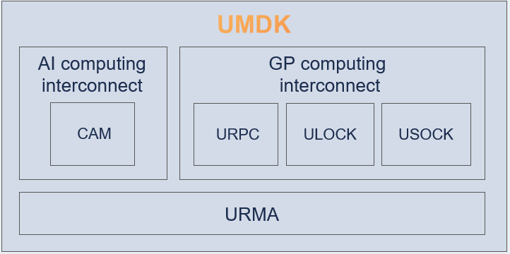

# UMDK
#### 1. UMDK Introduction
Lingqu UnifiedBus Memory Development Kit (UMDK) is a distributed communication software library centered around memory semantics. It provides high-performance communication interfaces for data center networks, within super nodes, and between cards inside servers, enabling and unleashing the hardware capabilities of the Lingqu bus.



#### 2. Component Introduction
1. URMA: Unifies memory semantics, provides remote memory operation methods such as unilateral, bilateral, and atomic operations, serving as the foundation for communication between applications.
It offers two types of interfaces: one is the northbound application programming interface, which provides communication APIs for applications, and the other is the southbound driver programming interface, which offers APIs for driver developers to access the UMDK.

2. CAM: SuperPOD communication acceleration library, providing high-performance training and promotion communication acceleration based on Lingqu superPOD affinity. It can connect to mainstream communities such as vllm, SGlang, and VeRL in the northbound direction and connect to Ascend superPOD hardware and networking in the southbound direction.

3. URPC: Unified remote procedure call, supporting Lingqu-native high-performance RPC communication between hosts and devices, as well as RPC acceleration.

4. ULOCK: Unified State synchronization, featuring native Lingqu high-performance state synchronization with distributed lock support, accelerates global resource allocation for distributed applications such as databases.

5. USOCK: Compatible with standard socket API, enabling TCP applications to enhance network communication performance with zero modifications.

#### 3. Build and install
1. Build Environment Requirements
- Kernel version：kernel 6.6
- You also need to install the following dependency packages：

```bash
  yum install -y rpm-build
  yum install -y make
  yum install -y cmake
  yum install -y gcc
  yum install -y gcc-c++
  yum install -y glibc-devel
  yum install -y openssl-devel
  yum install -y glib2-devel
  yum install -y libnl3-devel
  yum install -y libummu-devel
  yum install -y kernel-devel  # ubcore is necessary from openEuler kernel
```

2. Build Instructions
- You can build and install the UMDK RPM package using the following methods:
- Run the following commands from the source tree root:

```bash
  mkdir -p /root/rpmbuild/SOURCES/
  tar -czf /root/rpmbuild/SOURCES/umdk-26.06.0.tar.gz --exclude=.git `ls -A`
  rpmbuild -ba umdk.spec
```

- RPM build options
```bash
  $ --with asan                              option, i.e. disable asan by default
  $ --with test                              option, i.e. disable test by default
  $ --with urma                              option, i.e. disable urma by default
  $ --with urpc                              option, i.e. disable urpc by default
  $ --with dlock                             option, i.e. disable dlock by default
  $ --with ums                               option, i.e. disable ums by default
  $ --define 'kernel_version 6.6.92'         option, specify kernel version
  $ --define 'rpm_release  0'                option, specify release version
```

3. Install Instructions
- Runtime Dependencies: Ensure that prerequisite drivers are loaded. If not, please load them manually
```bash
cd /lib/modules/$(uname -r)/kernel/drivers
insmod ub/ubfi/ubfi.ko.xz  cluster=1     # When using a VF network device, it is necessary to remove the cluster=1 parameter.
insmod iommu/ummu-core/ummu-core.ko.xz
cd /lib/modules/$(uname -r)/kernel/drivers/ub/hisi-ub/kernelspace
insmod ummu/drivers/ummu.ko.xz ipver=609
insmod ubus/ubus.ko.xz ipver=609  cc_en=0  um_entry_size=1
insmod ubus/vendor/hisi/hisi_ubus.ko.xz msg_wait=2000 fe_msg=1 um_entry_size1=0 cfg_entry_offset=512
insmod ubase/ubase.ko.xz
insmod unic/unic.ko.xz tx_timeout_reset_bypass=1
insmod cdma/cdma.ko.xz

```
- Install the RPM package
```bash
rpm -ivh /root/rpmbuild/RPMS/*/umdk*.rpm
cp -f /usr/bin/urma_perftest /usr/local/bin/
modprobe ubcore
modprobe uburma
cd /lib/modules/$(uname -r)/kernel/drivers
insmod ub/hisi-ub/kernelspace/udma/udma.ko.xz dfx_switch=1 ipver=609 fast_destroy_tp=0 jfc_arm_mode=2
modprobe ubagg # If multi-path support is required
modprobe ums # if ums is required
```
-  Add permissions
```bash
# If you do not have the required permissions, you need to add them manually.
chmod 755 /usr/lib64/liburma*
```

4. Build, package, query, install, verify, and remove URMA with the Bazel script (workspace root: `src/urma`)

From the UMDK repository root, run the script from `src/urma`. The script checks build dependencies before compiling and runtime dependencies before installing. Already satisfied dependencies are left untouched; missing dependencies are installed with `yum install -y`, so make sure yum repositories are configured and the command is run with sufficient privileges when dependencies are absent.

```bash
cd src/urma
# Typical release package for AArch64, including UDMA and libummu.
./urma_bazel.sh compile --config=release --config=arm64 --define=build_udma=true
```

The `compile` command builds the fixed URMA package payload with Bazel, stages RPM-equivalent install content, writes `metadata/urma_version`, `metadata/urma_versions.json`, and `metadata/urma_versions.tsv`, and creates `urma-bazel-<timestamp>.tar.gz` in `src/urma`. It automatically checks the version metadata embedded in packaged shared objects, executables, and the version header before and after packaging. It also removes intermediate files after packaging, including `urma_version`, `bazel-urma-package`, and Bazel convenience symlinks.

The Bazel flow requires Bazel 7.4.1. Set in-tree URMA component versions in `src/urma/bazel/urma_versions.bzl`: update `URMA_VERSION` for the component and package version, and update `URMA_SOVERSION` for the shared-object ABI major version. The external `libummu` version remains independently configured in `src/urma/bazel/urma_deps.bzl`.

Do not install or link against a manually built system `libummu` for this flow. The script reads `LIBUMMU_REMOTE`, `LIBUMMU_COMMIT`, `LIBUMMU_VERSION`, and `LIBUMMU_ABI_VERSION` from `src/urma/WORKSPACE` or `src/urma/bazel/urma_deps.bzl`, fetches that commit into `src/urma/third_party/libummu`, builds it with Bazel, and packages libummu together with URMA.

If `libummu` already exists on the environment, the behavior is:

- `compile` ignores the system-installed `libummu`; it always uses `src/urma/third_party/libummu` at the configured commit.
- `install` installs the bundled `libummu` files from the tarball. Existing files or symlinks at the same paths, such as `/usr/lib64/libummu.so*`, are replaced by the packaged payload.
- `remove` does not uninstall third-party yum dependencies and does not remove the bundled `libummu` payload.

Extra arguments after `compile` are passed to `bazel build`, so architecture and diagnostic configurations can still be selected by the caller:

```bash
cd src/urma

# Release package for x86_64.
./urma_bazel.sh compile --config=release --config=x86_64 --define=build_udma=true

# Debug + AddressSanitizer / LeakSanitizer.
./urma_bazel.sh compile --config=debug --config=asan --define=build_udma=true

# ThreadSanitizer with cycle profiling enabled.
./urma_bazel.sh compile --config=tsan --define=perf_cycle=true --define=build_udma=true
```

Bazel-built artifacts expose their versions directly. Executables accept `--version` or `-V`; query a shared object or the generated version header with the packaged `/usr/bin/urma_version` tool. These interfaces are specific to the Bazel flow and do not depend on RPM queries.

```bash
# Query installed executables.
urma_admin --version
urma_perftest --version

# Query installed shared objects and the version header.
urma_version /usr/lib64/liburma.so.0
urma_version /usr/lib64/urma/liburma-udma.so
urma_version /usr/include/ub/umdk/urma/urma_version.h

# Print the version manifest declared by an archive.
./urma_bazel.sh version urma-bazel-<timestamp>.tar.gz
```

After installation, use `verify` to compare the environment with the archive. It first validates version metadata inside the archive, then uses `metadata/install_manifest` to compare every packaged URMA executable, every `.so*` file and symlink, and every `.h` file under `usr/include`. Regular files are compared by size and every byte; shared-object symlinks are compared by link target. A missing or different file fails the command. Newly packaged headers are selected automatically from the install manifest.

```bash
# Compare the archive with the current system root, '/'.
./urma_bazel.sh verify urma-bazel-<timestamp>.tar.gz

# Compare with a container rootfs, mounted filesystem, or cross-compilation sysroot.
./urma_bazel.sh verify urma-bazel-<timestamp>.tar.gz /tmp/urma-sysroot
```

`verify` only reads and compares files; it does not install URMA. The build path performs only the archive-internal version check, so the build host does not need the same URMA version installed. Byte comparison is implemented by the packaged `urma_version` binary and adds no dependency on `md5sum`, OpenSSL, or another comparison tool.

Copy the generated tarball to the target environment, extract it, and install with the packaged script. Run `install` and `remove` as root or with `sudo`; the script installs files according to `metadata/install_manifest`, refreshes `ldconfig`, restores SELinux contexts when `restorecon` is available, and restarts rsyslog when available. The `remove` command removes the URMA/UDMA/TPSA payload from the manifest, but leaves third-party libraries installed by yum and the bundled libummu payload in place.

```bash
# On the target environment.
mkdir -p /tmp/urma-bazel
tar -xzf urma-bazel-<timestamp>.tar.gz -C /tmp/urma-bazel
/tmp/urma-bazel/urma_bazel.sh install

# Remove the installed URMA/UDMA/TPSA payload later.
/tmp/urma-bazel/urma_bazel.sh remove
```

The script can also install or remove directly from an archive:

```bash
cd src/urma
./urma_bazel.sh install urma-bazel-<timestamp>.tar.gz
./urma_bazel.sh remove urma-bazel-<timestamp>.tar.gz
```

#### 4. Contributing

We warmly welcome contributions from developers. If you have discovered a bug or would like to discuss ideas, please feel free to [send an email to the development mailing list](https://openeuler.org/zh/community/mailing-list) or [submit an issue](https://atomgit.com/openeuler/umdk/issues) 。

#### 5. LICENSES

The license for code, please refer to [LICENSES](./LICENSES/README)

The license for documents in doc directory, please refer to [LICENSE](./doc/LICENSE)
