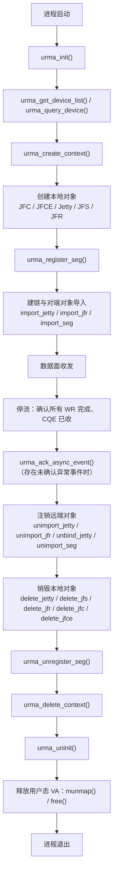
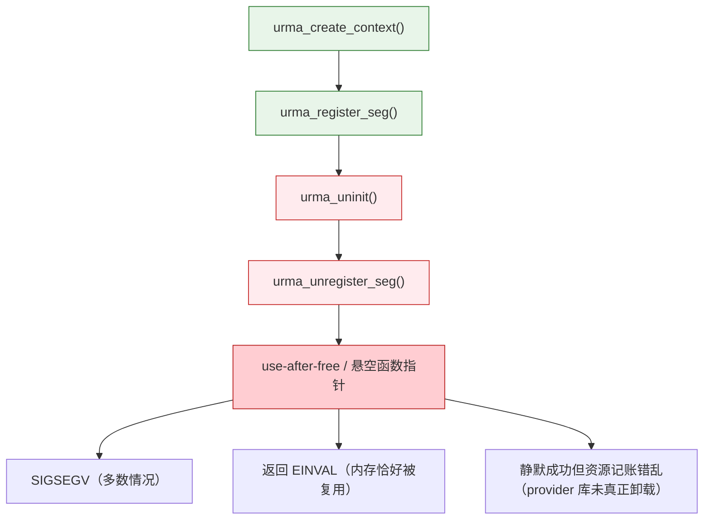
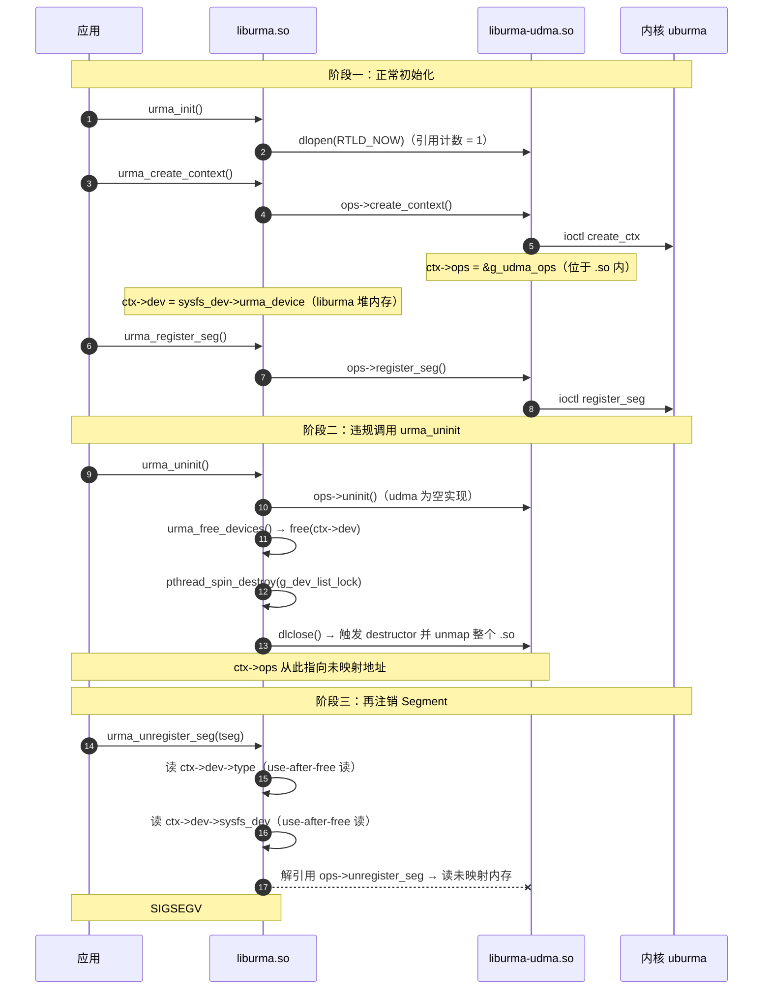
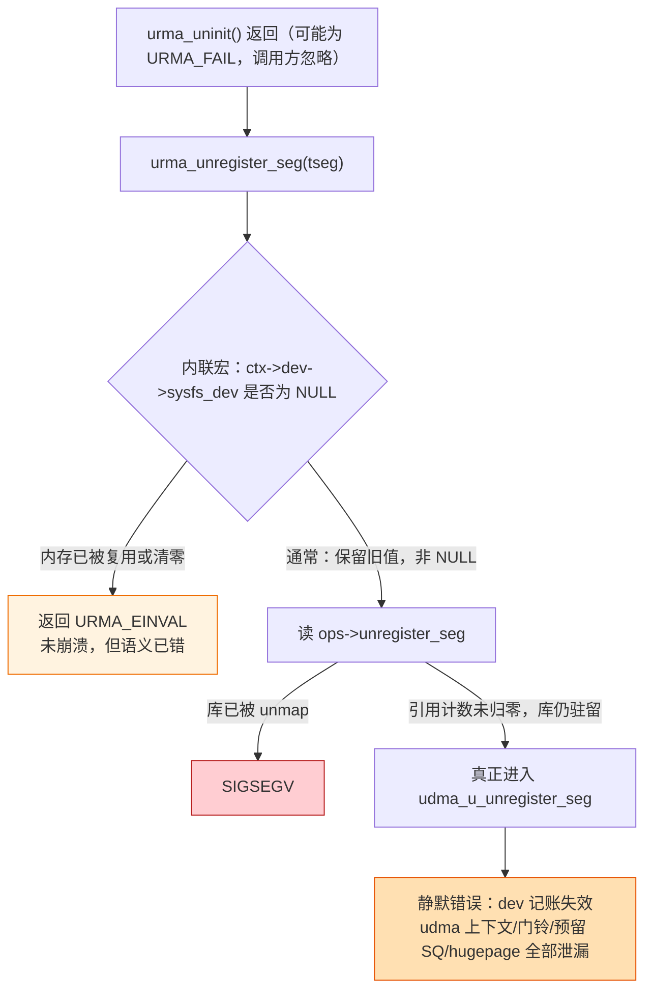
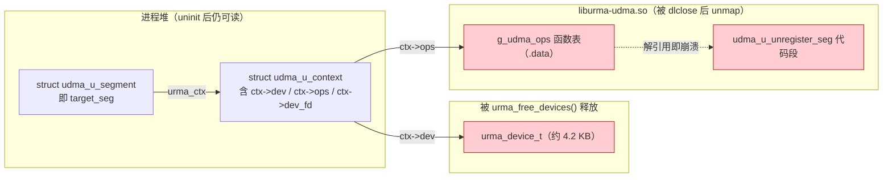
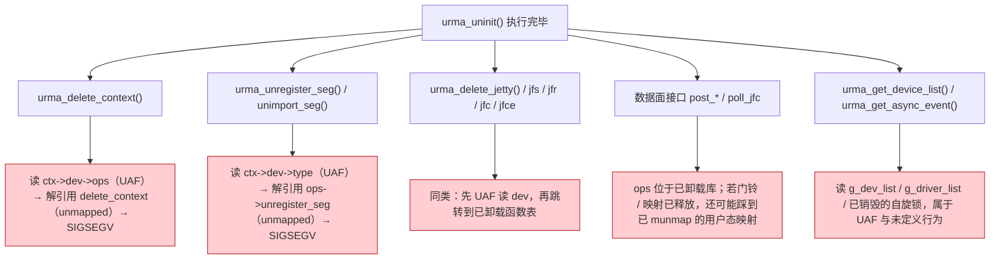
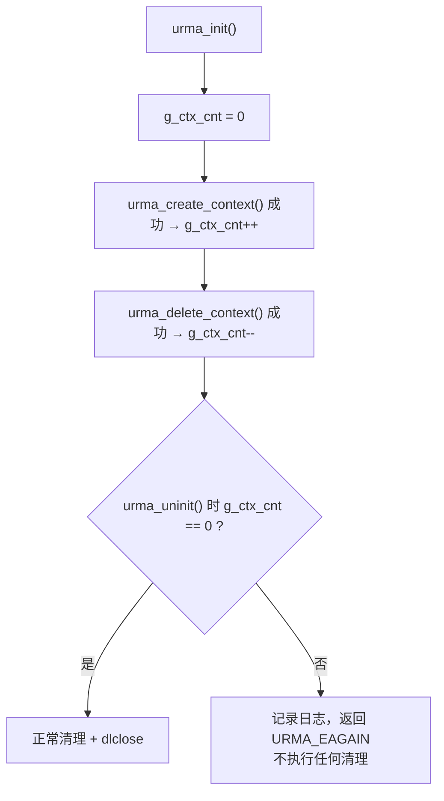

# URMA 资源释放顺序与野指针风险分析

## 0. 文档说明

| 项目 | 内容 |
|---|---|
| 分析对象 | UMDK / URMA 用户态（liburma、liburma-udma、liburma-bond） |
| 代码基线 | `src/urma/lib/urma/core/`、`src/urma/hw/udma/`、`src/urma/lib/urma/bond/` |
| 相关文档 | `doc/ch/urma/URMA User Guide.ch.md`、`doc/en/urma/URMA User Guide.md`、`doc/en/urma/URMA API Guide.md` |
| 核心问题 | `urma_delete_context` / `urma_uninit` / `urma_unregister_seg` 的调用先后要求，以及违反顺序后是否会访问野指针 |
| 结论 | 违反顺序（尤其 `urma_uninit` 之后再用旧句柄）是明确的 use-after-free / 悬空函数指针调用，绝大多数情况下进程 SIGSEGV；侥幸不崩时是静默资源泄漏与记账错乱 |

---

## 1. 结论摘要

| 编号 | 结论 | 依据 |
|---|---|---|
| C1 | URMA 的总原则是"按创建相反顺序释放"：先数据面/事务层对象，再 context，最后 uninit | User Guide 第 4 章流程终止阶段 |
| C2 | `urma_delete_context` 必须在所有子资源释放之后调用；否则实现会以引用计数拒绝 | `urma_main.c` 中 `atomic_cnt > 1` 时返回 `URMA_EAGAIN` |
| C3 | `urma_uninit` 必须在所有 context 删除之后调用；它不校验存活 context，且会 `dlclose` provider 动态库 | `urma_uninit()` 遍历 `g_so_list` 执行 `dlclose` |
| C4 | `urma_uninit` 之后再调用 `urma_unregister_seg` 等任何 API，都会解引用已 free 的 `urma_device_t` 和已 unmap 的 provider `.so` 函数表 | `urma_unregister_seg` 无初始化状态校验，直接使用 `ctx->dev` / `ctx->ops` |
| C5 | `urma_uninit` 的返回值不影响清理动作：即使某个 provider 的 `uninit` 失败，`dlclose` 仍无条件执行 | `urma_uninit` 函数体无 early return，失败只记录状态码 |
| C6 | 唯一能让"uninit 后误用不崩溃"的情形是 provider `.so` 因引用计数未归零而驻留（应用直接链接了该 `.so` 等），但那是静默错误，比崩溃更危险 | `dlclose` 引用计数语义 + `urma_close_provider` 不区分"已卸载/未卸载" |

---

## 2. API 生命周期与正确释放顺序

### 2.1 正确顺序



### 2.2 违规顺序（本文重点分析）



---

## 3. 关键 API 的约束对照

| API | 文档明确要求 | 代码实际约束 | 违反后果 |
|---|---|---|---|
| `urma_register_seg` | 本地内存须先注册；声明 remote write/atomic 时必须同时声明 local write | 创建时对 `ctx->ref` 加一 | 注册失败或权限不足 |
| `urma_unregister_seg` | 不再使用 Segment 时须调用以注销 | 未提供显式文档约束；实现无初始化状态校验，直接使用 `ctx->dev` / `ctx->ops` | 带流注销被拒；uninit 后调用则野指针 |
| `urma_unimport_seg` | 释放远端内存时调用 | 同上传入 `ctx`，并对 `ctx->ref` 减一 | 同 `unregister_seg` |
| `urma_delete_jfc` | 依赖它的 jetty/jfs/jfr 生命周期必须已结束，否则 use-after-free | 对 `ctx->ref`、`jfce->ref` 减一 | use-after-free |
| `urma_delete_jfr` | 共享该 JFR 的 jetty 生命周期必须已结束 | 对 `ctx->ref` 减一 | use-after-free |
| `urma_delete_jfce` | 无显式说明 | `jfce->ref > 1` 时返回 `URMA_FAIL` | 删除失败 |
| `urma_delete_jetty` | 无显式说明 | RC 模式下仍绑定 `remote_jetty` 时返回 `URMA_ENOPERM`，须先 unbind | 删除失败 |
| `urma_delete_context` | 仅说明"释放设备上下文"，未写明前置条件 | `ctx->ref.atomic_cnt > 1` 时返回 `URMA_EAGAIN` | 子资源未释放则删不掉 |
| `urma_uninit` | 仅说明"反初始化、释放 uasid、不支持多线程调用" | 不校验存活 context；`dlclose` 全部 provider；`g_init_flag` 减一 | 后续任何句柄调用都是 UB |
| 聚合设备 | 带流时禁止删除 Segment，须先停流或删除关联 Jetty | 同文档 | 删除失败或行为未定义 |
| UDMA 设备 | **中文版**额外要求：数据面通信进行中禁止删除 Jetty、注销 Segment、复位设备 | 英文版缺失该条款 | 若按英文版编码则可能违反 |

---

## 4. 违规场景分析：先 `urma_uninit` 再 `urma_unregister_seg`

### 4.1 执行时序



### 4.2 逐行悬空点定位

`urma_unregister_seg` 的实现与内联宏见 `urma_cp_api.c`；宏定义为：

```c
#define URMA_CHECK_OP_INVALID_RETURN_STATUS(urma_ctx, ops, op_name)                       \
    do {                                                                                  \
        if (((urma_ctx) == NULL) || ((urma_ctx)->dev == NULL) ||                          \
            ((urma_ctx)->dev->sysfs_dev == NULL) ||                                       \
            (((ops) = (urma_ctx)->ops) == NULL) || ((ops)->op_name == NULL)) {            \
            URMA_LOG_ERR("Invalid parameter.\n");                                         \
            return URMA_EINVAL;                                                           \
        }                                                                                 \
    } while (0)
```

| 序号 | 位置 | 访问内容 | 内存归属 | uninit 之后的状态 | 后果 |
|---|---|---|---|---|---|
| 1 | `urma_unregister_seg` 入口判断 | `target_seg->urma_ctx->dev == NULL` | `ctx` 在进程堆上 | 仍可读，值非 NULL | 不崩，检查被绕过 |
| 2 | 参数解析 | `target_seg->urma_ctx->dev->type` | `ctx->dev` → `urma_device_t` | 已被 `urma_free_devices` free | use-after-free 读；读到的脏值后续决定 token_id 释放分支 |
| 3 | 内联宏 | `ctx->dev->sysfs_dev` | 同上 | 已被 free | use-after-free 读；通常保留旧值（非 NULL），检查被绕过 |
| 4 | 内联宏 | `(ops) = ctx->ops` | `ctx->ops` → `&g_udma_ops` | 指针值本身合法，但目标在已 unmap 的 `.so` 中 | 赋值成功，非 NULL，检查被绕过 |
| 5 | 内联宏 | `(ops)->unregister_seg` | provider `.so` 的 `.data` 段 | 整个库映像已 unmap | **SIGSEGV（最典型崩溃点）** |
| 6 | 调用点 | `ops->unregister_seg(target_seg)` | provider `.so` 的代码段 | 已 unmap | 若第 5 步未崩则此处崩溃 |
| 7 | 错误日志分支 | `urma_ctx->dev->name`、`urma_ctx->eid_index` | 同第 2 步 | 已 free | use-after-free 读，`%s` 打印可能越界 |

> 关于第 3 步为什么通常"骗过"检查：`urma_device_t` 为 `name[64] + path[4096] + type + ops + sysfs_dev`，约 4.2 KB。该尺寸超过 glibc tcache 上限，`free` 只在块头附近写元数据，`sysfs_dev` 字段位于尾部并保留原值，因此非 NULL，流程继续执行到第 5 步才真正崩溃。

### 4.3 三种可能结果



### 4.4 为什么 provider 库一定被卸载



卸载链条：

1. provider 是独立动态库，安装到 `${CMAKE_INSTALL_LIBDIR}/urma`，liburma 并未 DT_NEEDED 它。
2. `urma_init` 时扫描 liburma 同级 `urma/` 目录并 `dlopen(..., RTLD_NOW)`，引用计数为 1。
3. `urma_uninit` 执行 `dlclose`，引用计数归零，触发 provider 的 destructor 并 unmap 整个库映像。
4. 链接选项只有 `-Wl,-z,now -s`，没有 `-z nodelete`。

### 4.5 返回值不影响卸载

`urma_uninit` 函数体是线性的，没有中途 `return`：

```c
urma_status_t urma_uninit(void)
{
    if (atomic_load(&g_init_flag) == 0) {
        URMA_LOG_WARN("urma has not been initialized.\n");
        return ret;                                   /* 唯一提前返回，且返回 0 */
    }

    UB_LIST_FOR_EACH (driver, node, &g_driver_list) {
        if (driver->ops->uninit == NULL || driver->ops->uninit() != URMA_SUCCESS) {
            URMA_LOG_WARN("Provider uninit failed %s\n", driver->ops->name);
            ret = URMA_FAIL;                          /* 只记状态码，不 break、不 return */
        }
    }
    urma_free_devices(&g_dev_list);                   /* 无条件执行 */
    (void)pthread_spin_destroy(&g_dev_list_lock);     /* 无条件执行 */
    UB_LIST_FOR_EACH_SAFE (so, next, node, &g_so_list) {
        urma_close_provider(so->dl, so->path);        /* 无条件 dlclose */
        ub_list_remove(&so->node);
        free(so);
    }
    atomic_fetch_sub(&g_init_flag, 1);                /* 无条件执行 */
    return ret;
}
```

因此："失败"只影响返回给调用方的状态码，不影响资源清理动作，调用方忽略返回值不改变任何行为。另外，现网两个 in-tree provider 的 `uninit` 都无条件返回 `URMA_SUCCESS`，标准安装下 `urma_uninit` 几乎不可能返回失败。

### 4.6 进程退出路径

| 退出方式 | provider destructor 是否执行 | 说明 |
|---|---|---|
| `return` from `main` / `exit()` | 是 | glibc 的 `_dl_fini` 逆序遍历所有已加载对象（含 `dlopen` 的），执行 `.fini_array` |
| `_exit()` / `abort()` / 被信号杀死 | 否 | 不经过 `_dl_fini`，仅靠进程退出时内核自动关闭 fd 触发 uburma release |

注意：正常退出路径执行的是 destructor，不等于 `dlclose`；但"provider 的卸载清理代码会不会跑"的答案是会。若 `urma_uninit` 已经 `dlclose` 成功，destructor 在那一刻就已执行过。

---

## 5. 同类风险：`uninit` 之后调用其它 API



共同根因有两个：

1. `urma_uninit` 只清理 liburma 自身的全局表并卸载 provider，**不失效化任何已存在句柄**。
2. 所有 API 入口都只校验参数的形参合法性，**不校验运行时是否仍处于已初始化状态**（`g_init_flag` 仅在 `urma_init` / `urma_uninit` 内被读写）。

---

## 6. 文档整改建议

| 编号 | 位置 | 建议内容 | 优先级 |
|---|---|---|---|
| D1 | API Guide `urma_delete_context` | 增加"前置条件"小节：该 context 派生的 JFC/JFCE/JFS/JFR/Jetty/Segment 及导入对象必须已全部释放；否则返回 `URMA_EAGAIN` 而非静默失败 | 高 |
| D2 | API Guide `urma_uninit` | 增加"前置条件"：所有 context 必须已通过 `urma_delete_context` 释放；增加"后置条件"：调用成功后所有已创建句柄立即失效，继续使用属于未定义行为（通常 SIGSEGV） | 高 |
| D3 | API Guide `urma_uninit` | 显式说明实现事实：内部会 `dlclose` provider 动态库；并说明返回值语义——**返回失败不代表资源未被清理**，调用方不得据此推断环境仍可用 | 高 |
| D4 | User Guide 第 4 章 | 将"按创建相反顺序释放"从文字段落升级为显式时序图（可用 mermaid），把 `unregister_seg → delete_context → uninit` 三段画进同一张图 | 中 |
| D5 | User Guide 中英文一致性 | 中文版 5.2.4 的"UDMA 资源销毁限制（带流禁止删除 Jetty / 注销 Segment / 复位设备）"在英文版缺失，需补齐 | 高 |
| D6 | API Guide 全部 destroy/delete/unregister/unimport 接口 | 统一增加 "Lifecycle Constraints" 小节，集中列出"谁必须在谁之前释放" | 中 |
| D7 | API Guide 编程示例 | 增加完整的创建与释放对照示例（现有示例在释放部分只有一句"与初始化对称，不重复"），并把错误顺序作为反例列出 | 中 |
| D8 | 全局说明 | 明确"不支持重复 `urma_uninit`"的语义：当前重复调用只打印 WARN 并返回 0，容易被误判为成功 | 低 |
| D9 | 新增章节 | 建议在 User Guide 增加"进程退出与资源回收"一节，说明正常退出、`_exit`、被信号杀死三种路径下 provider destructor 是否执行 | 低 |

---

## 7. 代码防御方案

### 方案 A：`urma_uninit` 前置校验存活 context（推荐）

思路：维护全局存活 context 计数，`urma_uninit` 在计数非 0 时拒绝清理。



```c
static atomic_uint g_ctx_cnt;

/* urma_create_context() 成功路径 */
atomic_fetch_add(&g_ctx_cnt, 1);

/* urma_delete_context() 成功路径 */
atomic_fetch_sub(&g_ctx_cnt, 1);

urma_status_t urma_uninit(void)
{
    if (atomic_load(&g_init_flag) == 0) {
        return URMA_SUCCESS;
    }
    if (atomic_load(&g_ctx_cnt) != 0) {
        URMA_LOG_ERR("urma_uninit rejected: %u context(s) still alive.\n",
                     atomic_load(&g_ctx_cnt));
        return URMA_EAGAIN;
    }
    /* ... 原有清理流程 ... */
}
```

优点：语义清晰，与现有引用计数模型一致，改动集中在两个函数。缺点：需要保证计数读取与 `g_init_flag` 的并发一致性。

### 方案 B：`uninit` 时主动失效化所有句柄（推荐，与 A 配套）

思路：维护 `g_ctx_list`，`urma_uninit` 遍历并把每个 ctx 的 `dev` / `ops` / `dev_fd` 置为无效值，使后续 API 在参数校验阶段就安全返回 `URMA_EINVAL`。

```c
void urma_invalidate_all_contexts(void)
{
    urma_context_t *ctx;
    UB_LIST_FOR_EACH (ctx, node, &g_ctx_list) {
        ctx->dev = NULL;
        ctx->ops = NULL;
        ctx->dev_fd = -1;
    }
}
```

优点：即使调用方忽略返回值，也不会崩溃，只得到 `URMA_EINVAL`。这是成本最低、收益最直接的兜底。

**重要前提**：`urma_unregister_seg` 在进入内联宏之前，存在一次提前解引用 `target_seg->urma_ctx->dev->type`。若只把 `ctx->dev` 置 NULL，这里会变成空指针解引用。因此方案 B 必须同时调整该函数，把类型读取移到内联宏之后，或先独立做一次 `ctx->dev == NULL` 判断。

### 方案 C：provider 采用 `RTLD_NODELETE` 加载

```c
so->dl = dlopen(canonicalized_path, RTLD_NOW | RTLD_NODELETE);
```

优点：一处改动，`uninit` 后 code/data 段不会消失，误用不再因跳转到未映射地址而崩溃。缺点：地址空间无法回收；**不能消除 `ctx->dev` 的 use-after-free 读**；本质上是掩盖问题而非修复问题，只适合作为缓解手段。

### 方案 D：API 入口统一做"代际"校验

思路：引入全局代际计数 `g_generation`，`urma_init` 与 `urma_uninit` 各加一；创建 context 时记录当时的代际；每个 API 入口先比对 `ctx->generation == g_generation`。

```c
typedef struct urma_context {
    /* ... 原有字段 ... */
    uint64_t generation;   /* 创建时的 g_generation 快照 */
} urma_context_t;

#define URMA_CHECK_CTX_GENERATION(ctx)                                     \
    do {                                                                   \
        if ((ctx)->generation != atomic_load(&g_generation)) {             \
            URMA_LOG_ERR("context is stale after urma_uninit.\n");         \
            return URMA_EINVAL;                                            \
        }                                                                  \
    } while (0)
```

优点：覆盖所有 API，行为可预期；还能正确处理"`uninit` → 再次 `init` → 使用旧 ctx"这类场景。缺点：改动面大，需要触碰所有 API 入口，且 `urma_context_t` 增加字段涉及 ABI 变更，需评估兼容性。

### 方案 E：`uninit` 不再 `dlclose`，卸载交给进程退出

思路：移除 `g_so_list` 的 `dlclose` 循环，仅做逻辑清理（device list、自旋锁、provider `uninit`），由 glibc 在进程退出时通过 `_dl_fini` 执行 destructor。

优点：彻底消除"代码段消失"这一类野指针。缺点：动态库常驻地址空间；反复 `init` / `uninit` 的进程无法真正释放；**不能解决 `ctx->dev` 的 use-after-free**。

### 方案对比

| 方案 | 改动量 | 能防崩溃 | 能防 UAF 读 | 能防资源泄漏 | 是否改变现有语义 |
|---|---|---|---|---|---|
| A 存活计数校验 | 小 | 间接（拒绝进入错误状态） | 是 | 是 | 是，`uninit` 新增失败返回 |
| B 句柄失效化 | 中 | 是 | 是 | 是 | 否 |
| C `RTLD_NODELETE` | 极小 | 是 | 否 | 否 | 否 |
| D 代际校验 | 大 | 是 | 是 | 是 | 否（ABI 变更需评估） |
| E 不 `dlclose` | 小 | 是 | 否 | 否 | 是，不再真正卸载 |

**推荐组合**：方案 A 作为主防线（明确拒绝非法状态），方案 B 作为兜底（即使被绕过也不崩），并同步修复 `urma_unregister_seg` 的提前解引用。若团队希望最小改动先止血，可单独上方案 C。

---

## 8. 验证建议

| 编号 | 用例 | 预期 |
|---|---|---|
| V1 | 创建 context 后直接调用 `urma_uninit` | 方案 A 下返回 `URMA_EAGAIN` 且环境保持可用 |
| V2 | `urma_uninit` 后依次调用 `urma_unregister_seg`、`urma_delete_context`、`urma_delete_jetty`、`urma_post_jfs_wr` | 方案 A + B 下返回 `URMA_EINVAL`，无崩溃 |
| V3 | 上述用例在 ASAN 下运行 | 无 heap-use-after-free 报告 |
| V4 | `urma_uninit` 重复调用两次 | 第二次返回 0 且打印 WARN，行为与文档一致 |
| V5 | 应用直接链接 provider `.so` 后再执行违规顺序 | 验证"库驻留"分支，确认不会静默成功 |
| V6 | 把 V1/V2 序列加入 `test/urma/fuzz/urma_api_fuzz.c` | 长期覆盖句柄生命周期组合 |

---

## 9. 附录：关键代码索引

| 功能 | 位置 |
|---|---|
| `urma_init` / `urma_uninit` | `src/urma/lib/urma/core/urma_main.c` |
| provider 打开与 `dlclose` 封装 | `src/urma/lib/urma/core/urma_main.c` |
| `urma_create_context` / `urma_delete_context` | `src/urma/lib/urma/core/urma_main.c` |
| `urma_free_devices` | `src/urma/lib/urma/core/urma_device.c` |
| `urma_unregister_seg` / 内联参数校验宏 | `src/urma/lib/urma/core/urma_cp_api.c` |
| context 初始化（`ctx->ops` / `ctx->dev` 赋值） | `src/urma/lib/urma/core/urma_cmd.c` |
| `urma_cmd_unregister_seg`（ioctl 下发） | `src/urma/lib/urma/core/urma_cmd.c` |
| udma provider 函数表与 `uninit` | `src/urma/hw/udma/udma_u_ops.c` |
| udma `unregister_seg` 实现 | `src/urma/hw/udma/udma_u_segment.c` |
| udma provider destructor | `src/urma/hw/udma/udma_u_main.c` |
| provider 构建与安装路径 | `src/urma/hw/udma/CMakeLists.txt` |
| `urma_device_t` / `urma_context_t` 定义 | `src/urma/lib/urma/core/include/urma_types.h` |
