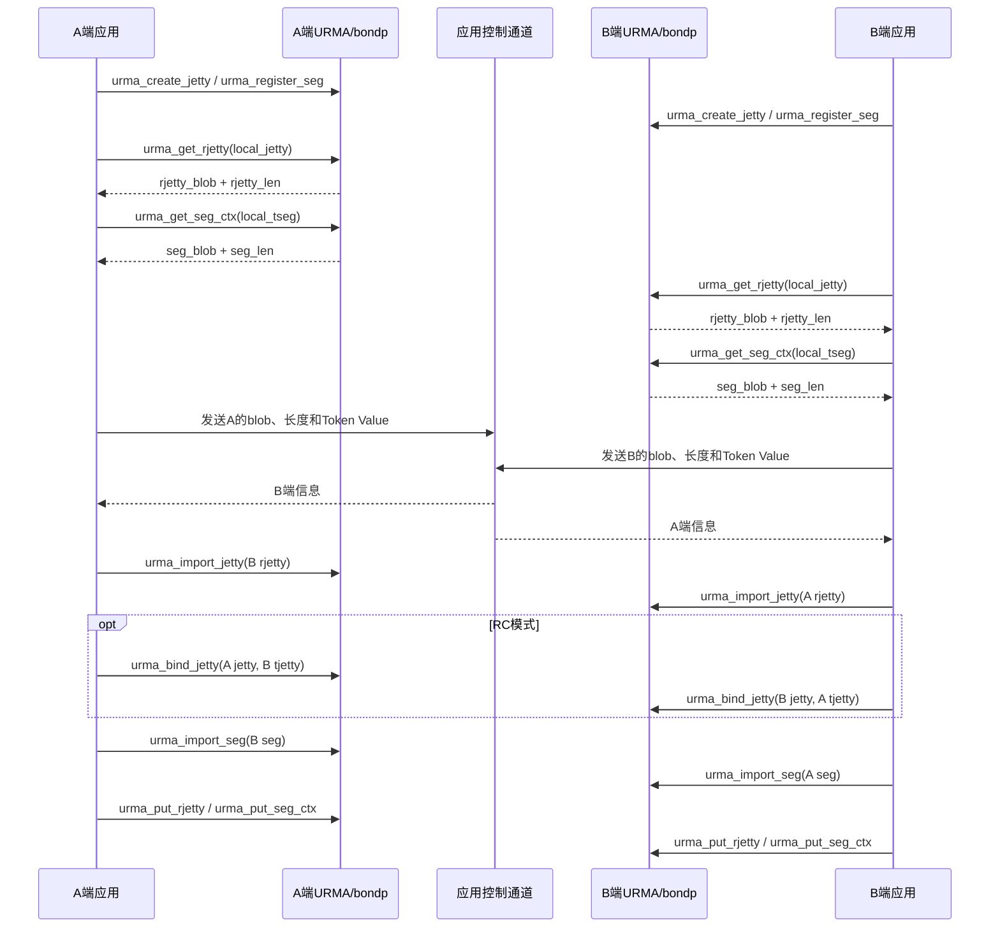

# URMA Bond应用代建链与单边语义可靠传输设计

## 1. 文档信息

| 项目 | 内容 |
|---|---|
| 代码基线 | `br_openEuler_24.03_LTS_SP3`，提交 `dd6abe98` |
| 分析对象 | URMA聚合设备用户态provider：`src/urma/lib/urma/bond` |
| 核心接口 | `urma_get_rjetty`、`urma_put_rjetty`、`urma_import_jetty`、`urma_bind_jetty`、`urma_get_seg_ctx`、`urma_put_seg_ctx`、`urma_import_seg`、`urma_unimport_seg` |
| 核心场景 | 应用代建链；聚合设备上的READ/WRITE/原子等单边语义可靠传输 |

本文基于当前代码实现走读，说明应用如何代替传统管控信息交换路径，在自己的控制通道中交换Jetty和Segment上下文，并由bond provider恢复聚合设备的物理连接与物理Segment矩阵。

本文中的“发送”“序列化”指应用对URMA返回的**不透明、变长上下文块**进行原样传输，不表示应用可以依赖或解析bond私有扩展布局。

---

## 2. 背景与问题

### 2.1 聚合设备的虚拟对象与物理对象

一个URMA聚合设备上下文（`bondp_context_t`）对应用暴露一个虚拟Context，同时维护最多`URMA_UBAGG_DEV_MAX_NUM`个物理Context：

```text
bondp_context_t
├── v_ctx                         应用可见的聚合Context
└── p_ctxs[local_idx]             各物理设备/端口对应的Context
```

相同的虚实映射存在于Jetty和Segment中：

```text
虚拟Jetty     -> p_jetty[local_idx]
远端虚拟Jetty -> p_tjetty[local_idx][target_idx]，当前实现采用紧凑路径数组表达
本地虚拟Seg   -> p_tseg[local_idx]
远端虚拟Seg   -> p_tseg[local_idx][target_idx]
```

其中：

- `local_idx`表示本端物理设备/端口索引；
- `target_idx`表示对端物理设备/端口索引；
- 数据面选择一条`(local_idx, target_idx)`路径后，必须同时找到该路径上的物理Jetty、源Segment和目的Segment。

对应代码：

- `bondp_context_t`、`bondp_tseg_t`、`bondp_import_tseg_t`：`src/urma/lib/urma/bond/bondp_types.h`；
- 虚拟tseg到物理tseg映射：`src/urma/lib/urma/bond/bondp_datapath_convert.c:225-236`；
- 虚拟WR到物理WR转换：`src/urma/lib/urma/bond/bondp_datapath_convert.c:327-402`。

### 2.2 仅交换`urma_seg_t`基础字段的问题

普通设备的远端Segment可由以下基础信息描述：

- `ubva`；
- `len`；
- `attr`；
- `token_id`。

但聚合设备的虚拟Segment背后有多个物理Segment，不同物理Segment的EID和`token_id`可能不同。应用如果仅交换：

```c
remote_seg = local_tseg->seg;
```

接收端只能获得虚拟Segment信息，无法直接恢复所有对端物理Segment，因此不能为每条可调度路径构造：

```text
remote_p_tseg[local_idx][target_idx]
```

传统路径中，`bondp_import_seg()`先执行虚拟Segment导入命令，由内核/驱动通过`udata_out`返回对端物理Segment信息和连接关系。应用代建链场景希望由应用自己的控制通道完成信息交换，不能只依赖接收端再次查询虚拟对象。

### 2.3 设计目标

1. 应用可通过自己的TCP、Socket、RPC或其他控制通道交换建链信息。
2. 同一组API同时适用于普通设备和聚合设备。
3. 应用只负责原样传输上下文块，不感知bond私有扩展结构。
4. 接收端可直接通过`urma_import_jetty()`和`urma_import_seg()`恢复物理对象。
5. 数据面能在选定路径上把虚拟WR一致地映射为物理Jetty和物理Segment，从而支持READ、WRITE和原子操作。
6. 连接矩阵不在应用消息中长期固化，接收端根据本地最新拓扑重建。

### 2.4 非目标

- 不定义跨大小端、跨指针宽度或跨不兼容URMA ABI的通用网络协议。
- 不允许应用修改或解释bond私有扩展内容。
- `urma_import_seg()`本身不提供传输可靠性；可靠性由Jetty传输模式、TP类型、硬件能力和数据面策略共同保证。
- 不替代应用对Token Value等安全凭据的独立交换和保护。

---

## 3. 总体设计

### 3.1 应用交换的不透明上下文

URMA新增/使用以下成对接口：

```c
urma_status_t urma_get_rjetty(
    urma_jetty_t *jetty,
    urma_rjetty_t **rjetty,
    uint32_t *length);

void urma_put_rjetty(urma_rjetty_t *rjetty);

urma_status_t urma_get_seg_ctx(
    urma_target_seg_t *tseg,
    urma_seg_t **seg,
    uint32_t *size);

void urma_put_seg_ctx(urma_seg_t *seg);
```

对于普通设备，返回对象只有基础结构；对于聚合设备，基础结构后追加私有扩展：

```text
Segment上下文块：
+---------------------------+
| urma_seg_t                |
+---------------------------+
| urma_user_info_ext_hdr_t  |  当attr.has_user_info=1时存在
|   len                     |
+---------------------------+
| bond私有Seg扩展            |  len字节，不透明
+---------------------------+

RJetty上下文块：
+---------------------------+
| urma_rjetty_t             |
+---------------------------+
| urma_user_info_ext_hdr_t  |  当flag.has_user_info=1时存在
|   len                     |
+---------------------------+
| bond私有RJetty扩展         |  len字节，不透明
+---------------------------+
```

应用必须同时传输返回的`length/size`，接收端必须保存完整字节块，并将块起始地址转换为`urma_rjetty_t *`或`urma_seg_t *`后传给导入接口。

### 3.2 Token Value独立交换

`urma_get_seg_ctx()`返回的Segment上下文包含Token ID，但不包含用于权限校验的Token Value。Token Value仍应由应用通过受保护的控制通道独立交换：

```text
建链消息 = Jetty上下文块 + Jetty Token Value
内存消息 = Segment上下文块 + Segment Token Value
```

当`seg->attr.token_policy != URMA_TOKEN_NONE`时，`urma_import_seg()`要求`token_value`非空；否则liburma直接返回`NULL`并设置`errno=EINVAL`。

### 3.3 拓扑关系在接收端重建

当前实现不再把完整`connected[local_idx][target_idx]`矩阵放入应用交换上下文。接收端依据对端聚合EID调用拓扑查询：

```text
bondp_topo_query_linked_port(dst_eid)
        ↓
connected[local_idx][target_idx]
```

这样可减少交换数据量，并避免把发送端视角的连接矩阵直接用于接收端。代价是：接收端必须已经加载正确且足够新的聚合拓扑信息；否则Jetty或Segment导入会失败。

---

## 4. 第一部分：应用代建链

### 4.1 场景定义

“应用代建链”是指应用使用已有控制通道交换URMA连接对象和内存对象的上下文，随后在本端调用URMA导入接口完成数据通道建立。URMA/bond provider负责对象展开、拓扑匹配和底层物理对象创建；应用不直接操作物理设备索引。

典型双工场景中，两端都执行相同流程：

1. 创建本地Context、JFC、JFR、Jetty；
2. 注册本地Segment；
3. 获取本地RJetty上下文和Segment上下文；
4. 通过应用控制通道与对端交换变长上下文和Token Value；
5. 导入对端Jetty；
6. 根据传输模式完成必要的bind；
7. 导入对端Segment；
8. 开始提交单边或双边WR。

### 4.2 控制面时序



### 4.3 Jetty上下文导出和导入

#### 4.3.1 `urma_get_rjetty()`导出内容

对于聚合设备，bond provider生成的RJetty私有扩展包含：

- 对端可用的物理Jetty索引及其EID、Jetty ID；
- 多路径/MSN相关标记；
- 本地/目标Context索引集合；
- 可选健康检查Segment信息。

扩展当前为version 0的紧凑变长布局。连接矩阵不随消息交换，而是在导入端根据拓扑重建。

`urma_get_rjetty()`还会填充通用字段：

- `jetty_id`；
- `trans_mode`；
- `policy`；
- `type`；
- `order_type`；
- `token_policy`。

实现入口：`src/urma/lib/urma/core/urma_cp_api.c:2113-2161`；bond扩展生成：`src/urma/lib/urma/bond/bondp_cp_tjetty.c:73-199`。

#### 4.3.2 `urma_import_jetty()`恢复物理路径

当`rjetty->flag.bs.has_user_info == 1`时，`bondp_import_jetty()`进入应用交换上下文路径：

1. 解析RJetty私有扩展；
2. 设置`BONDP_TJETTY_FLAG_SKIP_IMPORT_VJETTY`，跳过虚拟Jetty的重复导入；
3. 根据对端聚合EID重建连接矩阵；
4. 生成可用的`(local_idx, target_idx)`路径集合；
5. 对每条有效路径导入物理Jetty；
6. 注册健康检查信息；
7. 返回应用可见的虚拟`urma_target_jetty_t`。

实现入口：`src/urma/lib/urma/bond/bondp_cp_tjetty.c:557-651`。

#### 4.3.3 RM和RC模式的差异

- **RM（Reliable Message）**：导入远端Jetty本身承担远端对象导入及相关可靠传输准备；具体是否使用RTP/CTP、是否具备重传能力，取决于设备配置与能力。
- **RC（Reliable Connection）**：本地Jetty和导入的Target Jetty还需要通过`urma_bind_jetty()`建立一一绑定关系。bond调度器在选择RC路径时会校验物理本地Jetty当前绑定的`remote_jetty`是否与候选物理Target Jetty一致。
- **UM（Unreliable Message）**：不保证可靠性，且URMA语义上不支持单边内存访问，不属于本文“单边语义可靠传输”范围。

RC路径约束见`src/urma/lib/urma/bond/bondp_datapath_schedule.c:63-65、107-109、162-164`。

### 4.4 Segment上下文导出和导入

#### 4.4.1 注册端

`bondp_register_seg()`执行两层注册：

1. 在每个有效`p_ctxs[i]`上调用`urma_register_seg()`，得到物理`p_tseg[i]`；
2. 将各物理Segment基础信息作为`udata`传给`urma_cmd_register_seg()`，创建聚合虚拟Segment；
3. 对应用返回`bdp_tseg->v_tseg`。

对象关系：

```text
bondp_tseg_t
├── v_tseg
├── p_tseg[local_idx]
├── p_orig_handle[local_idx]
├── v_orig_handle
└── use_cnt / deleting
```

实现：`src/urma/lib/urma/bond/bondp_cp_seg.c:222-359`。

#### 4.4.2 `urma_get_seg_ctx()`导出内容

`urma_get_seg_ctx()`只应用于**本地注册得到的`tseg`**。对于聚合设备，bond provider：

1. 遍历`bdp_tseg->p_tseg[]`统计有效物理Segment数量；
2. 分配`urma_seg_t + 私有扩展头 + 变长扩展`；
3. 设置`seg->attr.bs.has_user_info = 1`；
4. 为每个有效物理Segment写入：
   - `peer_idx`：绝对物理设备索引；
   - `eid`：该物理Segment所属EID；
   - `token_id`：该物理Segment的Token ID；
5. liburma再填充外层虚拟Segment的`ubva/len/attr/token_id`并返回总长度。

当前紧凑布局为：

```text
urma_bond_seg_ext_v0_t
├── version
├── mask
├── peer_cnt
└── bondp_seg_peer_ctx_t entries[peer_cnt]
    ├── peer_idx
    ├── eid
    └── token_id
```

扩展不重复携带每个物理Segment的`va/len/uasid/attr`。这些字段在导入端复用外层虚拟Segment的字段，从而降低交换长度。

实现：

- liburma入口：`src/urma/lib/urma/core/urma_cp_api.c:2864-2919`；
- bond扩展构造：`src/urma/lib/urma/bond/bondp_cp_user_ctl.c:177-266`；
- 扩展结构：`src/urma/lib/urma/bond/include/urma_ubagg.h:246-258`。

#### 4.4.3 `urma_import_seg()`识别应用交换上下文

`urma_import_seg()`首先执行通用参数检查，然后分发到provider的`import_seg`操作。bond provider根据：

```c
seg->attr.bs.has_user_info
```

选择两条路径。

**路径A：传统导入路径，`has_user_info == 0`**

```text
urma_import_seg
  -> bondp_import_vseg
      -> urma_cmd_import_seg(vseg)
      <- udata_out.peer_p_seg + connected
  -> bondp_import_pseg
```

该路径先导入虚拟Segment，并通过内核/驱动返回物理Segment信息。

**路径B：应用交换路径，`has_user_info == 1`**

```text
urma_import_seg
  -> bondp_import_seg_from_user_ext
      -> 解析应用原样转发的私有扩展
      -> 重建peer_p_seg[target_idx]
      -> 根据dst_eid查询本地拓扑，重建connected矩阵
      -> 构造虚拟v_tseg外壳
      -> skip_import_vseg = true
  -> bondp_import_pseg
```

该路径的关键点是：

- 不再调用`urma_cmd_import_seg()`导入虚拟Segment；
- `skip_import_vseg = true`，释放时也不会执行虚拟Segment unimport；
- 物理Segment的`uasid/va/len/attr`复用外层Segment；
- 清除物理Segment上的`has_user_info`，避免把虚拟扩展递归传给物理provider；
- 将物理Segment的`user_token_id`标记为无效；
- 根据`peer_idx`把EID和Token ID填回对应物理索引。

实现：`src/urma/lib/urma/bond/bondp_cp_seg.c:607-744`。

### 4.5 推荐的应用消息格式

URMA返回的是进程内C ABI数据块。应用应在外层增加自己的协议头，至少包含：

```c
struct app_urma_exchange_hdr {
    uint32_t magic;
    uint16_t protocol_version;
    uint16_t flags;
    uint32_t rjetty_len;
    uint32_t seg_len;
    uint32_t rjetty_token_len;
    uint32_t seg_token_len;
    uint32_t total_len;
};
```

建议的消息体：

```text
[应用协议头]
[RJetty blob: rjetty_len]
[Segment blob: seg_len]
[Jetty Token Value]
[Segment Token Value]
[可选应用业务字段]
```

接收端必须在调用URMA前完成：

1. 检查`magic`和应用协议版本；
2. 检查各长度加和无整数溢出；
3. 检查`seg_len >= sizeof(urma_seg_t)`；
4. 检查`rjetty_len >= sizeof(urma_rjetty_t)`；
5. 检查消息实际长度不小于声明长度；
6. 对上下文起始地址进行自然对齐，建议至少8字节对齐；
7. 限制最大上下文长度，避免恶意大包；
8. 在同构、兼容URMA ABI的节点间使用。

UMQ现有实现采用“固定头 + 8字节对齐namespace + 变长seg blob”的方式，可作为应用封装参考：`src/urpc/umq/umq_ub/core/private/umq_ub_private.h:329-374`。

---

## 5. 第二部分：URMA聚合设备支持单边语义可靠传输

### 5.1 单边操作所需对象

以WRITE为例：

```text
本地源地址 --本地注册Segment--> src_tseg
远端目的地址 --远端导入Segment--> dst_tseg
远端通信对象 --导入Jetty-------> tjetty
```

应用提交的虚拟WR同时引用：

```c
wr->tjetty;
wr->rw.src.sge[i].tseg;
wr->rw.dst.sge[i].tseg;
```

对聚合设备而言，三者必须在同一条物理路径`(send_idx, target_idx)`上均可解析：

```text
virtual tjetty    -> physical tjetty(send_idx, target_idx)
local src_tseg    -> physical local tseg(send_idx)
remote dst_tseg   -> physical remote tseg(send_idx, target_idx)
```

READ时源/目的的本地远端角色相反，但映射规则相同；CAS/FADD同样要求源和目的tseg都存在于选中路径。

### 5.2 导入结果的数据结构

应用交换路径成功后，`bondp_import_tseg_t`保存：

```text
bondp_import_tseg_t
├── v_tseg
├── p_tseg[local_idx][target_idx]
├── p_orig_handle[local_idx][target_idx]
├── is_reused
├── skip_import_vseg = true
├── use_cnt
└── v_orig_handle
```

`bondp_import_pseg()`遍历接收端重建的`connected`矩阵，对每个有效组合调用物理Context上的`urma_import_seg()`：

```c
urma_import_seg(
    bdp_ctx->p_ctxs[local_idx],
    &peer_p_seg[target_idx],
    token,
    addr,
    flag);
```

至少存在一条有效直连路径才算导入成功；若任何需要导入的物理Segment失败，当前导入整体回滚。

实现：`src/urma/lib/urma/bond/bondp_cp_seg.c:412-526`。

### 5.3 数据面路径选择

bond数据面根据模式、可用性、健康状态、亲和信息和负载选择`send_idx/target_idx`。Jetty候选路径至少满足：

- 本地物理发送对象有效；
- 对端物理Target Jetty有效；
- 健康检查/重建状态允许使用；
- RC模式下物理Jetty绑定关系匹配。

Balance模式会在候选路径中选择较低负载路径；Standalone/Active-Backup模式按各自策略选择路径。当前常规首次提交路径主要按Jetty可用性调度，并依赖控制面导入阶段建立的对象完整性不变量：所有可调度连接路径都应具备对应的本地和远端物理Segment。重发路径会通过`check_jfs_wr_path()`显式检查该路径上的tseg是否存在。

因此，Segment导入所使用的拓扑和Jetty导入所使用的拓扑必须一致；如果二者不一致，虚拟WR转换可能得到空物理tseg，导致下发失败。当前实现尚未在每次首次提交前对所有SGE执行统一的显式路径检查。

### 5.4 虚拟WR到物理WR的一致映射

首次提交WR时，bond provider的主要流程为：

```text
1. schedule_send_wr()
   根据虚拟tjetty得到(send_idx, target_idx)

2. copy_jfs_wr()
   深拷贝应用WR和SGE；需要缓存/重试时同时持有tseg引用

3. convert_jfs_vwr_to_pwr()
   将虚拟tjetty/tseg替换为物理tjetty/tseg

4. comp_post_send()
   下发到p_jetty[send_idx]或p_jfs[send_idx]
```

故障切换或RNR等重发流程在重新绑定路径前调用`check_jfs_wr_path()`，显式检查目标物理Jetty和所有相关物理tseg是否存在，然后再次执行虚实转换和下发。

WRITE/READ转换逻辑：

```c
src_sge[i].tseg = get_p_tseg(src_sge[i].tseg, send_idx, target_idx);
dst_sge[i].tseg = get_p_tseg(dst_sge[i].tseg, send_idx, target_idx);
wr->tjetty       = get_p_tjetty(wr->tjetty, send_idx, target_idx);
```

其中`get_p_tseg()`通过`tseg->token_id`是否为空区分：

- 本地注册Segment：`p_tseg[local_idx]`；
- 远端导入Segment：`p_tseg[local_idx][remote_idx]`。

这正是`urma_get_seg_ctx()`必须携带所有对端物理Segment信息的原因：没有二维远端tseg矩阵，调度器切换到其他物理路径时，单边WR无法正确下发。

实现：

- 路径检查（当前主要用于重发）：`src/urma/lib/urma/bond/bondp_datapath_convert.c:248-325`、`src/urma/lib/urma/bond/bondp_datapath.c:1103-1124`；
- WR转换：`src/urma/lib/urma/bond/bondp_datapath_convert.c:327-473`；
- 调度和下发：`src/urma/lib/urma/bond/bondp_datapath.c:437-497`。

### 5.5 IMM_DATA编码与应用自定义字段

聚合设备数据面在提交带立即数的WR时，会把应用自定义字段与bond内部字段（虚拟Jetty ID、操作标签、MSN）一起打包进硬件的IMM_DATA；接收侧再把IMM_DATA还原给应用。应用需要了解位划分，避免自定义字段被bond覆盖或截断。

#### 5.5.1 64位IMM_DATA位划分

`encode_imm_data()`/`decode_imm_data()`采用固定位布局，定义与实现位于`src/urma/lib/urma/bond/bondp_datapath_convert.c:156-212`：

| Bits | 字段 | 宽度 | 说明 |
|---|---|---|---|
| 0-20 | `user_data` | 21 | 应用自定义数据，host字节序 |
| 21 | `reserved` | 1 | 保留位，bond编码时恒为0 |
| 22-37 | `vjetty_id` | 16 | 虚拟Jetty ID（0-65535） |
| 38-39 | `cr_opcode` | 2 | 操作标签（0-3） |
| 40-63 | `msn` / `user_data`扩展 | 24 | MSN启用时为消息序号；未启用时归应用高位自定义数据 |

因此：

- **MSN未启用**（当前用户态默认）：应用可使用bits 0-20和bits 40-63，合计45位自定义数据；bits 21-39由bond占用，写入会被覆盖；
- **MSN启用**：应用只能使用bits 0-20（21位，值域0~0x1FFFFF），bits 21-63全部由bond占用。

#### 5.5.2 打包时机与承载字段

bond仅在`encode_jfs_wr_msn()`（`src/urma/lib/urma/bond/bondp_datapath_convert.c:405-446`）中对以下WR重打包IMM_DATA：

- `URMA_OPC_SEND` / `URMA_OPC_SEND_IMM` / `URMA_OPC_SEND_INVALIDATE`：读取`wr->send.imm_data`作为应用自定义数据，并把原始opcode统一转成`URMA_OPC_SEND_IMM`下发；
- `URMA_OPC_WRITE_IMM`：读取`wr->rw.notify_data`作为应用自定义数据；
- `URMA_OPC_WRITE` / `URMA_OPC_READ` / `URMA_OPC_CAS` / `URMA_OPC_FADD`等：不重编码，原样透传。

打包时写入bits 38-39的`cr_opcode`标签对应`urma_cr_opcode_t`：

| 值 | 枚举 | 含义 |
|---|---|---|
| 0 | `URMA_CR_OPC_SEND` | 普通SEND |
| 1 | `URMA_CR_OPC_SEND_WITH_IMM` | SEND带立即数 |
| 2 | `URMA_CR_OPC_SEND_WITH_INV` | SEND带失效 |
| 3 | `URMA_CR_OPC_WRITE_WITH_IMM` | WRITE带立即数 |

该字段只有2位，因此只能表达0-3；`URMA_CR_OPC_FLUSH_WRITE`（值4）不在可编码范围内。

#### 5.5.3 应用配置自定义字段

应用在提交WR前填写`wr->send.imm_data`（SEND系列）或`wr->rw.notify_data`（WRITE_IMM），bond在深拷贝WR后重新编码，不会修改应用侧WR。接收侧bond在`convert_pcr_to_vcr()`（`src/urma/lib/urma/bond/bondp_datapath_convert.c:507-529`）中剥离内部字段：操作标签还原到`cr->opcode`、虚拟Jetty ID还原到`cr->remote_id.id`、MSN单独输出，应用自定义字段还原到`cr->imm_data`。即应用在完成记录里看到的`imm_data`只包含自己写入的位。

MSN未启用（当前默认）时，推荐用法：

```c
#define APP_IMM_LOW_MASK  ((1ULL << 21) - 1)    /* bits 0-20  */
#define APP_IMM_HIGH_MASK (0xFFFFFFULL << 40)   /* bits 40-63 */

wr.send.imm_data = (uint64_t)seq & APP_IMM_LOW_MASK;             /* 低位21位 */
wr.send.imm_data |= ((uint64_t)tag << 40) & APP_IMM_HIGH_MASK;   /* 高位24位 */

/* 接收侧CR */
uint64_t seq = cr->imm_data & APP_IMM_LOW_MASK;
uint64_t tag = (cr->imm_data >> 40) & 0xFFFFFF;
```

应用不应写入bit 21及bits 22-39；MSN启用时只应使用低21位。自定义字段的语义（如序号、消息类型、会话ID）由应用自行约定，URMA只保证按位划分原样往返。

#### 5.5.4 MSN与可靠性的关系

MSN（Message Sequence Number）是bond为多路径可靠投递提供的序号机制，与IMM_DATA共用位域：

- 发送侧在批量提交时为每条WR分配序号：`base_msn = atomic_fetch_add(&bdp_comp->msn, wr_total) % BONDP_MAX_BITMAP_SIZE`，逐条`wr_msn = (base_msn + i) % BONDP_MAX_BITMAP_SIZE`，编码进IMM_DATA的bits 40-63（`src/urma/lib/urma/bond/bondp_datapath.c:451-479、525-577`）；
- 接收侧从IMM_DATA解出MSN，按`(remote_jetty_id, msn)`维护滑动窗口去重：窗口外或重复的CR直接重新post接收WR并跳过上抛（`src/urma/lib/urma/bond/bondp_datapath.c:1557-1583`），从而把多路径调度或TP层重传带来的重复报文收敛为一次投递；
- 窗口初始化参数：序号空间`BONDP_MAX_BITMAP_SIZE`（1<<16），窗口大小`BONDP_RECV_WND_SIZE`（1<<12），见`src/urma/lib/urma/bond/bondp_connection.c:29`。

MSN与TP层的ACK/重传是两层机制：TP负责链路级确认与重发，MSN负责聚合设备多路径视角下的去重基础。发送侧按对端RJetty扩展宣告的`is_multipath`决定是否编码MSN（导入时写入`BONDP_TJETTY_FLAG_MSN_ENABLED`），接收侧按本地`bdp_ctx->msn_enable`解码，因此**两端MSN配置必须一致**，否则会出现自定义字段错位或序号误判。

当前用户态`bdp_ctx->msn_enable`默认为`false`；`BONDP_USER_CTL_DISABLE_MSN`只能强制关闭（`bondp_toggle_msn()`，`src/urma/lib/urma/bond/bondp_cp_user_ctl.c:147-161`），开启MSN当前返回`-EOPNOTSUPP`。因此现有实现实际都走“MSN未启用”的45位自定义数据布局。

### 5.6 可靠性边界

`urma_import_seg()`解决的是“远端内存对象在每条物理路径上可寻址、可鉴权”，不独立承诺报文可靠性。端到端可靠性需同时满足：

1. 使用支持可靠语义的传输模式，例如RM或RC；
2. Jetty/Target Jetty已按模式正确导入或绑定；
3. 所选TP类型及硬件能力提供所需ACK/重传能力；
4. bond的有效路径、健康检查、故障切换配置正确；
5. 应用按URMA规则处理完成队列和错误完成；
6. 有顺序要求时正确设置`place_order`、`comp_order`、`fence`等WR属性。
7. 需要多路径去重时，收发两端MSN配置一致，并正确使用IMM_DATA自定义位域。

因此，更准确的表述是：

> Segment上下文交换与物理tseg矩阵为聚合设备上的可靠单边传输提供“跨路径内存寻址和鉴权基础”；实际可靠性由可靠Jetty传输和底层TP机制提供。

### 5.7 生命周期与并发

- `bondp_import_tseg_t`初始`use_cnt=1`，表示应用持有导入对象；
- bond内部缓存/重试中的WR可通过`bondp_tseg_get()`增加引用；
- `urma_unimport_seg()`在bond provider中释放应用引用；最后一个引用释放时才真正unimport所有物理Segment；
- 应用仍应遵循标准资源释放顺序：停止提交、等待或处理完成、解除连接、再释放Segment和Jetty；
- 本地注册Segment在存在内部引用时，`bondp_unregister_seg()`可能返回`URMA_EAGAIN`，应用应停止提交并稍后重试。

推荐清理顺序：

```text
停止新WR
  -> 等待已提交WR完成/错误完成
  -> RC模式urma_unbind_jetty
  -> urma_unimport_seg
  -> urma_unimport_jetty
  -> 释放接收的应用消息buffer
  -> urma_unregister_seg
  -> 删除Jetty/JFR/JFC/Context
```

---

## 6. API说明

### 6.1 `urma_get_seg_ctx`

### 原型

```c
urma_status_t urma_get_seg_ctx(
    urma_target_seg_t *tseg,
    urma_seg_t **seg,
    uint32_t *size);
```

### 功能

为应用代理传输生成Segment上下文。普通设备返回固定大小的`urma_seg_t`；聚合设备返回带私有扩展的变长上下文块。

### 参数

| 参数 | 方向 | 说明 |
|---|---|---|
| `tseg` | IN | 必须是本地`urma_register_seg()`返回的Target Segment。不要传入`urma_import_seg()`得到的远端tseg。 |
| `seg` | OUT | 返回URMA分配的上下文块起始地址。 |
| `size` | OUT | 返回上下文总字节数，应用必须按此长度传输。 |

### 返回值

| 返回值 | 说明 |
|---|---|
| `URMA_SUCCESS` | 成功，`*seg`和`*size`有效。 |
| `URMA_EINVAL` | 入参或`tseg`所属Context无效。 |
| `URMA_ENOMEM` | 内存分配失败。 |
| `URMA_FAIL` | bond user control或上下文生成失败。 |

### 所有权

调用成功后，调用者拥有`*seg`，使用完成后必须调用`urma_put_seg_ctx(*seg)`。不要仅释放或传输`sizeof(urma_seg_t)`字节。

### 约束

- `size`是协议的一部分，不能忽略；
- 不允许应用修改私有扩展；
- 上下文描述的是调用时的Segment物理展开状态，不应无限期缓存；
- 若应用消息跨进程保存，应同时保存URMA版本、设备类型和上下文长度信息。

### 6.2 `urma_put_seg_ctx`

### 原型

```c
void urma_put_seg_ctx(urma_seg_t *seg);
```

### 功能

释放`urma_get_seg_ctx()`分配的上下文。

### 约束

- `seg == NULL`时无操作；
- 只能对尚未释放的上下文调用一次；
- 该接口只释放描述信息，不会注销原始Segment。

### 6.3 `urma_import_seg`

### 原型

```c
urma_target_seg_t *urma_import_seg(
    urma_context_t *ctx,
    urma_seg_t *seg,
    urma_token_t *token_value,
    uint64_t addr,
    urma_import_seg_flag_t flag);
```

### 功能

在本地Context中导入远端Segment，返回数据面可引用的Target Segment。对聚合设备，如果`seg`携带`has_user_info`扩展，则直接恢复远端物理Segment信息并跳过虚拟Segment导入。

### 参数

| 参数 | 方向 | 说明 |
|---|---|---|
| `ctx` | IN | 本端用于访问远端内存的URMA Context。聚合场景应为本端聚合Context。 |
| `seg` | IN | 对端交换来的完整Segment上下文块。普通设备可为基础`urma_seg_t`；聚合设备必须包含完整扩展。 |
| `token_value` | IN | 对端Segment的Token Value。Token策略不是`URMA_TOKEN_NONE`时必填。 |
| `addr` | IN | 映射地址；`URMA_SEG_NOMAP`场景通常传0。 |
| `flag` | IN | 导入缓存、映射和访问权限。请求权限不得违反对端注册权限和Token策略。 |

### 返回值

| 返回值 | 说明 |
|---|---|
| 非`NULL` | 导入成功。 |
| `NULL` | 导入失败；参数错误通常设置`errno=EINVAL`，分配失败可设置`errno=ENOMEM`，provider/驱动错误按实现返回。 |

### bond导入成功条件

- 外层Segment字段合法；
- Token Value满足Token策略；
- 私有扩展长度和`peer_idx`合法且无重复；
- 本端拓扑能够建立至少一条有效`(local_idx, target_idx)`路径；
- 每条需要建立的物理Segment均成功导入。

### 安全注意

当前`urma_import_seg()`没有显式`seg_size`参数。接收端应用必须在调用前根据自己的消息边界验证完整buffer长度，不能只信任buffer内部扩展长度字段。未经认证的远端数据不应直接传给该接口。

### 6.4 `urma_unimport_seg`

### 原型

```c
urma_status_t urma_unimport_seg(urma_target_seg_t *tseg);
```

### 功能

释放`urma_import_seg()`返回的Target Segment。bond provider会释放所有物理`tseg[local_idx][target_idx]`，应用交换路径不会执行虚拟Segment unimport。

### 约束

- `tseg`必须来自`urma_import_seg()`；
- 调用前应停止使用该tseg提交新WR；
- 应在相关WR完成后再释放；
- `tseg == NULL`返回`URMA_EINVAL`。

当前bond实现的`bondp_unimport_seg()`以引用释放为主，对底层物理unimport错误主要记录日志，公开返回值不能完全表达延迟销毁阶段的所有失败，应用需结合日志和异步错误机制诊断。

### 6.5 `urma_get_rjetty` / `urma_put_rjetty`

### 原型

```c
urma_status_t urma_get_rjetty(
    urma_jetty_t *jetty,
    urma_rjetty_t **rjetty,
    uint32_t *length);

void urma_put_rjetty(urma_rjetty_t *rjetty);
```

### 功能

生成并释放用于应用代理交换的远端Jetty描述。聚合设备返回变长私有扩展。调用`urma_get_rjetty()`的Jetty当前要求配置了共享JFR，否则返回`URMA_EINVAL`。

### 使用要求

- 必须传输完整`length`字节；
- Token Value不包含在RJetty blob中，应独立交换；
- 接收端将完整blob传给`urma_import_jetty()`；
- 发送端用完后调用`urma_put_rjetty()`。

### 6.6 `urma_import_jetty` / `urma_bind_jetty`

### 典型原型

```c
urma_target_jetty_t *urma_import_jetty(
    urma_context_t *ctx,
    urma_rjetty_t *rjetty,
    urma_token_t *token_value);

urma_status_t urma_bind_jetty(
    urma_jetty_t *jetty,
    urma_target_jetty_t *tjetty);
```

### 功能

- `urma_import_jetty()`根据远端Jetty上下文导入Target Jetty；聚合设备恢复物理Target Jetty路径集合；
- `urma_bind_jetty()`用于RC模式下绑定本地Jetty和远端Target Jetty。

### 与Segment导入的关系

Jetty上下文解决“请求通过哪条可靠路径发送”，Segment上下文解决“该路径访问哪个物理内存对象”。只有两者在同一`(local_idx, target_idx)`上同时有效，聚合设备的单边WR才能下发。

---

## 7. 应用参考流程

### 7.1 导出并发送

```c
urma_rjetty_t *rjetty = NULL;
uint32_t rjetty_len = 0;
if (urma_get_rjetty(local_jetty, &rjetty, &rjetty_len) != URMA_SUCCESS) {
    goto error;
}

urma_seg_t *seg_ctx = NULL;
uint32_t seg_len = 0;
if (urma_get_seg_ctx(local_tseg, &seg_ctx, &seg_len) != URMA_SUCCESS) {
    urma_put_rjetty(rjetty);
    goto error;
}

/* 应用协议必须同时发送长度、完整blob以及独立的Token Value。 */
ret = app_send_all(peer, rjetty, rjetty_len,
                   seg_ctx, seg_len,
                   &jetty_token, sizeof(jetty_token),
                   &seg_token, sizeof(seg_token));

urma_put_seg_ctx(seg_ctx);
urma_put_rjetty(rjetty);
```

### 7.2 接收、校验并导入

```c
/* recv_buf由应用按消息total_len分配，并已完成边界、版本和对齐检查。 */
const urma_rjetty_t *remote_rjetty = app_get_rjetty_blob(recv_buf);
const urma_seg_t *remote_seg = app_get_seg_blob(recv_buf);

urma_target_jetty_t *tjetty = urma_import_jetty(
    urma_ctx, (urma_rjetty_t *)remote_rjetty, &remote_jetty_token);
if (tjetty == NULL) {
    goto error;
}

if (remote_rjetty->trans_mode == URMA_TM_RC) {
    if (urma_bind_jetty(local_jetty, tjetty) != URMA_SUCCESS) {
        urma_unimport_jetty(tjetty);
        goto error;
    }
}

urma_import_seg_flag_t import_flag = {
    .bs.cacheable = URMA_NON_CACHEABLE,
    .bs.mapping = URMA_SEG_NOMAP,
    .bs.access = URMA_ACCESS_READ | URMA_ACCESS_WRITE | URMA_ACCESS_ATOMIC,
};

urma_target_seg_t *remote_tseg = urma_import_seg(
    urma_ctx, (urma_seg_t *)remote_seg, &remote_seg_token, 0, import_flag);
if (remote_tseg == NULL) {
    if (remote_rjetty->trans_mode == URMA_TM_RC) {
        (void)urma_unbind_jetty(local_jetty);
    }
    (void)urma_unimport_jetty(tjetty);
    goto error;
}
```

### 7.3 WRITE示例中的tseg角色

```c
urma_sge_t src = {
    .addr = local_addr,
    .len = len,
    .tseg = local_tseg,       /* urma_register_seg返回 */
};

urma_sge_t dst = {
    .addr = remote_addr,
    .len = len,
    .tseg = remote_tseg,      /* urma_import_seg返回 */
};

urma_jfs_wr_t wr = {
    .opcode = URMA_OPC_WRITE,
    .tjetty = tjetty,
    .rw.src = {.sge = &src, .num_sge = 1},
    .rw.dst = {.sge = &dst, .num_sge = 1},
};

urma_jfs_wr_t *bad_wr = NULL;
ret = urma_post_jetty_send_wr(local_jetty, &wr, &bad_wr);
```

---

## 8. 异常处理与回滚

### 8.1 导出失败

- `urma_get_rjetty()`成功、`urma_get_seg_ctx()`失败：释放RJetty上下文；
- 消息发送失败：释放本地导出上下文，不影响原始Jetty和Segment；
- 不应把部分blob发送给对端后继续建链，应由应用协议提供事务ID或完整性标志。

### 8.2 导入失败

bond provider内部对部分成功的物理Segment执行回滚：

```text
bondp_import_pseg失败
  -> bondp_unimport_pseg
  -> 非复用且非应用交换路径时bondp_unimport_vseg
  -> free(bdp_tseg)
```

应用层仍需按相反顺序回滚已成功的其他资源，例如先导入Jetty后导入Segment失败时，应unbind并unimport Jetty。

### 8.3 拓扑不一致

典型日志包括：

- `Failed to rebuild connected matrix by topo`；
- `No valid direct route`；
- `Failed to import seg (local_idx, target_idx)`；
- `Failed to bind WR to path, pseg is NULL`。

排查顺序：

1. 确认对端聚合EID正确；
2. 确认本地topology已初始化；
3. 确认双方启用的端口集合与实际组网一致；
4. 确认上下文blob未被截断；
5. 确认Token Value和Token策略匹配；
6. 确认Jetty路径和Segment路径来自同一组设备配置。

---

## 9. 兼容性与安全性

### 9.1 ABI兼容性

当前应用交换方案直接传输C结构内存表示，因此要求双方至少满足：

- 相同或兼容的URMA公共ABI；
- 相同字节序；
- 相同基本类型宽度和对齐规则；
- bond私有扩展版本兼容；
- 相同的聚合设备索引语义。

应用协议应增加自身版本和能力协商；不建议把blob长期持久化后跨版本恢复。

### 9.2 不透明性

尽管本文为设计分析展示了当前私有扩展布局，应用代码不应包含`urma_bond_seg_ext_v0_t`、`bondp_seg_peer_ctx_t`等私有类型，也不应修改`has_user_info`和扩展长度。应用只应执行：

```text
get -> 按返回长度复制/传输 -> import -> put/free
```

### 9.3 输入可信度

接收的blob可能影响：

- 内部扩展长度计算；
- `peer_cnt`遍历；
- 物理设备索引选择；
- EID和Token ID；
- 后续底层导入命令。

因此必须对控制通道进行认证和完整性保护，并在应用层实施严格的消息边界检查。`urma_import_seg()`没有`seg_size`参数是当前接口层面的已知约束。

---

## 10. 测试建议

### 10.1 API功能测试

1. 普通设备`get_seg_ctx -> 传输 -> import_seg`；
2. 聚合设备单物理路径；
3. 聚合设备多物理路径；
4. 双工双方同时导出和导入；
5. `URMA_TOKEN_NONE`与非NONE Token策略；
6. READ、WRITE、CAS、FADD；
7. RM和RC模式，RC覆盖bind/unbind；
8. `seg_len`大于`sizeof(urma_seg_t)`的变长传输；
9. SEND_IMM/WRITE_IMM的IMM_DATA往返：自定义字段按位划分填入，接收侧`cr->imm_data`原样还原、`cr->opcode`正确恢复操作标签；
10. MSN开启与关闭两种配置下自定义字段位宽差异；
11. 清理顺序和重复建链。

### 10.2 异常测试

1. 截断Segment blob；
2. 扩展`len`小于固定头；
3. `peer_cnt`导致所需长度大于实际消息长度；
4. `peer_idx`越界或重复；
5. Token Value缺失或错误；
6. 本地拓扑无对端EID；
7. 某条物理路径导入失败后的全量回滚；
8. 提交期间调用unimport；
9. 路径失效后重调度到其他物理路径；
10. 自定义字段写入bond保留位（bit 21、bits 22-39）后被覆盖；
11. 收发两端MSN配置不一致导致的字段错位；
12. 双方URMA版本不匹配。

### 10.3 现有参考实现

- `urma_perftest`的双工交换：`src/urma/tools/urma_perftest/perftest_resources.c:1101-1172、1226-1287、1718-1837`；
- UMQ变长Segment上下文序列化：`src/urpc/umq/umq_ub/core/private/umq_ub.c:196-223、657-715`；
- 核心API单元测试：`test/urma/ut/core/cp_api_test.cpp:1131-1173`；
- bond公共API和扩展测试：`test/urma/ut/bond/public_api_test.cpp:1385-1422`。

---

## 11. 当前实现限制与后续建议

### 11.1 当前限制

1. `urma_import_seg()`不接收buffer总长度，只能校验私有扩展中声明的长度和字段，应用必须先做外层边界校验。
2. blob依赖C ABI，不是通用跨架构序列化格式。
3. Segment扩展的`version/mask`当前主要作为演进预留，导入路径的版本协商能力有限。
4. 连接矩阵依赖接收端拓扑，拓扑未初始化或过期会导致导入失败。
5. Segment cache以`remote_eid + token_id`为关键标识，应用需要保证远端Segment生命周期内标识语义稳定。
6. bond的公开`unimport_seg`返回以引用释放结果为主，延迟销毁中的底层失败主要通过日志暴露。

### 11.2 建议演进

1. 增加带长度的导入接口，例如：

   ```c
   urma_target_seg_t *urma_import_seg_ex(
       urma_context_t *ctx,
       const void *seg_blob,
       uint32_t seg_blob_len,
       ...);
   ```

2. 定义稳定的TLV/CBOR等网络字节序交换格式，在liburma内部完成公共格式与provider私有格式转换。
3. 对Segment扩展增加严格的`version`校验和兼容mask语义。
4. 为应用代建链增加能力协商接口，明确普通设备、bond设备、扩展版本和最大blob长度。
5. 增加拓扑epoch或generation，便于识别导出与导入期间的拓扑变化。
6. 为延迟unimport错误增加异步事件或可查询状态。

---

## 12. 关键代码索引

| 功能 | 文件/位置 |
|---|---|
| 公共Segment API声明 | `src/urma/lib/urma/core/include/urma_api.h:826-857` |
| `urma_import_seg`公共入口 | `src/urma/lib/urma/core/urma_cp_api.c:2815-2862` |
| `urma_get_seg_ctx`公共入口 | `src/urma/lib/urma/core/urma_cp_api.c:2864-2919` |
| bond Segment注册/注销 | `src/urma/lib/urma/bond/bondp_cp_seg.c:201-410` |
| bond传统/应用交换导入 | `src/urma/lib/urma/bond/bondp_cp_seg.c:412-780` |
| Segment私有扩展生成 | `src/urma/lib/urma/bond/bondp_cp_user_ctl.c:177-266` |
| Segment私有扩展结构 | `src/urma/lib/urma/bond/include/urma_ubagg.h:246-258` |
| RJetty上下文生成/导入 | `src/urma/lib/urma/bond/bondp_cp_tjetty.c` |
| provider操作注册 | `src/urma/lib/urma/bond/bondp_provider_ops.c:25-103` |
| WR路径检查和对象转换 | `src/urma/lib/urma/bond/bondp_datapath_convert.c:215-473` |
| IMM_DATA编解码与MSN打包 | `src/urma/lib/urma/bond/bondp_datapath_convert.c:156-212、405-529` |
| 调度与物理WR下发 | `src/urma/lib/urma/bond/bondp_datapath.c:318-580` |
| 接收窗口MSN去重 | `src/urma/lib/urma/bond/bondp_datapath.c:1557-1583`、`bondp_connection.c:29` |
| 路径调度与RC约束 | `src/urma/lib/urma/bond/bondp_datapath_schedule.c` |
| perftest应用代交换示例 | `src/urma/tools/urma_perftest/perftest_resources.c` |
| UMQ变长Segment交换示例 | `src/urpc/umq/umq_ub/core/private/umq_ub.c` |
