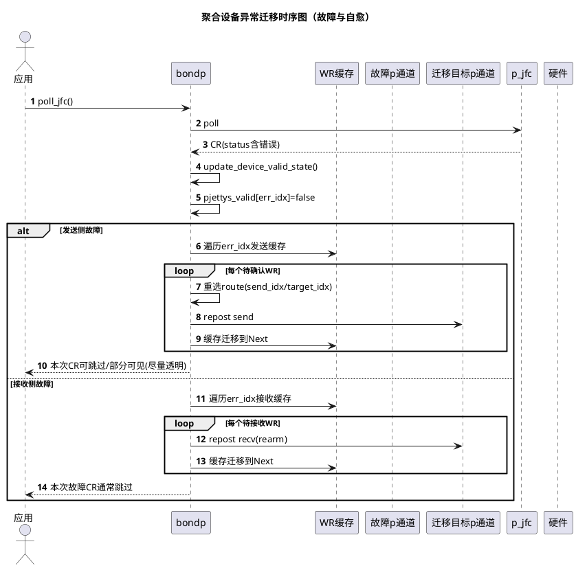
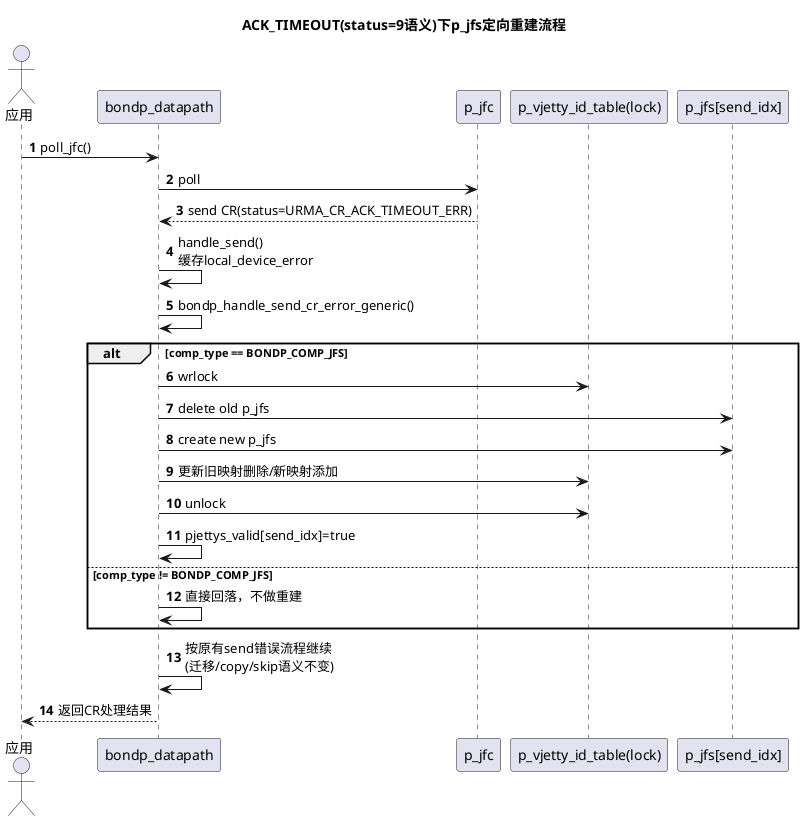

# 当前聚合设备异常迁移时序图

## 改动后的处理流程

## 新增关键结构体与函数
- `recreate_single_pjfs(bjetty_ctx_t *bjetty_ctx, uint32_t send_idx)`
  - 仅在 `BONDP_COMP_JFS` 场景生效。
  - 输入为故障路径索引 `send_idx`，只处理对应 `p_jfs[send_idx]`。
  - 处理顺序：
    1) 校验 `bdp_comp/bdp_ctx/send_idx/p_ctxs[send_idx]/p_jfs[send_idx]` 合法性；  
    2) 在 `p_vjetty_id_table` 写锁下执行 `delete old p_jfs -> create new p_jfs -> 更新映射`；  
    3) 成功后恢复 `bjetty_ctx->pjettys[send_idx]` 与 `pjettys_valid[send_idx]=true`。  
  - 失败保护：
    - 删除后创建失败：尝试按旧配置回滚创建，避免槽位长期为空；
    - 映射更新失败：删除新实例并尝试回滚创建与映射恢复（best-effort）。

- `bondp_handle_send_cr_error_generic(bjetty_ctx_t *bjetty_ctx, urma_cr_t *cr, uint32_t send_idx)`
  - 作为发送侧错误统一入口。
  - 当前规则：
    - `cr->status == URMA_CR_ACK_TIMEOUT_ERR`：尝试调用 `recreate_single_pjfs`；
    - 其它错误：不做新副作用，回落原逻辑（便于后续扩展通用处理策略）。

- `handle_send(...)` 接线方式
  - 先缓存 `local_device_error`，再调用通用错误函数。
  - 这样可以保证本次 CR 的原有分支判定不被重建副作用改写。

## 规格与约束
### 功能规格
- 当 poll 到 `send CR` 且 `status` 语义为 `URMA_CR_ACK_TIMEOUT_ERR` 时：
  - 仅定向重建故障路径 `send_idx` 对应的 `p_jfs`；
  - `jfr` 保持不变，不参与任何删建。
- 对其它报错，先走通用入口函数，当前默认回落现有流程。

### 兼容性与行为约束
- 不改变既有 `handle_send/handle_recv` 的返回语义：
  - `copy/skip` 规则保持不变；
  - 已有迁移、重发、重臂(rearm)逻辑保持不变。
- `BONDP_COMP_JETTY` 场景当前不做 `p_jfs` 重建，仅回落原流程，避免影响既有 jetty 生命周期。

### 并发与一致性约束
- `p_jfs` 指针切换与 `p_vjetty_id_table` 映射更新必须在同一写锁保护区间内完成。
- 不允许出现“指针已切换但映射未更新”或“映射已更新但指针无效”的长期状态。
- 回滚为 best-effort，优先保证运行期可用性和一致性。

### 性能约束
- 成功路径（`URMA_CR_SUCCESS`）不增加重操作，仅保留一次轻量分支判断。
- 重建逻辑只在 ACK_TIMEOUT 错误路径触发，按 `send_idx` O(1) 定位，不做全局扫描。
- 其它错误当前仅经过统一入口，无额外复杂处理开销。