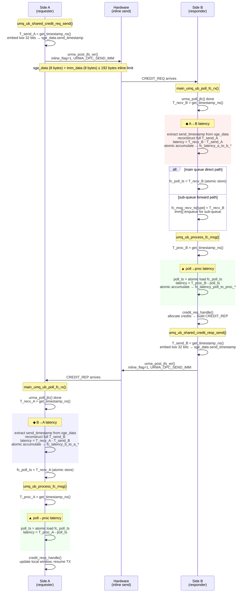
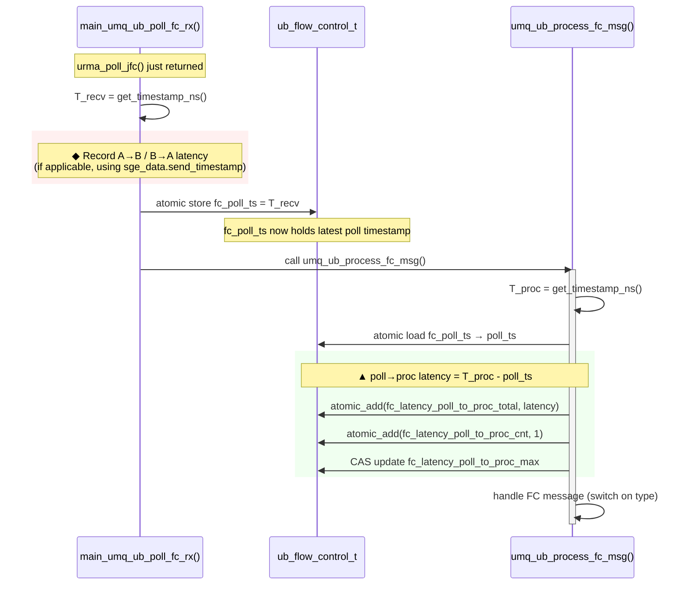
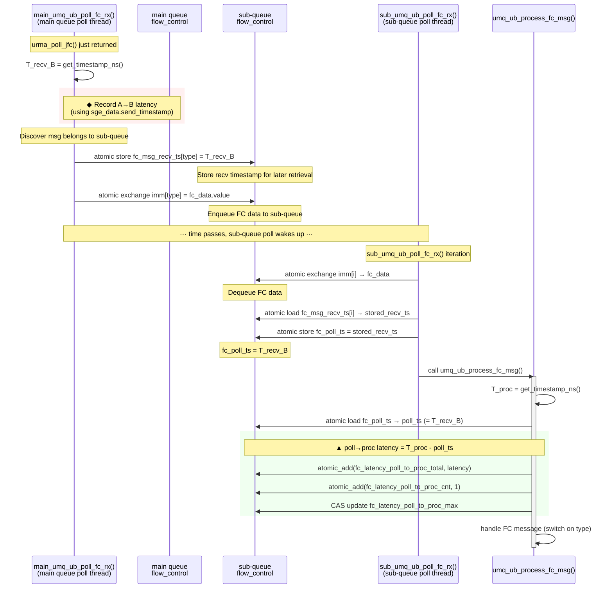
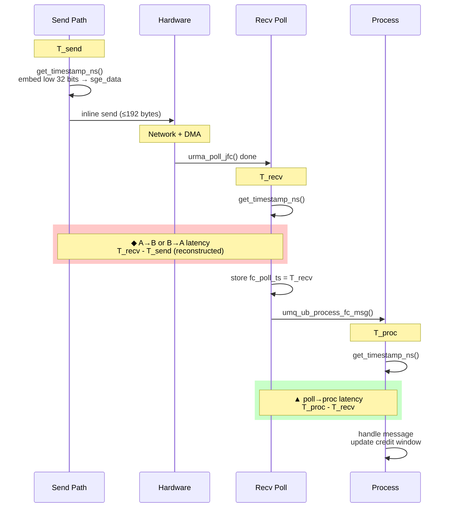
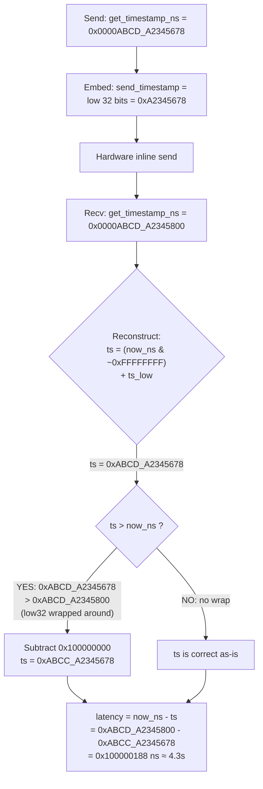
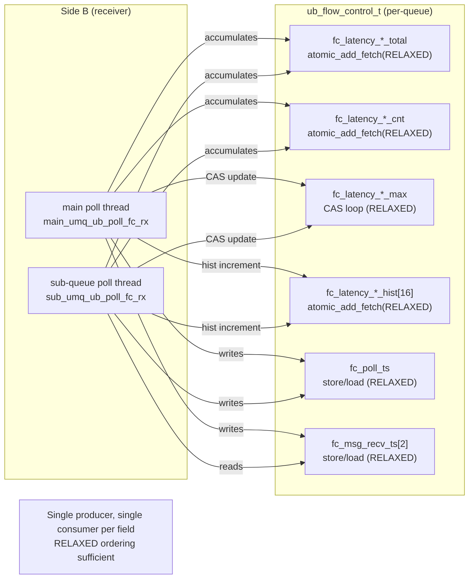

# UMQ Flow Control Latency Measurement Design

## Overview

FC (Flow Control) 消息时延打点，测量三个维度的时延：

| 指标 | 方向 | 含义 |
|------|------|------|
| **A→B** | CREDIT_REQ / RETURN_REQ | 从 A 端发送 FC 请求到 B 端 poll 收到 |
| **B→A** | CREDIT_REP / RETURN_ACK | 从 B 端发送 FC 响应到 A 端 poll 收到 |
| **poll→proc** | 本地 | 从硬件 poll 完成到 `umq_ub_process_fc_msg()` 实际处理 |

所有时间戳使用 `get_timestamp_ns()` (CLOCK_REALTIME, ns 精度)，同主机时钟一致。

---

## Key Time Points

```
T_send   = get_timestamp_ns() in send function, lower 32 bits embedded in sge_data
           → travels via hardware inline send to peer

T_recv   = get_timestamp_ns() after urma_poll_jfc() completes in poll function

T_proc   = get_timestamp_ns() at entry of umq_ub_process_fc_msg()
```

---

## 1. CREDIT_REQ / CREDIT_REP End-to-End Sequence

### ASCII Diagram

```
 Side A (requester)                           Side B (responder)
 ════════════════                             ════════════════

 umq_ub_shared_credit_req_send()
 │
 ├─ T_send_A ──┐
 │             │ get_timestamp_ns() low 32 bits
 │             │ embedded in sge_data.send_timestamp
 │             │
 │  urma_post_jfs_wr()                 ──────── HW inline send ───────→
 │  (inline_flag=1)                                                      │
 │                                                                       │
 │                                                       main_umq_ub_poll_fc_rx()
 │                                                                       │
 │                                                       urma_poll_jfc() done
 │                                                       │
 │                                                       ├─ T_recv_B ──┐
 │                                                       │             │
 │                                                       │  extract send_timestamp
 │                                                       │  reconstruct(T_send_A)
 │                                                       │             │
 │                                                       │  ◆ A→B = T_recv_B - T_send_A
 │                                                       │  stored in fc_latency_a_to_b_{total,cnt,max}
 │                                                       │             │
 │                                                       │  main queue direct:         sub-queue forward:
 │                                                       │  ┌──────────────────┐    ┌──────────────────────┐
 │                                                       │  │fc_poll_ts=T_recv_B│    │fc_msg_recv_ts[type]= │
 │                                                       │  │→ process_fc_msg() │    │  T_recv_B            │
 │                                                       │  └──────────────────┘    │→ imm[] enqueue       │
 │                                                       │                          └──────────────────────┘
 │                                                       │
 │                                                       umq_ub_process_fc_msg()
 │                                                       │
 │                                                       ├─ T_proc_B ──┐
 │                                                       │             │
 │                                                       │  ▲ poll→proc = T_proc_B - T_recv_B
 │                                                       │             │
 │                                                       │  credit_req_handle():
 │                                                       │  allocate credits → build CREDIT_REP
 │                                                       │             │
 │                                              umq_ub_shared_credit_resp_send()
 │                                                       │
 │                                                       ├─ T_send_B ──┐
 │                                                       │             │
 │                                                       │  embed sge_data.send_timestamp
 │                                                       │             │
 │  ←─────────── HW inline send ───────────             │  urma_post_jfs_wr()
 │                                             │  (inline_flag=1)
 │  main_umq_ub_poll_fc_rx()
 │
 │  urma_poll_jfc() done
 │
 ├─ T_recv_A ──┐
 │             │
 │  extract send_timestamp
 │  reconstruct(T_send_B)
 │             │
 │  ◆ B→A = T_recv_A - T_send_B
 │  stored in fc_latency_b_to_a_{total,cnt,max}
 │             │
 │  fc_poll_ts = T_recv_A
 │             │
 umq_ub_process_fc_msg()
 │
 ├─ T_proc_A ──┐
 │             │
 │  ▲ poll→proc = T_proc_A - T_recv_A
 │             │
 │  credit_resp_handle():
 │  update local window, resume TX
 │
 ▼
```

### Mermaid Diagram



---

## 2. Poll→Process Latency: Main Queue Direct Path

### ASCII Diagram

```
Time →
                    T_recv_B                      T_proc_B
                      │                              │
 main_umq_ub_poll_fc_rx()                        umq_ub_process_fc_msg()
                      │                              │
 urma_poll_jfc() returns                             │
 ─────────────────────●──────────────────────────────●──────────→
                      │                              │
                      │←── ▲ poll→proc latency ─────→│
                      │   (T_proc_B - T_recv_B)      │
                      │                              │
                      │  fc_poll_ts = T_recv_B       │  proc_ts = get_timestamp_ns()
                      │  (atomic store, RELAXED)     │  poll_ts = atomic load fc_poll_ts
                      │                              │  latency = proc_ts - poll_ts
                      │                              │
                      │  Cost includes:              │
                      │  · function call overhead    │
                      │  · dedup check (seq cmp)     │
                      │  · prior msg processing      │
                      │                              │
                      Typical: < 100 ns
```

### Mermaid Diagram



---

## 3. Poll→Process Latency: Sub-Queue Forward Path

### ASCII Diagram

```
Time →
                   T_recv_B                                    T_proc_sub
                     │                                             │
 Main poll thread    │         sub_umq_ub_poll_fc_rx()             │
 (main_umq_ub)       │         (sub-queue poll thread)             │
                     │                                             │
 urma_poll_jfc() ret │                                             │
 ────────────────────●─────────── ⋯ ──────────────────────────────●─────────→
                     │               │                             │
                     │  store:       │  exchange imm[i]            │
                     │  fc_msg_recv  │  → got fc_data              │
                     │  _ts[type]=   │                             │
                     │  T_recv_B     │  fc_poll_ts = stored        │
                     │               │  T_recv_B (from             │
                     │               │  fc_msg_recv_ts[i])         │
                     │               │                             │
                     │               │  umq_ub_process_fc_msg()    │
                     │               │  proc_ts = get_timestamp_ns()
                     │               │  ▲ = proc_ts - fc_poll_ts   │
                     │               │                             │
                     │←── ▲ poll→proc latency ────────────────────→│
                     │                                              │
                     Cost includes:
                     · main queue imm[] enqueue delay
                     · sub-queue poll scheduling interval
                     · function call overhead
                     · dedup check
                     
                     Typical: depends on sub-queue poll frequency, usually < 10 µs
```

### Mermaid Diagram



---

## 4. Three Latency Metrics Summary

```
┌──────────────────────────────────────────────────────────────────┐
│                    FC Message Lifetime                            │
├──────────────────────────────────────────────────────────────────┤
│                                                                  │
│  T_send_A                                                        │
│    │                                                             │
│    │  HW inline send (URMA_OPC_SEND_IMM, inline_flag=1)          │
│    │  sge_data carries send_timestamp low 32 bits                 │
│    │                                                             │
│    │         ◆ A→B latency (end-to-end)                          │
│    │         ═══════════════════════                             │
│    ▼                                                             │
│  T_recv_B  ←── urma_poll_jfc() done                              │
│    │                                                             │
│    │         ▲ poll→proc latency (local software delay)          │
│    │         ═══════════════════════════════                     │
│    ▼                                                             │
│  T_proc_B  ←── umq_ub_process_fc_msg() entry                    │
│    │                                                             │
│    │  handle → build response                                    │
│    │                                                             │
│  T_send_B  ←── response with embedded timestamp                  │
│    │                                                             │
│    │         ◆ B→A latency (end-to-end)                          │
│    │         ═══════════════════════                             │
│    ▼                                                             │
│  T_recv_A  ←── urma_poll_jfc() done                              │
│    │                                                             │
│    │         ▲ poll→proc latency                                 │
│    │         ═════════════════                                   │
│    ▼                                                             │
│  T_proc_A  ←── process + window update                           │
│                                                                  │
├──────────────────────────────────────────────────────────────────┤
│ DFX output (umq_flow_control_stats_to_str):                      │
│                                                                  │
│  A->B Total (ns)    : <cumulative>   A->B Cnt  : <samples>      │
│  A->B Max (ns)      : <peak>                                     │
│  B->A Total (ns)    : <cumulative>   B->A Cnt  : <samples>      │
│  B->A Max (ns)      : <peak>                                     │
│  Poll->Proc Total   : <cumulative>   Poll->Proc Cnt : <samples>  │
│  Poll->Proc Max     : <peak>                                     │
│                                                                  │
│  FC Latency Distribution (16 power-of-2 buckets):                │
│    Latency Range       A->B      B->A      Poll->Proc            │
│    <= 128ns            12345     12000      30000                │
│    <= 256ns             2345      2300       5000                │
│    ...                   ...       ...        ...                │
│    > 2ms                   0         0          0                │
│                                                                  │
│  FC Latency Percentiles:                                         │
│    Percentile          A->B      B->A      Poll->Proc            │
│    p50 (ns)             150       140         80                 │
│    p90 (ns)            1200      1100        500                 │
│    p99 (ns)            8500      9000       2000                 │
└──────────────────────────────────────────────────────────────────┘
```

### Mermaid Diagram



---

## 5. Timestamp Reconstruction

```
Embed (sender):
    sge_data.bs.send_timestamp = (uint32_t)get_timestamp_ns();
    // Only lower 32 bits travel with the message (saves 4 bytes in sge_data)

Reconstruct (receiver):
    ts = (now_ns & ~0xFFFFFFFFULL) | ts_low;
    if (ts > now_ns) {
        ts -= 0x100000000ULL;  // wrap: send was in previous 32-bit window
    }

Safety margin:
    32-bit wrap period  = 2³² ns ≈ 4.295 seconds
    FC message RTT      < 100 µs (typical)
    Safety margin       = 4.295 / 0.0001 ≈ 42,950x

    Even under extreme interrupt/ scheduling delays,
    FC latency will never approach 4 seconds.
    If no response within ~4s, the connection is already dead.
```

### Mermaid Diagram



---

## 6. Concurrency Model



---

## 7. Histogram: Power-of-2 Buckets

### 7.1 Design

16 个 2 的幂次桶，覆盖 128ns ~ 2ms 以上的时延范围：

| Bucket | Upper Bound | Range |
|--------|------------|-------|
| 0 | 128 ns | 2^7 |
| 1 | 256 ns | 2^8 |
| 2 | 512 ns | 2^9 |
| 3 | 1,024 ns (~1 µs) | 2^10 |
| 4 | 2,048 ns (~2 µs) | 2^11 |
| 5 | 4,096 ns (~4 µs) | 2^12 |
| 6 | 8,192 ns (~8 µs) | 2^13 |
| 7 | 16,384 ns (~16 µs) | 2^14 |
| 8 | 32,768 ns (~32 µs) | 2^15 |
| 9 | 65,536 ns (~64 µs) | 2^16 |
| 10 | 131,072 ns (~128 µs) | 2^17 |
| 11 | 262,144 ns (~256 µs) | 2^18 |
| 12 | 524,288 ns (~512 µs) | 2^19 |
| 13 | 1,048,576 ns (~1 ms) | 2^20 |
| 14 | 2,097,152 ns (~2 ms) | 2^21 |
| 15 | > 2 ms (overflow) | — |

### 7.2 Bucket Index Calculation

使用 `__builtin_clzll` 实现 O(1) 桶定位 (~2ns)：

```c
static inline int umq_perf_fc_latency_bucket_idx(uint64_t latency)
{
    if (latency <= 128) return 0;                        // bucket 0: [0, 128]
    int msb = 64 - __builtin_clzll(latency - 1);          // ceil(log2(latency))
    int bucket = msb - 7;                                 // subtract exponent of 128
    if (bucket < 0) return 0;
    if (bucket >= UMQ_FC_LATENCY_BUCKET_COUNT) return UMQ_FC_LATENCY_BUCKET_COUNT - 1;
    return bucket;
}
```

**原理**：`ceil(log2(x)) = 64 - __builtin_clzll(x - 1)`。由于最小桶上界是 128 = 2^7，将 msb 减去 7 得到桶号。

**验证示例**：

| Latency | ceil(log2) | msb | bucket | Bound |
|---------|-----------|-----|--------|-------|
| 1 ns | 0 | 0 | 0 | 128 ns |
| 128 ns | 7 | 7 | 0 | 128 ns |
| 129 ns | 8 | 8 | 1 | 256 ns |
| 500 ns | 9 | 9 | 2 | 512 ns |
| 1,000 ns | 10 | 10 | 3 | 1 µs |
| 50,000 ns | 16 | 16 | 9 | 64 µs |
| 1,500,000 ns | 21 | 21 | 14 | 2 ms |
| 3,000,000 ns | 22 | 22 | 15 | > 2 ms |

### 7.3 Recording Path

```c
void umq_perf_fc_latency_record_send_to_recv(
    volatile uint64_t *total, volatile uint64_t *cnt, volatile uint64_t *max,
    volatile uint64_t *hist,           // ← histogram array (16 uint64_t)
    uint32_t send_ts_low, uint64_t recv_ts)
{
    if (!g_umq_perf_record_enable) return;  // ← gated by existing switch
    uint64_t send_ts = umq_perf_fc_reconstruct_send_ts(send_ts_low, recv_ts);
    uint64_t latency = recv_ts - send_ts;
    umq_perf_fc_latency_update(total, cnt, max, hist, latency);  // total/cnt/max + hist
}
```

`umq_perf_fc_latency_update()` 在更新 total/cnt/max 后，追加一行 histogram 记录：

```c
int b = umq_perf_fc_latency_bucket_idx(latency);
__atomic_add_fetch(&hist[b], 1, __ATOMIC_RELAXED);
```

### 7.4 Per-Field Storage

每个 `ub_flow_control_t` 包含 3 个 histogram 数组：

```c
volatile uint64_t fc_latency_a_to_b_hist[UMQ_FC_LATENCY_BUCKET_COUNT];    // 128 bytes
volatile uint64_t fc_latency_b_to_a_hist[UMQ_FC_LATENCY_BUCKET_COUNT];    // 128 bytes
volatile uint64_t fc_latency_poll_to_proc_hist[UMQ_FC_LATENCY_BUCKET_COUNT]; // 128 bytes
```

每个 `umq_fc_latency_stats_t` (DFX 查询结果) 同理。

### 7.5 Overhead Analysis

| 组件 | 开销 | 说明 |
|------|------|------|
| 桶索引 (`__builtin_clzll`) | ~2 ns | 单条 CPU 指令 (lzcnt) |
| `__atomic_add_fetch` | ~10 ns | lock-free, RELAXED 序 |
| 函数调用 (perf.c) | ~5 ns | 非 inline, 正常调用开销 |
| **总计 (enabled)** | **~70 ns** | 含 timestamp 重建 + total/cnt/max + hist |
| **总计 (disabled)** | **~10 ns** | 函数调用 + `g_umq_perf_record_enable` 检查 → 立即返回 |
| **额外内存** | **384 bytes/queue** | 3 × 16 × 8 = 384 bytes |

### 7.6 Percentile Estimation from Histogram

`umq_flow_control_stats_to_str()` 输出时，从直方图估算 p50/p90/p99：

```
for each metric (A→B, B→A, poll→proc):
    total = sum(hist[0..15])
    if total == 0: percentile = 0
    for i in 0..15:
        cumulative += hist[i]
        if cumulative >= total * percentile / 100:
            estimated = bucket_upper[i]; break
```

估算精度 = 桶宽度（如对于 1-2ms 范围的样本，精度为 ±1ms），对诊断长尾问题足够。

---

## 8. Modified Files

| File | Changes |
|------|---------|
| `umq_ub_imm_data.h` | `umq_ub_fc_sge_data_t` expanded from 32-bit to 64-bit, added `send_timestamp : 32` |
| `umq_ub_private.h` | Added `fc_msg_recv_ts[]`, `fc_poll_ts`, 9 latency stat fields + 3 histogram arrays to `ub_flow_control_t` |
| `umq_ub_flow_control.h` | `umq_ub_fc_set_send_timestamp()` inline helper (record functions moved to `perf.c`) |
| `umq_ub_flow_control.c` | Timestamp embedded in 4 send functions; DFX query functions (atomic + non-atomic) copy histogram arrays |
| `umq_pro_ub.c` | Latency recording calls (5 sites) passing histogram arrays to `perf.c` functions |
| `perf.h` | Declared `umq_perf_fc_latency_record_send_to_recv()` and `umq_perf_fc_latency_record_poll_to_proc()` |
| `perf.c` | Implementation: `umq_perf_fc_reconstruct_send_ts()`, `umq_perf_fc_latency_bucket_idx()`, `umq_perf_fc_latency_update()`, and two public record functions — all gated by `g_umq_perf_record_enable` |
| `umq_dfx_types.h` | `UMQ_FC_LATENCY_BUCKET_COUNT` define; `umq_fc_latency_stats_t` with 3 histogram arrays |
| `umq_dfx_api.c` | `umq_flow_control_stats_to_str()` updated with FC Latency Distribution histogram + percentile estimation |

---

## 9. Data Structure: SGE Data Format

```
Before (4 bytes):                  After (8 bytes):
┌──────────────────────┐           ┌──────────────────────────────────────────────────────┐
│  u32 value           │           │  u64 value                                            │
│  type     : 4        │           │  type     : 4                                         │
│  window   : 10       │           │  window   : 10                                        │
│  ratio    : 2        │           │  ratio    : 2                                         │
│  rsvd     : 16       │           │  rsvd     : 16                                        │
│                       │           │  send_timestamp : 32  ← lower 32 bits of ns          │
└──────────────────────┘           └──────────────────────────────────────────────────────┘

Inline send limit: 192 bytes (SQE_WRITE_IMM_INLINE_SIZE)
FC inline payload: 8 bytes sge_data + 8 bytes imm_data = 16 bytes ✓ well within limit
```

---

## 10. DFX Output: Format, Timing, and Interpretation

### 10.1 When Is It Printed?

The latency stats are **not printed automatically** — there is no periodic dump or `printk`. Instead, they are exposed via the DFX query API as **always-on accumulators**. The data flow is:

```
umq_stats_flow_control_get(umqh, &stats)   ← user/admin queries via DFX tool
    │
    ├─ pool->ops.stats_query()              ← fill pool credit stats
    └─ fc->ops.stats_query()                ← fill queue credit + packet + latency stats
          │
          ├─ flow_control_stats_query_atomic()    (atomic mode: multi-thread safe)
          └─ flow_control_stats_query_non_atomic() (non-atomic mode: single-thread)

umq_flow_control_stats_to_str(&stats, buf, len)  ← format to human-readable string
```

Typical usage from DFX admin tool or debugfs read:

```c
umq_flow_control_stats_t stats = {0};
umq_stats_flow_control_get(umq_handle, &stats);
char buf[4096];
umq_flow_control_stats_to_str(&stats, buf, sizeof(buf));
// buf now contains formatted text, ready for display
```

### 10.2 Output Format

Calling `umq_flow_control_stats_to_str()` produces output like this:

```
================================================================================
                               Flow Control Statistics
================================================================================
Type                                     Value
------------------------------------------------------------------------------------------------------------------------
                               Pool Credit Statistics
------------------------------------------------------------------------------------------------------------------------
Pool Idle                                127
Pool Allocated                           255
Total Pool Idle                          10240
Total Pool Allocated                     20480
Total Pool Post RX Err                   0
------------------------------------------------------------------------------------------------------------------------
                              Queue Credit Statistics
------------------------------------------------------------------------------------------------------------------------
Queue Idle                               512
Queue Allocated                          256
Queue Acquired                           384
Total Queue Idle                         8192
Total Queue Acquired                     6144
Total Queue Allocated                    4096
Total Queue Post TX Success              6000
Total Queue Post TX Err                  0
Total Queue Acquired Err                 0
                              Packet Statistics
------------------------------------------------------------------------------------------------------------------------
Send Cnt                                 12345
Send Success                             12340
Recv Cnt                                 12330
Send Error Cnt                           5
Recv Error Cnt                           0
                              FC Latency Statistics
------------------------------------------------------------------------------------------------------------------------
A->B Total (ns)                          150000000
A->B Cnt                                 30000
A->B Max (ns)                            28500
B->A Total (ns)                          145000000
B->A Cnt                                 29000
B->A Max (ns)                            31200
Poll->Proc Total (ns)                    4500000
Poll->Proc Cnt                           60000
Poll->Proc Max (ns)                      856
------------------------------------------------------------------------------------------------------------------------
                           FC Latency Distribution
------------------------------------------------------------------------------------------------------------------------
Latency Range                    A->B            B->A            Poll->Proc
<= 128ns                         12345           12000           30000
<= 256ns                         2345            2300            5000
<= 512ns                         1000            950             2000
<= 1us                           500             480             1000
<= 2us                           200             190             400
<= 4us                           100             95              200
<= 8us                           50              48              100
<= 16us                          30              29              60
<= 32us                          15              14              30
<= 64us                          10              10              20
<= 128us                         5               5               10
<= 256us                         3               3               6
<= 512us                         2               2               4
<= 1ms                           1               1               2
<= 2ms                           0               0               1
> 2ms                            0               0               0
------------------------------------------------------------------------------------------------------------------------
                           FC Latency Percentiles
------------------------------------------------------------------------------------------------------------------------
Percentile                       A->B            B->A            Poll->Proc
p50 (ns)                         150             140             80
p90 (ns)                         1200            1100            500
p99 (ns)                         8500            9000            2000
------------------------------------------------------------------------------------------------------------------------
================================================================================
```

### 10.3 How to Interpret Each Field

#### A→B Latency (CREDIT_REQ / RETURN_REQ: requester → responder)

| Field | Unit | Meaning |
|-------|------|---------|
| `A->B Total` | ns | Cumulative sum of all A→B latencies since queue creation |
| `A->B Cnt` | count | Number of A→B FC messages received (sample count) |
| `A->B Max` | ns | Maximum (peak) A→B latency observed |

**How to read it:**
- **Avg A→B = Total / Cnt** — the mean FC one-way latency
- **Max** — the worst-case latency; if this is much larger than Avg, there may be intermittent jitter (interrupt delay, CPU contention)
- **Healthy range**: typically < 10 µs (10,000 ns) for same-host loopback. If Avg > 100 µs, check CPU load or interrupt steering

#### B→A Latency (CREDIT_REP / RETURN_ACK: responder → requester)

| Field | Unit | Meaning |
|-------|------|---------|
| `B->A Total` | ns | Cumulative sum of all B→A latencies |
| `B->A Cnt` | count | Number of B→A FC messages received |
| `B->A Max` | ns | Maximum B→A latency observed |

**How to read it:**
- Same interpretation as A→B
- **A→B vs B→A asymmetry**: if one direction is consistently higher, check for asymmetric CPU load or interrupt affinity
- **Cnt difference**: A→B Cnt should approximately equal B→A Cnt (each REQ gets a REP). A significant gap might indicate lost FC messages

#### Poll→Process Latency (local software dispatch delay)

| Field | Unit | Meaning |
|-------|------|---------|
| `Poll->Proc Total` | ns | Cumulative sum of all poll-to-process delays |
| `Poll->Proc Cnt` | count | Number of FC messages processed (≈ A→B + B→A cnts combined) |
| `Poll->Proc Max` | ns | Maximum poll-to-process delay observed |

**How to read it:**
- **Avg = Total / Cnt** — the mean time from hardware poll completion to `umq_ub_process_fc_msg()` entry
- **Main queue path**: typically < 100 ns (just function call overhead + dedup check)
- **Sub-queue path**: depends on sub-queue poll frequency, typically < 10 µs
- **If Max is high** (e.g., > 100 µs):
  - Sub-queue poll interval too long → tune sub-queue poll frequency
  - Batch processing: many messages queued before `process_fc_msg()` runs
  - CPU preemption: the processing thread was descheduled

#### FC Latency Distribution (Histogram)

| Field | Unit | Meaning |
|-------|------|---------|
| `<= 128ns` through `> 2ms` | count | Number of samples in each power-of-2 latency bucket |

**How to read it:**
- Each row shows how many FC messages fell into that latency range
- **Concentration**: most samples should cluster in the lower buckets (e.g., <=256ns or <=512ns for same-host)
- **Long tail**: samples in higher buckets (>16us, >1ms) indicate outlier delays — look for intermittent CPU preemption, interrupt storms, or scheduling jitter
- **Overflow bucket** (> 2ms): any non-zero value here is a strong signal of system-level issues (e.g., process was descheduled)
- **Compare across columns**: if Poll->Proc has many samples in high buckets while A→B/B→A don't, the bottleneck is local software dispatch, not network

#### FC Latency Percentiles

| Field | Unit | Meaning |
|-------|------|---------|
| `p50 (ns)` | ns | Estimated median latency (50th percentile) from histogram |
| `p90 (ns)` | ns | Estimated 90th percentile latency |
| `p99 (ns)` | ns | Estimated 99th percentile latency |

**How to read it:**
- **p50 ≈ Avg**: if p50 is close to the computed average (Total/Cnt), the distribution is roughly symmetric
- **p99 vs p50 ratio**: a large ratio (e.g., p99 = 100× p50) indicates a significant long tail — common in networked systems but worth investigating if > 1000×
- **p99 vs Max**: p99 is a better indicator of "typical worst case" than Max, since Max can be skewed by a single extreme outlier
- **A→B p99 vs B→A p99**: asymmetry points to one-sided bottlenecks (CPU load, interrupt affinity)
- **Estimation precision**: percentile values are upper-bound estimates from histogram buckets (± bucket width). For precise percentiles, use total/cnt/max to compute exact values from raw data

### 10.4 Diagnostic Workflow

```
                     ┌─────────────────────────────────────────┐
                     │ Is FC throughput below expectation?      │
                     └────────────────────┬────────────────────┘
                                          │
                     ┌────────────────────▼────────────────────┐
                     │ Check A→B Avg and B→A Avg               │
                     │ Both < 10 µs?                            │
                     └──────┬──────────────────┬───────────────┘
                            │ YES              │ NO
                            ▼                  ▼
              ┌──────────────────────┐  ┌──────────────────────────┐
              │ End-to-end latency OK│  │ Which direction is slow? │
              │ Check poll→proc Max  │  │ → Check that side's CPU  │
              └──────────┬───────────┘  │   load / interrupt affin.│
                         │              └──────────────────────────┘
              ┌──────────▼──────────┐
              │ poll→proc Max       │
              │ < 10 µs?            │
              └──────┬──────────────┘
                     │
            ┌────────┴────────┐
            │ YES             │ NO
            ▼                 ▼
   ┌──────────────┐  ┌──────────────────────┐
   │ System healthy│  │ Software dispatch    │
   │ All latencies │  │ bottleneck           │
   │ within bounds │  │ Check:               │
   │               │  │ - sub-queue poll freq│
   │               │  │ - batch size         │
   │               │  │ - CPU preemption     │
   └──────────────┘  └──────────────────────┘
```

### 10.5 Design: Gated by `g_umq_perf_record_enable`

All FC latency recording (total/cnt/max/histogram) is gated by `g_umq_perf_record_enable` (static bool in `perf.c`), controlled by `umq_perf_start()` / `umq_perf_stop()`.

**When disabled** (default):
- Recording functions return immediately after ~1 function call + CMP
- Hot-path overhead: ~10 ns
- All accumulators stay at zero

**When enabled**:
- Full latency measurement: timestamp reconstruction + total/cnt/max atomics + histogram atomic
- Hot-path overhead: ~70 ns per FC message
- Histogram `__atomic_add_fetch` adds ~10 ns (included in ~70 ns total)

**Design rationale**:
- Recording functions live in `perf.c`, accessing `g_umq_perf_record_enable` directly — no extern exposure
- Same switch controls both basic stats (total/cnt/max) and histogram — no separate gate needed
- All accumulators use `__atomic_*_fetch(RELAXED)` — lock-free, no memory barriers
- Stats are only formatted when explicitly queried via `umq_flow_control_stats_to_str()` — zero background CPU
