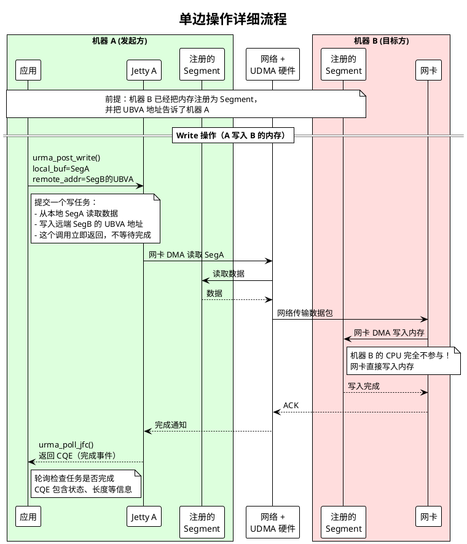
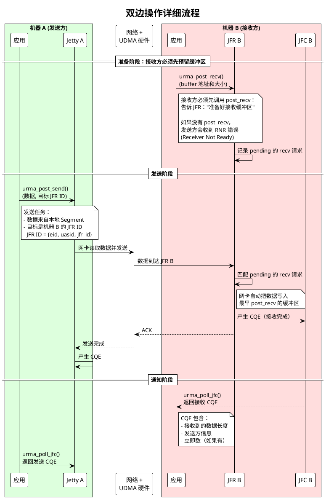

# URMA 概念与架构（15分钟）
## 1. URMA 是什么（3分钟）
### 1.1 背景：为什么需要 URMA？
传统的网络通信（如 TCP）有一个问题：**数据需要多次拷贝**。
```
发送方：应用缓冲区 → 内核缓冲区 → 网卡缓冲区 → 网络
接收方：网络 → 网卡缓冲区 → 内核缓冲区 → 应用缓冲区
```
每次拷贝都消耗 CPU 和内存带宽，对于高性能场景（分布式存储、AI 训练）是巨大瓶颈。
**URMA 的解决方案：让网卡直接访问应用内存，绕过内核，零拷贝。**
```
发送方：应用缓冲区 ←→ 网卡 ←→ 网络
接收方：网络 ←→ 网卡 ←→ 应用缓冲区
CPU 不参与数据搬运，只负责提交任务和检查结果
```
### 1.2 URMA 是什么
**URMA (Unified Remote Memory Access)** 是华为 UDMA 硬件的用户态编程接口。
核心能力：
1. **远程内存访问**：一台机器可以直接读写另一台机器的内存
2. **零拷贝**：数据直接在应用内存和网卡之间传输
3. **异步操作**：提交任务后立即返回，通过轮询或事件检查结果
### 1.3 在 UMDK 中的位置
```
┌─────────────────────────────────────────────────────────┐
│                    User Application                      │
├─────────────────────────────────────────────────────────┤
│  URPC  │  ULOCK  │  USOCK  │  CAM  │  User App Direct   │  ← 高层库
├─────────────────────────────────────────────────────────┤
│                       URMA                              │  ← 本分享重点
├─────────────────────────────────────────────────────────┤
│                   UDMA Driver (Kernel)                   │  ← 内核驱动
├─────────────────────────────────────────────────────────┤
│                   UDMA Hardware                          │  ← 网卡硬件
└─────────────────────────────────────────────────────────┘
```
---
## 2. 核心对象模型（7分钟）
### 2.1 从一个简单问题开始
假设我们要实现：**机器 A 直接写入机器 B 的内存**
需要解决几个问题：
1. **怎么找到对方？** → 需要地址标识
2. **怎么告诉网卡做什么？** → 需要任务队列
3. **怎么知道任务完成了？** → 需要完成队列
4. **怎么保护内存不被随便访问？** → 需要权限控制
URMA 的对象模型就是围绕这些问题设计的。
### 2.2 核心对象概览
| 对象 | 解决的问题 | 类比理解 |
|------|-----------|---------|
| Device | 网卡硬件 | 一块物理网卡 |
| Context | 进程级资源容器 | 这个进程使用的网卡资源 |
| EID | 网络地址标识 | 类似 IP 地址，标识一个端点 |
| JFC | 完成队列 | 存放已完成任务的通知 |
| JFS | 发送任务队列 | 提交写/读/发送任务的地方 |
| JFR | 接收任务队列 | 存放接收任务的地方 |
| Jetty | JFS + JFR 组合 | 同时能发能收 |
| Segment | 注册的内存区域 | 告诉网卡"这块内存可以被远程访问" |
| Token | 访问令牌 | "密码"，控制谁能访问我的内存 |
### 2.3 对象层次结构
```
Device (网卡)
  │
  └── Context (进程级上下文)
        │
        ├── EID (地址标识，属于 Context)
        │
        ├── JFC (完成队列)
        │     └── depth: 队列大小
        │
        ├── JFR (接收端)
        │     ├── 绑定一个 JFC (接收完成通知)
        │     └── token_value: 访问密码
        │
        └── Jetty (发送+接收组合)
              ├── JFS (发送端)
              │     └── 绑定一个 JFC (发送完成通知)
              └── JFR (可选，可以共享一个 JFR)
```
### 2.4 详细解读每个对象
#### 2.4.1 Device（设备）
Device 代表一块 UDMA 网卡。系统可能有多块网卡，每块都是一个 Device。
```c
// urma_types.h:370-377
typedef struct urma_device {
    char name[URMA_MAX_NAME];         // 设备名称，如 "ubcore_0"
    char path[URMA_MAX_PATH];         // sysfs 路径（内核导出的信息）
    urma_transport_type_t type;       // 传输类型
    struct urma_provider_ops *ops;    // 驱动操作函数表（内部使用）
} urma_device_t;
```
**怎么获取 Device？**
```c
// 方法1：获取所有设备列表
int num_devices;
urma_device_t **devices = urma_get_device_list(&num_devices);
// 使用完后释放
urma_free_device_list(devices);
// 方法2：按名称获取
urma_device_t *dev = urma_get_device_by_name("ubcore_0");
```
**解读：**
- `urma_get_device_list()` 返回设备指针数组，不是复制，不要 free 单个指针
- 必须调用 `urma_free_device_list()` 释放数组本身
#### 2.4.2 Context（上下文）和 EID
Context 是进程级的资源容器。**一个进程通常只创建一个 Context**，所有资源都在这个 Context 下创建。
```c
// urma_types.h:389-400
typedef struct urma_context {
    struct urma_device *dev;    // 关联的设备
    urma_eid_t eid;             // 端点标识符（64位地址）
    uint32_t uasid;             // 用户地址空间 ID（进程隔离）
    int async_fd;               // 异步事件文件描述符
    // ... 内部字段
} urma_context_t;
```
**EID（Endpoint ID）是什么？**
EID 是 64 位的网络地址标识，可以理解为一个"网卡地址"。
```c
// urma_types.h:136-147
typedef union urma_eid {
    uint8_t raw[16];            // 16 字节原始值
    struct {
        uint64_t reserved;
        uint32_t prefix;        // IPv4 映射时为 0x0000ffff
        uint32_t addr;          // IPv4 地址
    } in4;
    struct {
        uint64_t subnet_prefix; // 子网前缀
        uint64_t interface_id;  // 接口 ID
    } in6;
} urma_eid_t;
```
**创建 Context：**
```c
// urma_sample.c:129-147 - 获取 EID
static int get_eid_index(urma_device_t *dev)
{
    urma_eid_info_t *eid_list;
    uint32_t eid_cnt;
    
    // 获取设备上的所有 EID
    eid_list = urma_get_eid_list(dev, &eid_cnt);
    
    // 打印所有 EID
    for (int i = 0; i < eid_cnt; i++) {
        printf("device: %s, eid%d: %s\n", 
               dev->name, eid_list[i].eid_index, 
               eid_to_string(&eid_list[i].eid));
    }
    
    // 使用第一个 EID
    int eid_index = eid_list[0].eid_index;
    urma_free_eid_list(eid_list);
    return eid_index;
}
// 创建 Context
urma_context_t *ctx = urma_create_context(dev, eid_index);
```
**解读：**
- 一块网卡可以配置多个 EID（类似多 IP）
- `eid_index` 指定使用哪个 EID
- 创建 Context 后，这个进程就有了唯一的网络标识 (EID + UASID)
#### 2.4.3 JFC（完成队列）
JFC (Jetty Completion Queue) 存放已完成任务的通知（CQE - Completion Queue Entry）。
**为什么需要 JFC？**
URMA 操作是异步的：
1. 调用 `urma_post_write()` 只是提交任务，立即返回
2. 任务由网卡硬件在后台执行
3. 执行完成后，网卡产生一个 CQE 放入 JFC
4. 应用程序通过 `urma_poll_jfc()` 检查 CQE
```c
// urma_types.h:427-434 - JFC 配置
typedef struct urma_jfc_cfg {
    uint32_t depth;       // 队列深度，最多存放多少个 CQE
    urma_jfc_flag_t flag; // 标志位
    uint32_t ceqn;        // 事件队列 ID（可选）
    urma_jfce_t *jfce;    // 完成事件通道（可选，用于事件通知模式）
    uint64_t user_ctx;    // 用户上下文
} urma_jfc_cfg_t;
// urma_types.h:485-495 - JFC 结构
typedef struct urma_jfc {
    urma_context_t *urma_ctx;
    urma_jfc_id_t jfc_id;
    urma_jfc_cfg_t jfc_cfg;
    // ... 内部字段
} urma_jfc_t;
```
**两种使用模式：**
```c
// 模式1：轮询模式（Polling）- 主动查询
urma_cr_t cr;
while (1) {
    int n = urma_poll_jfc(jfc, 1, &cr);  // 查询是否有完成的任务
    if (n > 0) {
        // 处理完成的任务
        if (cr.status == URMA_CR_SUCCESS) {
            printf("任务成功完成，传输了 %u 字节\n", cr.len);
        } else {
            printf("任务失败，错误码: %d\n", cr.status);
        }
    }
}
// 模式2：事件模式（Event）- 等待通知
// 需要先创建 JFCE（事件通道）
urma_jfce_t *jfce = urma_create_jfce(ctx);
urma_jfc_cfg_t cfg = { .depth = 1024, .jfce = jfce };
urma_jfc_t *jfc = urma_create_jfc(ctx, &cfg);
urma_rearm_jfc(jfc, false);  // 启用事件通知
// 等待事件
fd_set fds;
FD_ZERO(&fds);
FD_SET(jfce->fd, &fds);
select(jfce->fd + 1, &fds, NULL, NULL, NULL);  // 阻塞等待
// 有事件了，再 poll
urma_poll_jfc(jfc, 1, &cr);
```
**解读：**
- `depth` 决定了最多能有多少个未处理的完成事件
- 轮询模式延迟更低（适合高性能场景），但占用 CPU
- 事件模式省 CPU，但有额外开销
#### 2.4.4 JFR（接收端）
JFR (Jetty Receiver) 是接收数据的端点。
**JFR 的作用：**
1. 接收别人发来的数据（双边操作 Send/Recv）
2. 通过 Token 控制谁能发数据给我
```c
// urma_types.h:643-655 - JFR 配置
typedef struct urma_jfr_cfg {
    uint32_t id;                      // JFR ID（可选，0 表示自动分配）
    uint32_t depth;                   // 接收队列深度
    urma_jfr_flag_t flag;             // 标志位（token 策略等）
    urma_transport_mode_t trans_mode; // 传输模式
    uint8_t max_sge;                  // 最大 SGE 数量
    uint8_t min_rnr_timer;            // RNR 定时器（接收端未准备好时的等待时间）
    urma_jfc_t *jfc;                  // 绑定的完成队列
    urma_token_t token_value;         // 访问令牌值
    uint64_t user_ctx;                // 用户上下文
} urma_jfr_cfg_t;
```
**Token 机制：**
Token 是一个"密码"，控制谁能往这个 JFR 发送数据。
```c
// 设置 Token
urma_token_t token = { .token = 0xACFE };  // 设置密码为 0xACFE
jfr_cfg.token_value = token;
// 发送方必须提供相同的 Token 才能发送成功
```
**创建 JFR 的代码解读：**
```c
// urma_sample.c:234-249
urma_jfr_cfg_t jfr_cfg = {
    .depth = 256,                    // 接收队列可以放 256 个接收任务
    .flag.bs.tag_matching = 0,       // 不使用标签匹配
    .flag.bs.order_type = 0,         // 默认顺序
    .trans_mode = URMA_TM_RM,        // 可靠消息模式（无连接）
    .min_rnr_timer = 12,             // 接收端未准备好时，等 4.096 * 2^12 微秒
    .jfc = ctx->jfc,                 // 接收完成通知发到这个 JFC
    .token_value = ctx->token,       // 设置访问密码
    .id = 0,                         // 让系统自动分配 ID
    .max_sge = 1                     // 每次接收最多 1 个内存段
};
ctx->jfr = urma_create_jfr(ctx->urma_ctx, &jfr_cfg);
if (ctx->jfr == NULL) {
    fprintf(stderr, "Failed to create jfr\n");
    return -1;
}
```
**解读：**
- `depth = 256`：意味着可以有 256 个未处理的接收任务
- `trans_mode`：决定是面向连接还是无连接
- `jfc`：接收完成后，CQE 会放入这个 JFC
- `token_value`：保护 JFR，发送方必须知道这个 token
#### 2.4.5 JFS（发送端）
JFS (Jetty Sender) 是发送数据的端点。
**JFS 的作用：**
1. 发送数据（Send 操作）
2. 读写远端内存（Write/Read 操作）
3. 原子操作（CAS、Fetch-and-Add 等）
```c
// urma_types.h:553-571 - JFS 配置
typedef struct urma_jfs_cfg {
    uint32_t depth;                   // 发送队列深度
    urma_jfs_flag_t flag;             // 标志位
    urma_transport_mode_t trans_mode; // 传输模式
    uint8_t priority;                 // 优先级 [0-15]，15 最高
    uint8_t max_sge;                  // 最大本地 SGE 数量
    uint8_t max_rsge;                 // 最大远端 SGE 数量
    uint32_t max_inline_data;         // 最大内联数据大小
    uint8_t rnr_retry;                // RNR 重试次数
    uint8_t err_timeout;              // 错误超时
    urma_jfc_t *jfc;                  // 绑定的完成队列
    uint64_t user_ctx;                // 用户上下文
} urma_jfs_cfg_t;
```
**创建 JFS 的代码解读：**
```c
// urma_sample.c:251-263
urma_jfs_cfg_t jfs_cfg = {
    .depth = 256,                    // 发送队列可以放 256 个发送任务
    .flag.bs.order_type = 0,         // 默认顺序
    .flag.bs.multi_path = 0,         // 不使用多路径
    .trans_mode = URMA_TM_RM,        // 可靠消息模式
    .priority = 15,                  // 最高优先级
    .max_sge = 1,                    // 每次发送最多 1 个本地内存段
    .max_inline_data = 0,            // 不使用内联数据
    .rnr_retry = 7,                  // 接收端未准备好时无限重试
    .err_timeout = 17,               // 超时时间 4.096 * 2^17 微秒
    .jfc = ctx->jfc,                 // 发送完成通知发到这个 JFC
    .user_ctx = 0                    // 用户上下文为空
};
```
**解读：**
- `priority = 15`：高优先级任务会被网卡优先处理
- `rnr_retry = 7`：接收端如果没有准备好（没 post_recv），会重试
- `jfc`：发送完成后，CQE 会放入这个 JFC
#### 2.4.6 Jetty（JFS + JFR 组合）
Jetty 把 JFS 和 JFR 组合在一起，**一个端点既能发也能收**。
```c
// urma_types.h:722-739 - Jetty 配置
typedef struct urma_jetty_cfg {
    uint32_t id;            // Jetty ID（可选）
    urma_jetty_flag_t flag; // 标志位（是否共享 JFR）
    urma_jfs_cfg_t jfs_cfg; // JFS 配置
    union {
        struct {
            urma_jfr_t *jfr;     // 共享的 JFR
            urma_jfc_t *jfc;     // 替换 JFR 的 JFC（可选）
        } shared;
        urma_jfr_cfg_t *jfr_cfg; // 创建新的 JFR（已废弃）
    };
    urma_jetty_grp_t *jetty_grp; // 所属 Jetty 组（可选）
    uint64_t user_ctx;           // 用户上下文
} urma_jetty_cfg_t;
```
**两种创建方式：**
```c
// 方式1：Jetty 共享已存在的 JFR（推荐）
urma_jetty_cfg_t jetty_cfg = {
    .flag.bs.share_jfr = 1,       // 使用共享模式
    .jfs_cfg = jfs_cfg,           // JFS 配置
    .shared.jfr = ctx->jfr,       // 共享这个 JFR
};
ctx->jetty = urma_create_jetty(ctx->urma_ctx, &jetty_cfg);
// 方式2：Jetty 内部创建新的 JFR（不推荐）
// 实际上 Jetty 内部会创建 JFS 和 JFR
```
**解读：**
- 共享 JFR 的好处：多个 Jetty 可以共用一个接收端，节省资源
- Jetty 创建后，`jetty->jfs_cfg` 保存了内部 JFS 的配置
#### 2.4.7 Segment（内存段）
Segment 是**注册给网卡的内存区域**。只有注册过的内存才能被远程访问。
**为什么要注册？**
1. 网卡需要知道物理地址才能 DMA 访问
2. 注册时设置访问权限（只读、可写、可原子操作）
3. 通过 Token ID 控制谁能访问
```c
// urma_types.h:950-958 - Segment 配置
typedef struct urma_seg_cfg {
    uint64_t va;  // 虚拟地址（要注册的内存起始地址）
    uint64_t len; // 长度（要注册的内存大小）
    urma_token_id_t *token_id; // 关联的 Token ID（可选）
    urma_token_t token_value;  // Token 值（访问密码）
    urma_reg_seg_flag_t flag;  // 属性标志
    uint64_t user_ctx;         // 用户上下文
    uint64_t iova;             // IOVA 地址（可选）
} urma_seg_cfg_t;
// urma_types.h:960-965 - Segment 结构
typedef struct urma_seg {
    urma_ubva_t ubva;     // 统一总线虚拟地址（网卡用的地址）
    uint64_t len;         // 长度
    urma_seg_attr_t attr; // 属性（访问权限等）
    uint32_t token_id;    // 关联的 Token ID
} urma_seg_t;
```
**UBVA 是什么？**
UBVA (Unified Bus Virtual Address) 是网卡视角的地址，包含 EID + UASID + VA：
```c
// urma_types.h:860-864
typedef struct urma_ubva {
    urma_eid_t eid;     // 哪个端点的内存
    uint32_t uasid;     // 哪个进程的内存
    uint64_t va;        // 虚拟地址
} __attribute__((packed)) urma_ubva_t;
```
**注册 Segment 的代码解读：**
```c
// urma_sample.c:276-300
// Step 1: 分配内存（需要页对齐）
ctx->va = memalign(PAGE_SIZE, MEM_SIZE);  // 分配 1GB，页对齐
memset(ctx->va, 0, MEM_SIZE);
// Step 2: 设置注册属性
urma_reg_seg_flag_t flag = {
    .bs.token_policy = URMA_TOKEN_NONE,    // 不验证 token
    .bs.cacheable = 0,                      // 不可缓存
    .bs.access = URMA_ACCESS_READ | URMA_ACCESS_WRITE | URMA_ACCESS_ATOMIC,
};
// Step 3: 配置 Segment
urma_seg_cfg_t seg_cfg = {
    .va = (uint64_t)ctx->va,       // 起始地址
    .len = MEM_SIZE,               // 长度 1GB
    .token_id = NULL,              // 不使用 Token ID
    .token_value = ctx->token,     // Token 值
    .flag = flag,
    .user_ctx = 0,
    .iova = 0,
};
// Step 4: 注册
ctx->local_tseg = urma_register_seg(ctx->urma_ctx, &seg_cfg);
if (ctx->local_tseg == NULL) {
    fprintf(stderr, "Failed to register segment\n");
    return -1;
}
// 注册成功后，local_tseg->seg.ubva 就是远端用来访问这个内存的地址
```
**解读：**
- `memalign(PAGE_SIZE, ...)` 确保页对齐，因为网卡按页管理内存
- `access` 设置了读、写、原子操作权限
- 注册成功后，`local_tseg->seg.ubva` 可以发给远端，远端就能访问这块内存
#### 2.4.8 Token ID 和访问控制
Token 是访问控制的"密码"。有两种粒度：
1. **Token Value**：JFR 级别的密码，发送方必须提供
2. **Token ID**：Segment 级别的密码，更细粒度
```c
// Token 策略
#define URMA_TOKEN_NONE          0  // 不验证
#define URMA_TOKEN_PLAIN_TEXT    1  // 明文验证
#define URMA_TOKEN_SIGNED        2  // 签名验证
#define URMA_TOKEN_ALL_ENCRYPTED 3  // 全加密
// 访问权限
#define URMA_ACCESS_LOCAL_ONLY (0x1 << 0)  // 只能本地访问
#define URMA_ACCESS_READ       (0x1 << 1)  // 可读
#define URMA_ACCESS_WRITE      (0x1 << 2)  // 可写
#define URMA_ACCESS_ATOMIC     (0x1 << 3)  // 可原子操作
```
### 2.5 完整的对象创建流程（源码解读）
```c
// urma_sample.c:179-274 完整解读
static context_t *init_context(const argument_t *args)
{
    // ====== Step 1: 分配上下文结构 ======
    context_t *ctx = calloc(1, sizeof(context_t));
    if (ctx == NULL) {
        return NULL;
    }
    ctx->args = *args;
    // ====== Step 2: 获取设备 ======
    // 根据名称获取设备（如 "ubcore_0"）
    urma_device_t *urma_dev = urma_get_device_by_name(args->dev_name);
    if (urma_dev == NULL) {
        fprintf(stderr, "urma get device by name failed!\n");
        goto UNINIT;
    }
    // ====== Step 3: 查询设备能力 ======
    // 获取设备的最大队列深度、支持的特性等
    if (urma_query_device(urma_dev, &ctx->dev_attr) != URMA_SUCCESS) {
        fprintf(stderr, "Failed to query device %s.\n", args->dev_name);
        goto UNINIT;
    }
    // ====== Step 4: 获取 EID ======
    // 获取设备上的 EID 列表，选择第一个
    int eid_index = get_eid_index(urma_dev);
    if (eid_index < 0) {
        fprintf(stderr, "Failed to get eid index\n");
        goto UNINIT;
    }
    // ====== Step 5: 创建 Context ======
    // 这是进程级的主上下文
    ctx->urma_ctx = urma_create_context(urma_dev, (uint32_t)eid_index);
    if (ctx->urma_ctx == NULL) {
        fprintf(stderr, "Failed to create instance\n");
        goto UNINIT;
    }
    
    // 设置 Token 值（访问密码）
    ctx->token.token = 0xACFE;
    // ====== Step 6: 创建 JFCE（事件通道，可选）======
    ctx->jfce = urma_create_jfce(ctx->urma_ctx);
    if (ctx->jfce == NULL) {
        fprintf(stderr, "Failed to create jfce\n");
        goto DEL_CTX;
    }
    // ====== Step 7: 创建 JFC（完成队列）======
    urma_jfc_cfg_t jfc_cfg = {
        .depth = ctx->dev_attr.dev_cap.max_jfc_depth,  // 使用设备支持的最大深度
        .flag = {.value = 0},
        .jfce = ctx->jfce,   // 关联事件通道
        .user_ctx = 0,
    };
    ctx->jfc = urma_create_jfc(ctx->urma_ctx, &jfc_cfg);
    if (ctx->jfc == NULL) {
        fprintf(stderr, "Failed to create jfc\n");
        goto DEL_JFCE;
    }
    // ====== Step 8: 创建 JFR（接收端）======
    urma_jfr_cfg_t jfr_cfg = {
        .depth = 256,                                    // 接收队列深度
        .flag.bs.tag_matching = URMA_NO_TAG_MATCHING,    // 不使用标签匹配
        .trans_mode = args_to_trans_mode(args),          // 传输模式
        .min_rnr_timer = URMA_TYPICAL_MIN_RNR_TIMER,     // RNR 定时器
        .jfc = ctx->jfc,                                 // 关联完成队列
        .token_value = ctx->token,                       // 访问密码
        .id = 0,                                         // 自动分配 ID
        .max_sge = 1                                     // 最大 SGE 数
    };
    ctx->jfr = urma_create_jfr(ctx->urma_ctx, &jfr_cfg);
    if (ctx->jfr == NULL) {
        fprintf(stderr, "Failed to create jfr\n");
        goto DEL_JFC;
    }
    // ====== Step 9: 创建 Jetty（JFS + 共享 JFR）======
    urma_jfs_cfg_t jfs_cfg = {
        .depth = 256,
        .trans_mode = args_to_trans_mode(args),
        .priority = URMA_MAX_PRIORITY,        // 最高优先级
        .max_sge = 1,
        .max_inline_data = 0,
        .rnr_retry = URMA_TYPICAL_RNR_RETRY,
        .err_timeout = URMA_TYPICAL_ERR_TIMEOUT,
        .jfc = ctx->jfc,                      // 关联完成队列
        .user_ctx = 0
    };
    
    urma_jetty_cfg_t jetty_cfg = {
        .flag.bs.share_jfr = 1,   // 共享模式：使用已存在的 JFR
        .jfs_cfg = jfs_cfg,
        .shared.jfr = ctx->jfr    // 共享这个 JFR
    };
    
    ctx->jetty = urma_create_jetty(ctx->urma_ctx, &jetty_cfg);
    if (ctx->jetty == NULL) {
        fprintf(stderr, "Failed to create jetty\n");
        goto DEL_JFR;
    }
    // ====== Step 10: 分配并注册内存 ======
    ctx->va = memalign(PAGE_SIZE, MEM_SIZE);  // 页对齐分配
    if (ctx->va == NULL) {
        fprintf(stderr, "Failed to alloc buffer\n");
        goto DEL_JETTY;
    }
    memset(ctx->va, 0, MEM_SIZE);
    urma_reg_seg_flag_t flag = {
        .bs.token_policy = URMA_TOKEN_NONE,
        .bs.cacheable = URMA_NON_CACHEABLE,
        .bs.access = URMA_ACCESS_READ | URMA_ACCESS_WRITE | URMA_ACCESS_ATOMIC,
    };
    urma_seg_cfg_t seg_cfg = {
        .va = (uint64_t)ctx->va,
        .len = MEM_SIZE,
        .token_id = NULL,
        .token_value = ctx->token,
        .flag = flag,
        .user_ctx = 0,
        .iova = 0
    };
    ctx->local_tseg = urma_register_seg(ctx->urma_ctx, &seg_cfg);
    if (ctx->local_tseg == NULL) {
        fprintf(stderr, "Failed to register segment\n");
        goto FREE_MEM;
    }
    return ctx;
// 错误处理：按相反顺序清理
FREE_MEM:
    free(ctx->va);
DEL_JETTY:
    urma_delete_jetty(ctx->jetty);
DEL_JFR:
    urma_delete_jfr(ctx->jfr);
DEL_JFC:
    urma_delete_jfc(ctx->jfc);
DEL_JFCE:
    urma_delete_jfce(ctx->jfce);
DEL_CTX:
    urma_delete_context(ctx->urma_ctx);
UNINIT:
    free(ctx);
    return NULL;
}
```
---
## 3. 两种通信模式（5分钟）
### 3.1 单边操作（One-sided Operations）
**发起方直接读写远端内存，远端进程不需要参与。**
这意味着：
- 远端不需要调用任何函数
- 远端不需要预分配接收缓冲区
- 远端甚至不知道发生了什么
**需要的条件：**
1. 远端必须把内存注册为 Segment
2. 远端把 Segment 信息（UBVA + Token）发给发起方
3. 发起方导入 Segment 后，就可以读写了

**Write 操作的代码详解：**
```c
// urma_sample.c - Write 操作
static int do_write(context_t *ctx, urma_target_seg_t *remote_tseg, 
                    urma_target_jetty_t *tjetty, uint64_t offset)
{
    // ====== Step 1: 构造本地 SGE（Scatter/Gather Element）======
    // SGE 描述一个内存段：地址 + 长度 + Segment
    urma_sge_t local_sge = {
        .addr = (uint64_t)ctx->va,        // 本地数据起始地址
        .len = MSG_SIZE,                  // 数据长度
        .tseg = ctx->local_tseg,          // 本地注册的 Segment
    };
    
    // ====== Step 2: 构造远端 SGE ======
    urma_sge_t remote_sge = {
        .addr = remote_tseg->seg.ubva.va + offset,  // 远端地址 = 基址 + 偏移
        .len = MSG_SIZE,                            // 写入长度
        .tseg = remote_tseg,                        // 导入的远端 Segment
    };
    
    // ====== Step 3: 构造 Work Request（WR）======
    urma_jfs_wr_t wr = {
        .opcode = URMA_OPC_WRITE,              // 操作类型：写
        .flag.bs.complete_enable = 1,          // 完成后产生 CQE
        .tjetty = tjetty,                      // 目标 Jetty（路由信息）
        .user_ctx = (uint64_t)my_context,      // 用户上下文（会复制到 CQE）
        .rw = {
            .src = { .sge = &local_sge, .num_sge = 1 },  // 源：本地内存
            .dst = { .sge = &remote_sge, .num_sge = 1 }, // 目的：远端内存
        },
    };
    
    // ====== Step 4: 提交任务 ======
    // 参数：jetty, wr 数组, wr 个数, 错误的 wr 索引
    urma_status_t ret = urma_post_write(ctx->jetty, &wr, 1, NULL);
    if (ret != URMA_SUCCESS) {
        fprintf(stderr, "post_write failed: %d\n", ret);
        return ret;
    }
    
    // ====== Step 5: 等待完成 ======
    urma_cr_t cr;
    int n = urma_poll_jfc(ctx->jfc, 1, &cr);  // 轮询 1 个 CQE
    
    if (n <= 0) {
        fprintf(stderr, "poll_jfc failed or no completion\n");
        return -1;
    }
    
    // ====== Step 6: 检查结果 ======
    if (cr.status != URMA_CR_SUCCESS) {
        fprintf(stderr, "write failed, status: %d\n", cr.status);
        return -1;
    }
    
    printf("write success, %u bytes transferred\n", cr.len);
    return URMA_SUCCESS;
}
```
**关键数据结构解读：**
```c
// SGE (Scatter/Gather Element) - 描述一个内存段
typedef struct urma_sge {
    uint64_t addr;               // 地址
    uint32_t len;                // 长度
    urma_target_seg_t *tseg;     // 所属 Segment（必须是已注册或已导入的）
    urma_user_tseg_t *user_tseg; // 用户提供的 Segment（跳过导入步骤）
} urma_sge_t;
// Work Request (WR) - 工作请求
typedef struct urma_jfs_wr {
    urma_opcode_t opcode;           // 操作码：WRITE/READ/SEND/...
    urma_jfs_wr_flag_t flag;        // 标志：是否需要完成通知等
    urma_target_jetty_t *tjetty;    // 目标 Jetty（路由信息）
    uint64_t user_ctx;              // 用户上下文（完成后原样返回）
    union {
        urma_rw_wr_t rw;            // Read/Write 参数
        urma_send_wr_t send;        // Send 参数
        urma_cas_wr_t cas;          // CAS 参数
        urma_faa_wr_t faa;          // Fetch-and-Add 参数
    };
    struct urma_jfs_wr *next;       // 链表指针（批量提交用）
} urma_jfs_wr_t;
// Completion Record (CR/CQE) - 完成记录
typedef struct urma_cr {
    uint64_t user_ctx;           // 用户上下文（来自 WR）
    urma_cr_status_t status;     // 完成状态：成功/失败/错误类型
    urma_cr_opcode_t opcode;     // 操作类型
    uint32_t len;                // 实际传输长度
    uint32_t imm_data;           // 立即数（如果有）
    // ...
} urma_cr_t;
```
### 3.2 双边操作（Two-sided Operations）
**双方都需要参与：接收方先预留缓冲区，发送方才能发送。**
这类似传统的消息传递：
1. 接收方调用 `urma_post_recv()` 预留接收缓冲区
2. 发送方调用 `urma_post_send()` 发送数据
3. 数据到达后，自动匹配到预留的缓冲区

**Send/Recv 操作的代码详解：**
```c
// ====== 接收方代码 ======
// Step 1: 准备接收缓冲区
void *recv_buf = memalign(PAGE_SIZE, RECV_BUF_SIZE);
// Step 2: 构造接收 SGE
urma_sge_t recv_sge = {
    .addr = (uint64_t)recv_buf,
    .len = RECV_BUF_SIZE,
    .tseg = ctx->local_tseg,  // 必须是已注册的 Segment
};
// Step 3: 构造接收 WR
urma_jfr_wr_t recv_wr = {
    .src = { .sge = &recv_sge, .num_sge = 1 },
};
// Step 4: 提交接收请求（必须在发送方发送之前！）
urma_status_t ret = urma_post_recv(ctx->jfr, &recv_wr, 1, NULL);
if (ret != URMA_SUCCESS) {
    fprintf(stderr, "post_recv failed: %d\n", ret);
    return ret;
}
// Step 5: 等待接收完成
urma_cr_t cr;
int n = urma_poll_jfc(ctx->jfc, 1, &cr);
if (n > 0 && cr.status == URMA_CR_SUCCESS) {
    printf("received %u bytes\n", cr.len);
    // cr.opcode 告诉我们这是什么类型的接收
    // URMA_CR_OPC_SEND, URMA_CR_OPC_SEND_WITH_IMM, URMA_CR_OPC_SEND_WITH_INV
}
// ====== 发送方代码 ======
// Step 1: 准备发送数据
void *send_buf = ...;  // 要发送的数据
uint32_t send_len = ...;
// Step 2: 构造发送 SGE
urma_sge_t send_sge = {
    .addr = (uint64_t)send_buf,
    .len = send_len,
    .tseg = ctx->local_tseg,
};
// Step 3: 构造发送 WR
urma_jfs_wr_t send_wr = {
    .opcode = URMA_OPC_SEND,              // 普通发送
    // .opcode = URMA_OPC_SEND_IMM,       // 带立即数的发送
    .flag.bs.complete_enable = 1,         // 需要完成通知
    .tjetty = target_jetty,               // 目标 Jetty（已导入的）
    .user_ctx = (uint64_t)my_context,
    .send = {
        .src = { .sge = &send_sge, .num_sge = 1 },
        .imm_data = 0x1234,               // 立即数（仅 SEND_IMM 有效）
    },
};
// Step 4: 发送
urma_status_t ret = urma_post_send(ctx->jetty, &send_wr, 1, NULL);
// Step 5: 等待发送完成
urma_cr_t cr;
urma_poll_jfc(ctx->jfc, 1, &cr);
```
**立即数（Immediate Data）是什么？**
`SEND_IMM` 操作可以携带 4 字节的立即数，接收方可以从 CQE 中读取：
```c
// 发送方
send_wr.opcode = URMA_OPC_SEND_IMM;
send_wr.send.imm_data = 0x12345678;  // 4 字节立即数
// 接收方
urma_cr_t cr;
urma_poll_jfc(jfc, 1, &cr);
if (cr.opcode == URMA_CR_OPC_SEND_WITH_IMM) {
    printf("received imm_data: 0x%x\n", cr.imm_data);  // 0x12345678
}
```
用途：传递小型元数据，如消息类型、序列号等，避免额外通信。
### 3.3 两种模式对比
| 特性 | 单边操作 (Write/Read) | 双边操作 (Send/Recv) |
|------|----------------------|---------------------|
| 远端是否参与 | 不参与 | 必须参与（post_recv） |
| 编程复杂度 | 较低（只需一方操作） | 较高（双方需配合） |
| 延迟 | 更低（无远端 CPU 开销） | 稍高（远端需要 post_recv） |
| 适用场景 | 大数据传输、共享内存 | 消息传递、RPC、控制消息 |
| 内存需求 | 远端需注册 Segment | 远端需预分配接收缓冲区 |
| 典型应用 | 分布式存储、KV 缓存 | URPC、分布式锁 |
---
## 总结
### 核心概念回顾
| 对象 | 作用 | 创建函数 |
|------|------|---------|
| Device | 网卡硬件 | `urma_get_device_list()` |
| Context | 进程级资源容器 | `urma_create_context()` |
| JFC | 完成队列 | `urma_create_jfc()` |
| JFR | 接收端 | `urma_create_jfr()` |
| JFS | 发送端 | （通常通过 Jetty 创建）|
| Jetty | 发送+接收组合 | `urma_create_jetty()` |
| Segment | 注册的内存 | `urma_register_seg()` |
| TargetSeg | 导入的远端内存 | `urma_import_seg()` |
| TargetJetty | 导入的远端端点 | `urma_import_jetty()` |
### 对象创建顺序
```
urma_init()
    │
    ▼
urma_get_device_by_name()  ← 获取设备
    │
    ▼
urma_create_context()      ← 创建上下文
    │
    ├──────────────────────┐
    ▼                      ▼
urma_create_jfce()    urma_create_jfc()  ← 创建完成队列（和可选的事件通道）
    │                      │
    └──────────┬───────────┘
               ▼
        urma_create_jfr()  ← 创建接收端（可选，也可以让 Jetty 内部创建）
               │
               ▼
        urma_create_jetty() ← 创建 Jetty（包含 JFS）
               │
               ▼
        urma_register_seg() ← 注册内存
               │
               ▼
        交换信息（通过 TCP 等）
               │
               ▼
        urma_import_seg() / urma_import_jetty() ← 导入远端资源
               │
               ▼
        urma_bind_jetty() (RC 模式需要) ← 建立连接
```
### 下一步
- **Part 2**: API 速览 - 详细讲解各 API 的参数和使用场景
- **Part 3**: 代码走读 - 深入分析 urma_sample.c 示例
- **Part 4**: 总结与扩展 - URPC 如何基于 URMA 构建