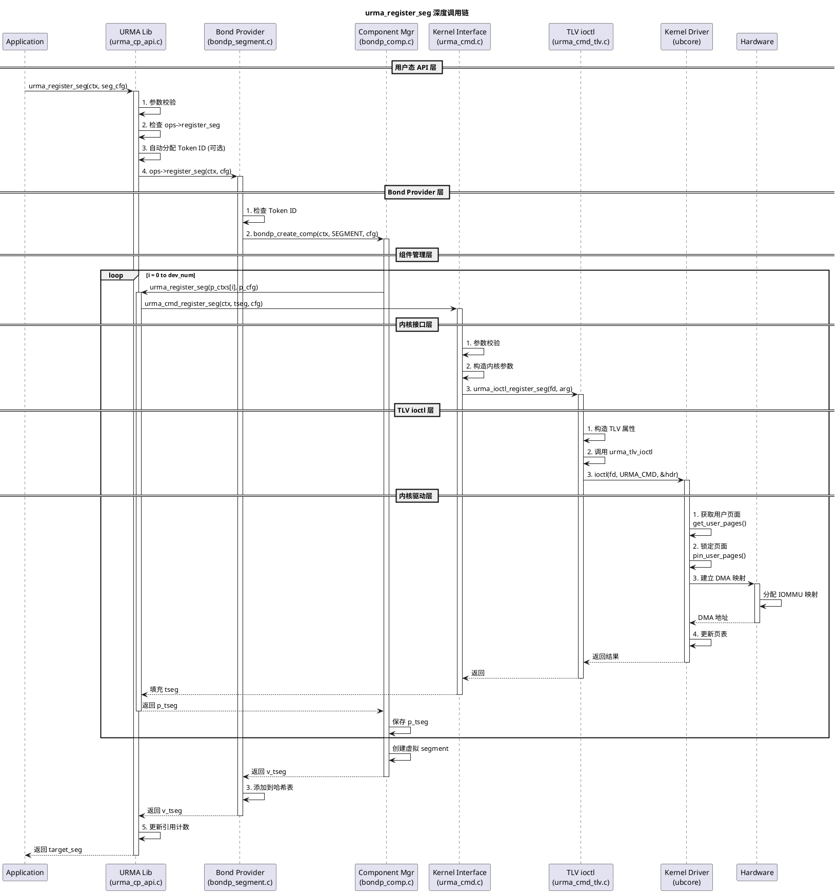

# URMA内存注册 (urma_register_seg)

从用户态 API 到内核交互。

## 调用链概览
```
用户态 API (urma_cp_api.c)
    ↓
ops 函数指针 (ops->register_seg)
    ↓
Bond Provider (bondp_segment.c)
    ↓
组件创建 (bondp_comp.c)
    ↓
内核接口 (urma_cmd.c)
    ↓
TLV ioctl (urma_cmd_tlv.c)
    ↓
内核驱动 (ubcore)
    ↓
硬件操作 (DMA, pin pages)
```
## 1. 用户态 API 层
**源文件**: `src/urma/lib/urma/core/urma_cp_api.c:2785-2825`
```c
urma_target_seg_t *urma_register_seg(urma_context_t *ctx, urma_seg_cfg_t *seg_cfg)
{
    urma_target_seg_t *seg = NULL;
    urma_ops_t *ops = NULL;
    
    // 1. 参数校验
    if (ctx == NULL || seg_cfg == NULL || seg_cfg->va == 0) {
        URMA_LOG_ERR("Invalid parameter.\n");
        errno = EINVAL;
        return NULL;
    }
    
    // 2. 检查 ops 函数指针
    URMA_CHECK_OP_INVALID_RETURN_POINTER(ctx, ops, register_seg);
    
    // 3. 检查配置合法性
    if (!urma_check_seg_cfg(ctx->dev->type, seg_cfg)) {
        errno = EINVAL;
        return NULL;
    }
    
    // 4. 自动分配 Token ID（如果用户没有提供）
    urma_seg_cfg_t tmp_cfg = *seg_cfg;
    if (seg_cfg->flag.bs.token_id_valid == URMA_TOKEN_ID_INVALID && 
        ctx->dev->type == URMA_TRANSPORT_UB) {
        tmp_cfg.token_id = urma_alloc_token_id(ctx);
        if (tmp_cfg.token_id == NULL) {
            return NULL;
        }
        tmp_cfg.flag.bs.token_id_valid = URMA_TOKEN_ID_VALID;
    }
    
    // 5. 调用 provider 的 register_seg
    seg = ops->register_seg(ctx, &tmp_cfg);
    if (seg == NULL) {
        // 失败时清理 Token ID
        if (seg_cfg->flag.bs.token_id_valid == URMA_TOKEN_ID_INVALID && 
            ctx->dev->type == URMA_TRANSPORT_UB) {
            urma_free_token_id(tmp_cfg.token_id);
        }
        URMA_LOG_ERR("[DRV_ERR]register seg failed\n");
        return NULL;
    }
    
    // 6. 更新引用计数
    seg->seg.attr.bs.user_token_id = seg_cfg->flag.bs.token_id_valid;
    atomic_fetch_add(&seg->urma_ctx->ref.atomic_cnt, 1);
    
    if (ctx->dev->type == URMA_TRANSPORT_UB && seg->token_id != NULL) {
        atomic_fetch_add(&seg->token_id->ref.atomic_cnt, 1);
    }
    
    return seg;
}
```

**关键点**:
- 参数校验确保输入合法
- 自动分配 Token ID（如果未提供）
- 通过 `ops` 函数指针调用底层实现
- 引用计数管理资源生命周期
- 错误时自动清理已分配的资源

## 2. Bond Provider 层
**源文件**: `src/urma/lib/urma/bond/bondp_segment.c:124-149`

```c
urma_target_seg_t *bondp_register_seg(urma_context_t *ctx, urma_seg_cfg_t *seg_cfg)
{
    // 1. 检查 Token ID
    if (seg_cfg->token_id == NULL || 
        seg_cfg->flag.bs.token_id_valid == URMA_TOKEN_ID_INVALID) {
        URMA_LOG_ERR("Invalid token id for register bondp seg\n");
        return NULL;
    }
    
    // 2. 创建组件
    bondp_comp_t *bdp_comp = bondp_create_comp(ctx, BONDP_COMP_SEGMENT, seg_cfg);
    if (bdp_comp == NULL) {
        URMA_LOG_ERR("Failed to create bondp comp\n");
        return NULL;
    }
    
    // 3. 添加到哈希表（用于快速查找）
    bdp_va_vtseg_info_t *va_vtseg = calloc(1, sizeof(bdp_va_vtseg_info_t));
    if (va_vtseg == NULL) {
        bondp_delete_comp(bdp_comp, BONDP_COMP_SEGMENT);
        return NULL;
    }
    
    va_vtseg->va = bdp_comp->v_tseg.seg.token_id;
    va_vtseg->vtseg = &bdp_comp->v_tseg;
    
    bondp_hash_table_add_with_hash(&g_va_vtseg_tbl, &va_vtseg->hmap_node,
        ub_hash_bytes(&va_vtseg->va, sizeof(uint64_t), 
                       BDP_VA_VTSEG_INFO_HASH_BASIS));
    
    return &bdp_comp->v_tseg;
}
```

**Bond 层的作用**:
- 支持多网卡聚合 (Bonding)
- 维护全局哈希表加速查找
- 创建组件管理虚拟资源
- 每个物理网卡上创建真实 segment
## 3. 组件管理层
**源文件**: `src/urma/lib/urma/bond/bondp_comp.c`

组件创建函数会每个物理网卡上调用 `urma_cmd_register_seg`:

```c
bondp_comp_t *bondp_create_comp(urma_context_t *ctx, 
                                            bondp_comp_type_t type,
                                            void *cfg)
{
    bondp_comp_t *comp = calloc(1, sizeof(bondp_comp_t));
    if (comp == NULL) {
        return NULL;
    }
    
    // 初始化组件
    comp->type = type;
    comp->ctx = ctx;
    
    // 遍历所有物理网卡
    for (int i = 0; i < ctx->dev_num; i++) {
        if (ctx->p_ctxs[i] == NULL) {
            continue;
        }
        
        // 在每个物理网卡上创建 segment
        urma_seg_cfg_t p_cfg = convert_bondp_to_physical_cfg(cfg);
        urma_target_seg_t *p_tseg = urma_register_seg(ctx->p_ctxs[i], &p_cfg);
        if (p_tseg == NULL) {
            // 失败时清理
            bondp_delete_comps(comp, i);
            return NULL;
        }
        
        // 保存物理 segment
        comp->p_tsegs[i] = p_tseg;
    }
    
    // 创建虚拟 segment（聚合）
    urma_target_seg_t *v_tseg = create_virtual_segment(comp);
    comp->v_tseg = *v_tseg;
    comp->v_orig_handle = v_tseg->handle;
    
    return comp;
}
```

**组件管理关键**:
- Bonding 场景下，每个物理网卡独立注册
- 虚拟层聚合多个物理 segment
- 错误时自动清理所有已创建的资源
## 4. 内核接口层
**源文件**: `src/urma/lib/urma/core/urma_cmd.c:240-269`

```c
int urma_cmd_register_seg(urma_context_t *ctx, urma_target_seg_t *tseg, 
                               urma_seg_cfg_t *cfg)
{
    // 1. 参数校验
    if (ctx == NULL || ctx->dev_fd < 0 || tseg == NULL || cfg == NULL || cfg->va == 0) {
        URMA_LOG_ERR("Invalid parameter");
        errno = EINVAL;
        return -1;
    }
    
    // 2. 构造内核命令参数
    urma_cmd_register_seg_t arg = {0};
    arg.in.va = cfg->va;                    // 用户虚拟地址
    arg.in.len = cfg->len;                  // 长度
    if (cfg->token_id != NULL) {
        arg.in.token_id = cfg->token_id->token_id;
        arg.in.token_id_handle = cfg->token_id->handle;
    }
    arg.in.token = cfg->token_value.token;  // Token 值
    arg.in.flag = cfg->flag.value;         // 标志
    
    
    // 3. 调用 ioctl
    int ret = urma_ioctl_register_seg(ctx->dev_fd, &arg);
    if (ret != 0) {
        URMA_LOG_ERR("ioctl failed, ret:%d, errno:%u.\n", ret, errno);
        return ret;
    }
    
    // 4. 填充返回结构
    fill_registered_tseg(tseg, ctx, cfg, arg.out.token_id, arg.out.handle);
    
    return 0;
}
```

**内核命令参数**:
- `va`: 用户态虚拟地址
- `len`: 内存长度
- `token_id`: Token ID
- `token`: Token 值（密码）
- `flag`: 标志位
## 5. TLV ioctl 层
**源文件**: `src/urma/lib/urma/core/urma_cmd_tlv.c:100-117`

```c
int urma_ioctl_register_seg(int ioctl_fd, urma_cmd_register_seg_t *arg)
{
    // 1. 构造 TLV 属性数组
    urma_cmd_attr_t attrs[] = {0};
    
    // 2. 填充输入参数
    ATTR(a++, REGISTER_SEG_IN_VA, arg->in.va);
    ATTR(a++, REGISTER_SEG_IN_LEN, arg->in.len);
    ATTR(a++, REGISTER_SEG_IN_TOKEN_ID, arg->in.token_id);
    ATTR(a++, REGISTER_SEG_IN_TOKEN_ID_HANDLE, arg->in.token_id_handle);
    ATTR(a++, REGISTER_SEG_IN_TOKEN, arg->in.token);
    ATTR(a++, REGISTER_SEG_IN_FLAG, arg->in.flag);
    
    // 3. 填充输出参数
    ATTR(a++, REGISTER_SEG_OUT_TOKEN_ID, arg->out.token_id);
    ATTR(a++, REGISTER_SEG_OUT_HANDLE, arg->out.handle);
    
    // 4. 调用通用 ioctl
    return urma_tlv_ioctl(ioctl_fd, URMA_CMD_REGISTER_SEG, attrs, sizeof(attrs));
}
```

**TLV 格式**:
- Type-Length-Value 三元组
- 可扩展性好：添加新参数不影响旧版本
- 篇幅高效：只传递需要的参数
## 6. 通用 ioctl 函数
**源文件**: `src/urma/lib/urma/core/urma_cmd_tlv.c:45-58`

```c
static int urma_tlv_ioctl(int ioctl_fd, urma_cmd_t cmd, 
                          urma_cmd_attr_t *args, uint32_t args_len)
{
    // 1. 构造命令头
    urma_cmd_hdr_t hdr = {
        .command = (uint32_t)cmd,
        .args_len = args_len,
        .args_addr = (uint64_t)args,
    };
    
    // 2. 调用系统 ioctl
    int ret = ioctl(ioctl_fd, URMA_CMD, &hdr);
    if (ret != 0) {
        URMA_LOG_ERR("ioctl failed, ret:%d, errno:%d\n", ret, errno);
    }
    return ret;
}
```

**系统调用**:
- `ioctl()` 是 Linux 系统调用
- `URMA_CMD` 是驱动定义的命令号
- 参数通过 `hdr` 结构传递
## 7. 内核驱动操作
当 ioctl 进入内核后，驱动执行以下操作:
### 7.1 参数校验
- 检查 `va`, `len` 合法性
- 检查 `token_id` 有效性
- 检查进程权限
### 7.2 内存操作
```c
// 1. 获取用户页面
long get_user_pages(unsigned long start, unsigned long nr_pages, 
                    struct page **pages, unsigned int gup_flags)
{
    // 2. 锁定页面
    long pin_user_pages(unsigned long start, unsigned long nr_pages, 
                        struct page **pages, unsigned int gup_flags)
    {
        // 设置 FOLL_TOUCH 标志
        // 防止页面被换出
        // 增加页面引用计数
    }
    
    // 3. 建立 DMA 映射
    dma_addr_t dma_map_page(struct device *dev, struct page *page)
    {
        // 获取页面的物理地址
        // 建立 DMA 映射
        // 返回设备可访问的 DMA 地址
    }
    
    // 4. 更新页表
    void set_page_attributes(struct page *page, pgprot_t pgprot)
    {
        // 设置访问权限
        // 设置缓存属性
    }
}
```
**关键内核函数**:
- `get_user_pages()`: 获取用户进程的页面
- `pin_user_pages()`: 锁定页面（防止换出）
- `dma_map_page()`: 建立 DMA 映射
- `set_page_attributes()`: 设置页表属性
### 7.3 数据结构填充
```c
// 填充返回给用户态的数据
tseg->seg.ubva.eid = ctx->eid;        // 端点 ID
tseg->seg.ubva.uasid = ctx->uasid;  // 地址空间 ID
tseg->seg.ubva.va = cfg->va;          // 虚拟地址
tseg->seg.len = cfg->len;              // 长度
tseg->seg.attr = cfg->flag;            // 属性
tseg->seg.token_id = token_id;         // Token ID
tseg->handle = handle;                  // 内核句柄
```
## 8. 完整流程图

## 9. 关键数据结构
### 9.1 用户配置 (urma_seg_cfg_t)
```c
typedef struct urma_seg_cfg {
    uint64_t va;                   // 用户态虚拟地址
    uint64_t len;                  // 长度
    urma_token_id_t *token_id;     // Token ID 句柄（可选）
    urma_token_t token_value;      // Token 值（密码）
    urma_reg_seg_flag_t flag;      // 标志位
    uint64_t user_ctx;             // 用户上下文
    uint64_t iova;                 // IOVA 地址（可选）
} urma_seg_cfg_t;
```
### 9.2 返回结构 (urma_target_seg_t)
```c
typedef struct urma_target_seg {
    urma_seg_t seg;            // Segment 信息
    uint64_t user_ctx;         // 用户上下文
    uint64_t mva;              // 映射虚拟地址
    urma_context_t *urma_ctx;  // 所属 Context
    urma_token_id_t *token_id; // Token ID 句柄
    uint64_t handle;           // 内核句柄
} urma_target_seg_t;
```
### 9.3 Segment 信息 (urma_seg_t)
```c
typedef struct urma_seg {
    urma_ubva_t ubva;     // UB Virtual Address（网卡视角）
    uint64_t len;         // 长度
    urma_seg_attr_t attr; // 属性
    uint32_t token_id;    // Token ID
} urma_seg_t;
```
### 9.4 UBVA 地址 (urma_ubva_t)
```c
typedef struct urma_ubva {
    urma_eid_t eid;     // 端点 ID（哪个机器）
    uint32_t uasid;     // 地址空间 ID（哪个进程）
    uint64_t va;        // 虚拟地址（哪个地址）
} __attribute__((packed)) urma_ubva_t;
```
**UBVA 解析**:
- `eid`: 标识网络中的端点
- `uasid`: 标识进程地址空间
- `va`: 内存起始地址
- 这三者唯一确定一块远程可访问的内存
### 9.5 内核命令参数 (urma_cmd_register_seg_t)
```c
struct urma_cmd_register_seg {
    struct {
        uint64_t va;              // 虚拟地址
        uint64_t len;             // 长度
        uint32_t token_id;        // Token ID
        uint64_t token_id_handle; // Token ID 句柄
        uint32_t token;           // Token 值
        uint32_t flag;            // 标志
    } in;
    struct {
        uint32_t token_id;        // 返回的 Token ID
        uint64_t handle;          // 返回的句柄
    } out;
    urma_cmd_udrv_priv_t udata; // 私有数据
};
```
## 10. 核心操作详解
### 10.1 自动分配 Token ID
```c
if (seg_cfg->flag.bs.token_id_valid == URMA_TOKEN_ID_INVALID) {
    tmp_cfg.token_id = urma_alloc_token_id(ctx);
    if (tmp_cfg.token_id == NULL) {
        return NULL;
    }
    tmp_cfg.flag.bs.token_id_valid = URMA_TOKEN_ID_VALID;
}
```
**为什么自动分配?**
- Token ID 是权限控制的关键
- 用户不提供时，库自动分配一个
- 分配后与 Segment 关联
### 10.2 引用计数
```c
atomic_fetch_add(&seg->urma_ctx->ref.atomic_cnt, 1);
if (seg->token_id != NULL) {
    atomic_fetch_add(&seg->token_id->ref.atomic_cnt, 1);
}
```
**为什么需要引用计数?**
- Context 可能被多个 Segment 共享
- Token ID 可能被多个 Segment 共享
- 引用计数归零时自动释放资源
### 10.3 Bond 层聚合
```c
// 遍历所有物理网卡
for (int i = 0; i < ctx->dev_num; i++) {
    // 在每个网卡上注册
    urma_target_seg_t *p_tseg = urma_register_seg(ctx->p_ctxs[i], &p_cfg);
    comp->p_tsegs[i] = p_tseg;
}
```
**为什么需要 Bonding?**
- 多网卡提供更高带宽
- 单网卡故障时仍可工作
- 负载均衡