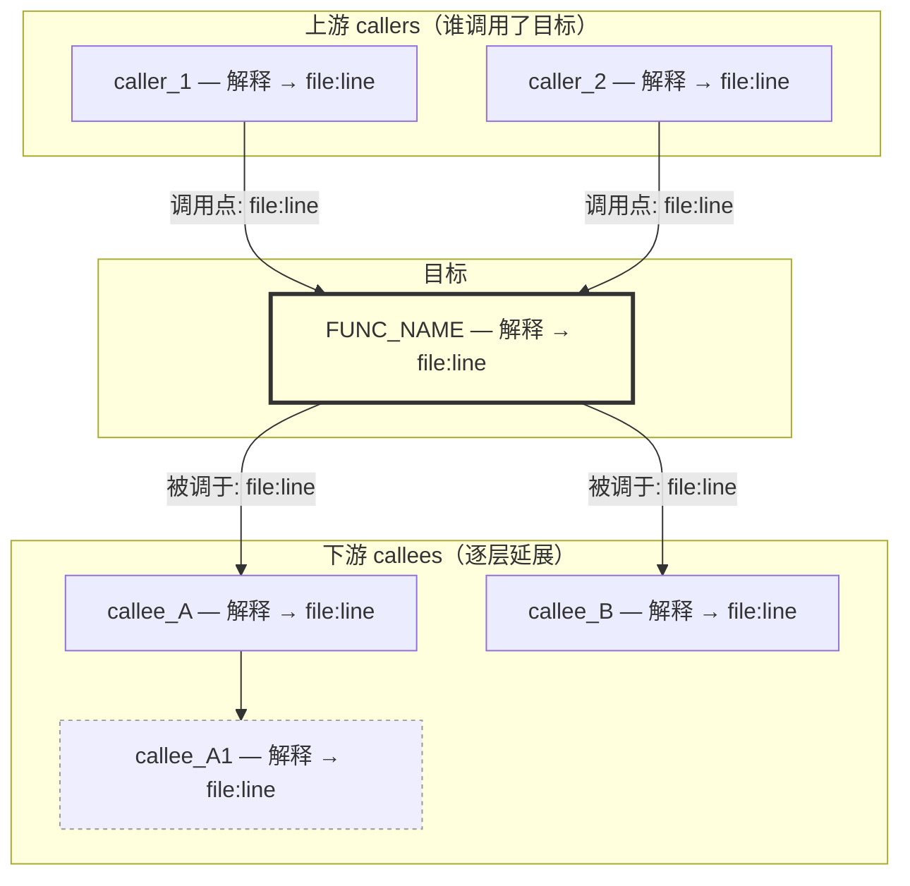
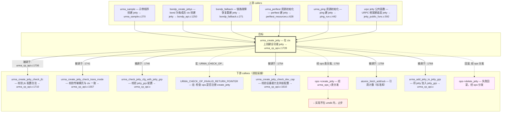
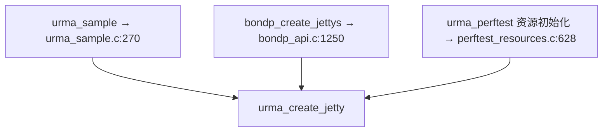
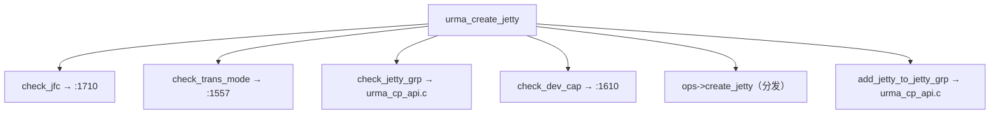

# 调用图输出格式（Mermaid，通用模板 + 真实示例）

本文件规定调用图用 **Mermaid flowchart** 渲染。模板部分与框架无关；示例基于 UMDK 真实数据
（`urma_create_jetty`），仅作格式参考，移植到其他框架时换掉示例数据即可。

## 1. 为什么用 Mermaid

- 可在支持 Mermaid 的终端/Markdown 渲染器里直接成图，结构一目了然。
- 纯文本，可被 skill 后续维护与 diff。
- 支持子图、虚线、样式类，能表达直接/间接/递归/不可达下层等多种边。

## 2. 整体结构

每次回答由**两段**组成：

1. 一句话引述：目标函数是什么、图覆盖深度、覆盖范围提示。
2. 一个 Mermaid `flowchart` 代码块，**上游 callers 与下游 callees 合并在同一张图**：
   - 目标函数节点居中，用粗框高亮。
   - callers 在目标函数**上方**（箭头 caller → 目标）。
   - callees 在目标函数**下方**（箭头 目标 → callee），逐层延展。
   - 用 `subgraph` 把"上游/目标/下游"分区，便于阅读。

## 3. Mermaid 模板



### 节点约定

- **节点 ID**：函数名 sanitized（去掉 `->`、`(`、`)`、空格等 Mermaid 非法字符）。
  如 `ops->create_jetty` → 节点 ID `ops_create_jetty`；`urma_create_jetty` 保持原样。
- **节点显示文本**：`["FUNC_NAME — 一句话解释 → file:line"]`，用方括号节点。
  其中 `file:line` 写成纯文本（Mermaid 节点内不支持 markdown 链接渲染，但在回答的图**下方**附
  一个"节点跳转表"提供可点击链接，见 §5）。
- **一句话解释**：不超一行，标注来源（Doxygen/推断/复用索引）。

### 边约定

- **方向**：`caller --> target`（上游指向目标），`target --> callee`（目标指向下游）。
- **边标签**：调用点行号，写法 `-->|"被调于: file:Lxx"|` 或 `-->|"调用点: file:Lxx"|`。
  Mermaid 边标签里含 `/`、`#` 可能出错，行号标签用纯文本如 `被调于: urma_cp_api.c:1736`。
- **直接调用**：实线 `-->`。
- **间接调用**（ops 表分发）：虚线 `-.->` 并加样式 `:::indirect`，边标签写 `经 ops 表分发`。
- **宏展开**：虚线，边标签 `宏: MACRO_NAME`。
- **递归**：自指边 `A --> A`，边标签 `递归`，不再延展。
- **不可达下层**（syscall/ioctl 等 `umdk/` 内看不到实现的调用）：指向一个红色 `outOfRange` 样式节点，文本 `↓ 下层不在 umdk 内`。
- **叶子**：节点用 `leaf` 样式（浅灰虚框），不再延展。
- 

### 样式类

| class          | 用途                                       | 视觉     |
| -------------- | ------------------------------------------ | -------- |
| `target`     | 目标函数                                   | 黄底粗框 |
| `leaf`       | 叶子函数（无 callee 或仅标准库）           | 浅灰虚框 |
| `outOfRange` | 不可达下层（syscall/ioctl，umdk 内无实现） | 红底     |
| `indirect`   | 间接调用节点（ops 分发的实现）             | 紫底虚框 |

## 4. 真实示例：`urma_create_jetty`

数据采集自仓库实测。callee 默认展开 2 层。

> 目标函数 `urma_create_jetty` 在设备上下文上创建全功能 jetty（含发送+接收），定义于
> [urma_cp_api.c:1728](umdk/src/urma/lib/urma/core/urma_cp_api.c#L1728)，声明+Doxygen 见
> [urma_api.h:472](umdk/src/urma/lib/urma/core/include/urma_api.h#L472)。下图：caller 1 层、callee 2 层；
> `ops->create_jetty` 经 `urma_ops_t` 表分发，部分实现注册点不在 `umdk/` 内，止步于边界节点。



> 说明：`urma_create_jetty` 是用户态 API 的"门面"——先做 4 项配置校验（jfc/trans_mode/jetty_grp/dev_cap），
> 再经 ops 表把真正创建下发给 provider（bond/udma 等），最后加入 jetty_grp；失败时回滚。
> 标 `leaf` 的为叶子函数（仅校验字段或标准库），不再延展。

## 5. 节点跳转表（必备）

Mermaid 节点内无法渲染可点击的 markdown 链接，因此在图**下方**附一个跳转表，把每个节点的函数名
映射到 `file:line` 的 markdown 链接，供用户点开核对：

| 函数                                   | 定义位置                                                                                    | 一句话                       |
| -------------------------------------- | ------------------------------------------------------------------------------------------- | ---------------------------- |
| `urma_create_jetty`                  | [urma_cp_api.c:1728](umdk/src/urma/lib/urma/core/urma_cp_api.c#L1728)                        | 在 ctx 上创建全功能 jetty    |
| `urma_create_jetty_check_jfc`        | [urma_cp_api.c:1710](umdk/src/urma/lib/urma/core/urma_cp_api.c#L1710)                        | 校验 jfc 配置合法            |
| `urma_create_jetty_check_trans_mode` | [urma_cp_api.c:1557](umdk/src/urma/lib/urma/core/urma_cp_api.c#L1557)                        | 校验传输模式与 ctx 一致      |
| `urma_create_jetty_check_dev_cap`    | [urma_cp_api.c:1610](umdk/src/urma/lib/urma/core/urma_cp_api.c#L1610)                        | 校验设备能力支持该配置       |
| `urma_add_jetty_to_jetty_grp`        | urma_cp_api.c                                                                               | 将 jetty 加入 jetty_grp      |
| `urma_sample`                        | [urma_sample.c:270](umdk/src/urma/examples/urma_sample.c#L270)                               | 示例程序创建 jetty           |
| `bondp_create_jettys`                | [bondp_api.c:1250](umdk/src/urma/lib/urma/bond/bondp_api.c#L1250)                            | bond 为每成员 ctx 创建 jetty |
| `urma_perftest` 资源初始化           | [perftest_resources.c:628](umdk/src/urma/tools/urma_perftest/perftest_resources.c#L628)      | perftest 建 jetty            |
| `urpc jetty 公共函数`                | [jetty_public_func.c:592](umdk/src/urpc/framework/core/queue/jetty/jetty_public_func.c#L592) | URPC 框架建底层 jetty        |
| ...                                    | ...                                                                                         | ...                          |

> 表格只列**有明确 file:line 的节点**；ops 分发的实现、标准库、宏等无单一落点的节点不列入。

## 6. 简化变体

### 只要 callers（图）



### 只要一层 callees（不延展）



> 用 `&` 语法让目标同时连多个 callee，图更紧凑。

## 7. 深度控制

- 默认 callee 2 层。
- 更深：`展开 3 层` / `全部展开`（遇递归/叶子/不可达下层自动停）。
- 更浅：`只要一层`。
- callees 很多时按"主路径"过滤（只展开非校验、非日志主逻辑），在引述里标注
  "已省略 N 个校验/日志辅助调用，可用 --full 查看"。

## 8. 错误情况

- **函数不存在**：`未在 umdk/ 下找到函数 X。是否拼写有误？`（不出图）
- **函数是叶子**（无 callee）：仍出图，上游画 callers，下游标 `X 为叶子函数，无 callees`。
- **无 caller**（入口函数）：仍出图，下游画 callees，上游标 `X 为入口函数，无 umdk 内 callers`。
- **callees 全是不可达下层**：下游画到边界节点并标 `↓ 下层不在 umdk 内`，列出边界调用点行号。

## 9. Mermaid 语法避坑

- 节点 ID 不能含 `->`、`(`、`)`、空格、`#`；用下划线替代。
- 边标签 `-->|"文本"|` 里避免 `/` 和 `#`（会破坏解析）；行号写成 `file.c:1736` 不带路径斜杠。
  若必须区分路径，用文件名+行号即可，完整路径放跳转表。
- 节点显示文本含特殊字符时用引号包裹：`["text with (parens)"]`。
- `subgraph` 内 `direction TB` 控制子图排列方向。
- 大图（>40 节点）渲染慢，按深度/主路径裁剪后保持 ≤30 节点为佳。

## 10. 渲染提示（终端环境）

终端里的 Claude Code 不渲染 Mermaid 代码块，只当纯文本打印。在终端环境生成图后，在回答末尾加一句
简短提示，告知用户如何看渲染结果：

> 终端不渲染 Mermaid。把上方 ```mermaid 代码块整体复制到一个 `.md` 文件，用 VSCode
> （装 Mermaid 预览扩展，如 `bierner.markdown-mermaid` 或 `vscode-mermaid-preview`）打开预览即可看到渲染后的图；
> 或贴到支持 Mermaid 的在线渲染器（如 mermaid.live）。

不主动写文件、不主动调外部命令——只提示用户自行拷贝渲染。
