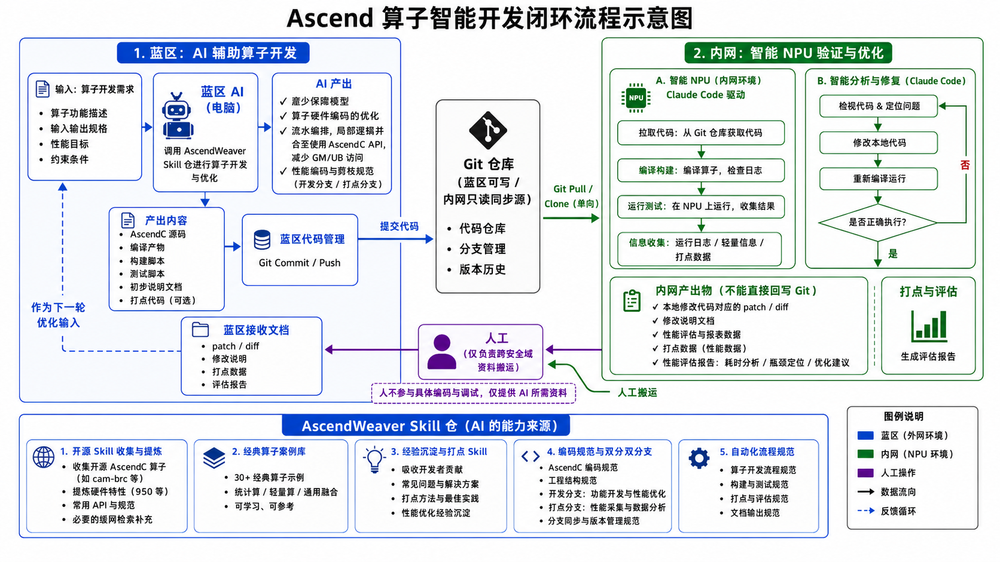

# AscendWeaver

AscendWeaver 是一个面向 **AscendC 算子开发** 的 AI Skill 与工程知识仓，目标是将算子开发过程中分散的硬件知识、AscendC API 使用经验、经典算子实现、性能优化方法和自动化开发流程沉淀为可被 AI Agent 使用的工程能力。

AscendWeaver 希望让 AI 不仅能够“写出 AscendC 代码”，还能够逐步完成：

* 算子需求理解
* 算子设计与代码生成
* 构建与测试脚本生成
* 基于硬件特征的初步性能优化
* NPU 环境编译、运行与问题定位
* Cycle 级打点与性能分析
* 基于实测结果的下一轮优化

最终形成一个 **AI 驱动的 Ascend 算子开发闭环**。

---

## Overview



AscendWeaver 的典型工作流程分为两个环境。

### 蓝区：AI 辅助算子开发

蓝区 AI 根据明确的算子开发需求，调用 AscendWeaver 中的 Skill、Hardware Knowledge、AscendC API Knowledge 和经典算子案例完成初步开发。

蓝区主要负责：

* 理解算子需求
* 设计数据流与并行策略
* 编写 AscendC 源码
* 生成构建脚本
* 生成测试脚本
* 完成能够静态判断的初步优化
* 维护开发分支与打点分支
* Git Commit / Push

初始实现应尽可能保证能够成功编译，并在进入真实 NPU 环境前完成第一轮基于硬件特征的优化。

---

### 内网：智能 NPU 验证与优化

真实 NPU 位于隔离的内网环境。

内网通过 Claude Code 等 Agent 获取 Git 仓库中的代码，并在真实 NPU 上执行：

```text
Git Pull
   ↓
Compile
   ↓
Run
   ↓
Diagnose
   ↓
Fix
   ↓
Recompile
   ↓
Validate
```

在算子正确执行后，可以进一步：

* 插入 Cycle 打点
* 收集性能数据
* 分析不同阶段执行时间
* 定位计算、搬运、通信和同步瓶颈
* 给出下一轮性能优化建议

内网环境不直接向蓝区 Git 仓库写回代码。

内网主要输出：

* patch / diff
* 修改说明
* 错误定位与修复报告
* 运行日志
* 打点数据
* 性能评估报告
* 优化建议

这些资料由人工完成跨安全域搬运，再交给蓝区 AI 进行下一轮开发和优化。

---

## How Agents load AscendWeaver

AscendWeaver 的能力已随 `.agents/` 落在 `umdk/src/cam/` 内，主路径是 `umdk/src/cam`。

```text
主路径：把 umdk/src/cam 作为工作区根打开
        Cursor / Codex 直接发现 .agents/skills/
        Agent 先读 .agents/AGENTS.md，再按任务打开 skills/<name>/SKILL.md

Claude Code：把 src/cam/.agents/skills 复制或软链到 .claude/skills/
```

Contract / 实现改动落在 umdk 对应模块；`.agents/` 内容只被引用，不随单次任务改写。

内网要拿到当前主路由，必须 `git clone` / `git pull` **已经 push 的** umdk 仓，而不是蓝区未提交的工作树。

---

AscendWeaver 不是 AscendC 文档的简单集合。

仓库中的内容应优先回答一个问题：

> **这些信息如何帮助 AI Agent 更可靠、更高效地开发 AscendC 算子？**

因此，AscendWeaver 将内容划分为不同层次。

```text
skills
   ↓
告诉 Agent 如何完成任务

knowledge
   ↓
告诉 Agent 开发过程中需要知道什么

cases
   ↓
告诉 Agent 成熟算子是如何设计的

workflows
   ↓
定义完整的工程流程

templates
   ↓
定义标准工程产物
```

---

## Repository Structure

```text
AscendWeaver/
├── README.md
├── AGENTS.md
├── assets/
│
├── skills/
│   ├── operator-spec-reconstruction/
│   ├── operator-development/
│   ├── operator-iteration/
│   ├── operator-debug/
│   ├── operator-optimization/
│   ├── docs-search/
│   └── instrumentation/
│
├── knowledge/
│   ├── hardware/
│   ├── ascendc-api/
│   ├── engineering-experience/
│   └── coding-guidelines/
│
├── cases/
│   ├── compute/
│   ├── communication/
│   └── compute-communication/
│
├── workflows/
│   ├── README.md                 ← 两类最小 Prompt
│   ├── new-operator/
│   ├── existing-operator-feature/
│   ├── correctness-debug/
│   ├── performance-tuning/
│   └── instrumentation-analysis/
│
├── templates/
```

---

## Skills

`skills/` 描述 AI Agent **如何完成某一类任务**。

当前计划包括：

### Operator Spec Reconstruction

入口：`skills/operator-spec-reconstruction/SKILL.md`。没有可靠设计文档时，从调用链、测试/golden、tiling 与 kernel 交叉重建 Operator Contract + Semantic Dataflow。查 CANN API 仍走 Docs Search。合同清楚后再进 Development。

### Operator Development

入口：`skills/operator-development/SKILL.md`。先分 **NEW OPERATOR** 与 **EXISTING OPERATOR FEATURE**（`workflows/README.md`）。新算子第一轮只要 Design+Gate A；已有 Feature 第一轮只重建 Baseline。之后：PAC freeze → 实现 → Gate B → L1。上板走 Operator Iteration。

```text
performance-aware baseline
  ≠
performance-optimal implementation
```

### Operator Iteration

入口：`skills/operator-iteration/SKILL.md`。上板强制状态机：Freeze → Build → Install → Load → L0…L9。完整 e2e 不是第一定位工具；synchronize / 507xxx 不是 fault 行号；profiler 不是 correctness debugger。层定义与证据门槛读 `knowledge/engineering-experience/npu-on-device-validation.md`。

### Operator Debug

面向算子：

* 编译错误
* Runtime Error
* 数据错误
* Hang
* 多卡通信问题

进行系统化定位。

### Operator Optimization

基于：

* 算子源码
* Hardware Knowledge
* Cycle 数据
* Profiling Report

分析性能瓶颈并进行下一轮优化。

### Instrumentation

入口：`skills/instrumentation/SKILL.md`。TRACE_POINT / MoeTracing / profiling GM / Chrome trace。门禁 G1–G5。解释瓶颈仍走 Operator Optimization。

---

## Knowledge

`knowledge/` 保存 AI 开发算子时需要使用的工程知识。

主要包括：

### Hardware

```text
knowledge/hardware/
```

沉淀不同 Ascend 硬件平台的重要特征，例如：

* Core 架构
* Vector / Cube
* GM
* UB
* L1 / L0
* Pipeline
* Memory Bandwidth
* 对齐约束
* 数据类型支持

当前优先建设：

```text
knowledge/hardware/ascend950/
```

### AscendC API

```text
knowledge/ascendc-api/
```

不直接复制完整官方手册，而是提炼 Agent 编写算子真正需要的信息：

* API 用途
* 参数语义
* Alignment
* Mask / Repeat / Stride
* Pipeline
* 常见错误
* 性能建议
* 简洁示例

### Engineering Experience

```text
knowledge/engineering-experience/
```

主要沉淀真实算子开发中形成的经验，例如：

* GM Access Pattern
* UB Reuse（lifetime ≠ max-footprint closure ≠ leftover-safe handshake）
* Gate B 静态攻击（helper 相乘复杂度 / overlay / visibility / leftover flag）
* Double Buffer
* Pipeline
* Synchronization
* Tail Processing
* Multi-Core Partition
* 性能陷阱

---

## Classic Operator Cases

`cases/` 收集典型 AscendC 算子实现。

计划逐步构建约 30 个经典案例，覆盖：

```text
Compute
Communication
Compute + Communication
```

每个案例不仅保存源码，还应尽量包含 Case Card，描述：

* 算子类型
* 数据流
* 核心设计
* Tile 策略
* Memory 使用
* Pipeline
* 关键 AscendC API
* 性能特点
* 值得复用的设计
* 不适合直接照搬的部分

目标是帮助 Agent **学习设计模式，而不是复制代码**。

---

## Development Branch & Instrumentation Branch

AscendWeaver 推荐算子开发过程中维护两个分支。

### Development Branch

用于：

* 功能开发
* Correctness Fix
* 性能优化
* 正式代码维护

### Instrumentation Branch

从开发分支派生，用于：

* Cycle 打点
* Pipeline 阶段分析
* 通信耗时分析
* 同步等待分析
* 性能瓶颈定位

典型关系：

```text
development
     │
     └──── instrumentation
```

打点代码原则上不进入最终正式开发分支。

---

## Expected Operator Output

有目标工程时，优先改它已有的 host / tiling / kernel ABI / CMake / binding / test，并落盘：

```text
<target-repo>/docs/ascendweaver/<operator>_operator_contract.md
```

不要默认新建孤立的 `operator/src + build.sh`。只有没有接入路径、或用户明确要求 standalone 时才搭脚手架。

一次任务至少应有：

* Operator Contract（含 Target Context）
* Design Proposal（含 project integration）
* Gate A / Gate B 记录
* 接到目标仓的源码与可重复构建、测试入口

---

## Roadmap

当前 AscendWeaver 处于早期建设阶段。

### v0.1

优先完成：

* [x] Operator Spec Reconstruction Skill（无文档时重建合同；不写核）
* [x] Operator Development Skill（主路由；P-gates 在 reference）
* [ ] Ascend 950 Hardware Knowledge
* [ ] 高频 AscendC API Knowledge
* [ ] 5 个经典算子 Case
* [x] Instrumentation Skill（G1–G5 工序；解释走 optimization）
* [ ] Coding Guidelines
* [ ] Build / Test / Report Templates
* [x] 基础 Eval Tasks（v1 L1：`debug_507035` + Gate B / worker-space / resource-path / envelope / golden-delta；L2/L3 未开）

### Next

后续逐步扩展：

* 更多经典算子案例
* 通信算子知识
* 通算融合算子知识
* 更多开发者经验沉淀
* 自动 Case 检索
* 自动 Knowledge Routing
* 自动 NPU Feedback 分析
* 基于真实性能数据的闭环优化

---

## Contributing

AscendWeaver 希望持续吸收真实 AscendC 算子开发中的工程经验。

有价值的贡献包括：

* 经典算子实现
* 硬件知识
* AscendC API 使用经验
* Debug Case
* 性能优化 Case
* Cycle 打点方法
* 常见错误与解决方案
* Agent Workflow
* Evaluation Task

新增内容应优先做到：

> **准确、简洁、有适用条件、能够被 Agent 直接使用。**
