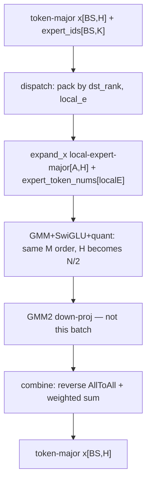

# MoE chain contract: token / expert / rank coordinates

Status: evidence for **Case A + B + C**. Cards:

- A: `cases/compute/moe/ascend950-moe-local-permutation/`
- B: `cases/compute-communication/moe/ascend950-moe-ep-dispatch-combine/`
- C: `cases/compute/grouped-gemm/ascend950-gmm-swiglu-mx-quant/`

This file is the close-read of **edges**, not of kernels. Kernel details live in the per-op notes.

```yaml
source_identity:
  registry_ref: ops-transformer
  scanned_commit: 9311b63bcd065b9779eb08a7d634e9463ee41ef1
  scanned_branch: master
  scan_path: /home/wangyibo/ops-transformer_bak
  ops_this_half:
    - moe/moe_gating_top_k/
    - moe/moe_init_routing_v3/
    - moe/moe_finalize_routing_v2/
  deferred_to_part_2: []
  part_2_ops:
    - mc2/moe_distribute_dispatch_v2/
    - mc2/moe_distribute_combine_v2/
    - gmm/grouped_matmul_swiglu_quant_v2/
    - gmm/grouped_matmul/   # GMM2 down-proj interface only
  upstream_presence:
    verified: false
    upstream_commit: null
```

## Rule for this source

This batch does **not** prove that these operators form a fixed call sequence in any framework.

Every arrow is one of:

| label | meaning |
| --- | --- |
| **direct-data-edge** | B’s input tensor can consume A’s output tensor as-is: name is not enough; dtype, rank, shape rule, and **index layout** match, shown from `OpDef` / infershape / kernel indexing. |
| **conditional-direct** | Direct only under stated attrs (quant off, dropless, matching `row_idx_type` / `drop_pad_mode`, …). |
| **logical-edge** | Same MoE lifetime, but a tensor is missing, transformed, renamed, or produced by a sibling / outside op. Must not be written as a data edge. |

No in-tree UT, ST, or example **calls** GatingTopK → InitRoutingV3 → FinalizeV2. Combinability is from API/kernel contracts, not from a graph.

---

## What this half is trying to close

```
token-major hidden x [T,H]
        +
logits [T,E]  --gating-->  expert_idx [T,K],  gate weights y [T,K]
        |
        v
init-routing permutes hidden x by expert_idx
        |
        v
expert-major expanded_x  (+ expanded_row_idx  +  counts)
        |
        v   (expert FFN / GMM  — not in this half)
        |
        v
finalize weighted-reduces expert rows back to token-major y [T,H]
```

The **permutation loop** is: token order → expert-major → token order. EP rank shuffle and Cube/MX expert compute are **out of this half**.

---

## Edge table

### E0. Gate linear → `MoeGatingTopK.x`

- Missing from these three ops.
- **logical-edge**.

### E1. `MoeGatingTopK.expert_idx` → `MoeInitRoutingV3.expert_idx`

| check | result |
| --- | --- |
| dtype | both INT32 |
| shape | both `[T, K]` (gating infershape; init consumes 2-D expert ids) |
| kernel | init sorts this buffer; it does not need a different packing |

**Verdict: API-compatible direct-data-edge.**

Caveat (`design-doc`): `moe_init_routing_v3/README.md` and `docs/zh/ascend950_op_list.md` name **`aclnnMoeGatingTopKSoftmaxV2`** as the producer. SoftmaxV2 also emits INT32 `[T,K]` `expert_idx`. GatingTopK is a **sibling**, not the documented canonical caller. Do not write “the graph always uses GatingTopK”. The **tensor** still matches.

### E2. `MoeGatingTopK.y` → `MoeInitRoutingV3`

Init has no gate-weight input. Init `scale` / `offset` are **quant** parameters.

**Verdict: no edge.** Weights skip init-routing.

### E3. `MoeGatingTopK.x` (logits `[T,E]`) → `MoeInitRoutingV3.x` (hidden `[T,H]`)

Wrong tensor. Logits vs activations; `E` vs `H`.

**Verdict: not an edge.** Hidden `x` is a **logical-edge** from the attention/FFN residual (outside).

### E4. `MoeGatingTopK.y` → `MoeFinalizeRoutingV2.scales`

| check | result |
| --- | --- |
| shape | gating `y` is `[T,K]`; finalize `scales` is 2-D and infershape ties dim1 to `expert_idx` / attr `k` |
| dtype | overlapping fp16/bf16/fp32; finalize also allows mixed (`scales` fp32 with bf16 `expanded_x` on one 910 dtype combo) |
| semantics | both are per-(token,k) gate weights after TopK |

**Verdict: API-compatible direct-data-edge**, optional on finalize. No joint test. If the graph uses SoftmaxV2, the producer of `scales` is that sibling’s `y`, not GatingTopK.

### E5. `MoeGatingTopK.expert_idx` → `MoeFinalizeRoutingV2.expert_idx`

Optional on finalize. Same INT32 `[T,K]`. Needed when bias / 950 expert-range extras are used; the README formula indexes `bias[expertid]`.

**Verdict: API-compatible direct-data-edge when that optional input is present.** The **same** buffer can also have gone through init-routing as its required `expert_idx` (init does not rewrite it).

### E6. `MoeInitRoutingV3.expanded_x` → `MoeFinalizeRoutingV2.expanded_x`

This is the edge that looks obvious and is usually **wrong**.

| if | then |
| --- | --- |
| `quant_mode != -1` | init emits INT8 / FP8 / INT4 / HiF8 / FP4. Finalize infershape accepts **only** fp16/fp32/bf16. **not an edge** |
| expert FFN / GMM runs | finalize README: `expanded_x` is **FFN output**. Init’s `expanded_x` is **expert input**. Same name, different lifetime. **logical-edge** |
| dropless, `quant_mode=-1`, fp hidden, and **no** expert compute | dtype/rank can match (`[T*K,H]` 2-D ↔ finalize modes 0/2). Drop-pad 3-D ↔ finalize modes 1/3. Still **no in-tree call**. **conditional-direct** only as a degenerate permute→unpermute |

**Verdict: logical-edge in any production MoE FFN. Do not write direct-data-edge for the Scout chain gating→init→EP→GMM→EP→finalize.**

### E7. `MoeInitRoutingV3.expanded_row_idx` → `MoeFinalizeRoutingV2.expanded_row_idx`

Same name, INT32, 1-D. Infershape: finalize dropless (modes 0/2) requires `len(row_idx) == expanded_x.dim0`.

That is **rank/dtype compatibility**, not layout identity.

Init stores one of two maps (`row_idx_type`):

- `0 GATHER`: `expanded_row_idx[original_flat] = expanded_slot` (`RowIdxGather` SIMT).
- `1 SCATTER`: `expanded_row_idx[expanded_slot] = original_flat` (sort kernels).

Finalize **reads** `expanded_row_idx[offset]` and uses the value as an index into `expanded_x`. Offset itself has two live strides (`h_full_load.h` `SetExpandedRowIdxOffset`):

- modes 0/1 **COLUMN**: `offset = token + k * T`
- modes 2/3 **ROW**: `offset = token * K + k`

A direct-data-edge exists only if:

1. init `row_idx_type` is the map finalize expects (original-indexed **slot** values, i.e. gather-type write), **and**
2. init’s original flattening of `(token, k)` uses the same stride as finalize’s `drop_pad_mode`.

No joint test pins that pairing. Init example uses `rowIdxType=1`. Finalize example uses `dropPadMode=0`. Those two programs are **not** a proof they compose.

**Verdict: conditional-direct, currently unproven as a specific attr pair. Until a joint test or a framework graph is shown, do not stamp this as an unconditional direct-data-edge.**

### E8. `MoeInitRoutingV3.expert_tokens_count_or_cumsum` → finalize

Finalize has no such input.

**Verdict: no edge** to finalize.

It is a **candidate** for GMM group metadata. Type 0 prefix-sum is similar to CATLASS 60 `groupList`; type 1 is per-expert counts; **shape is the same**, so downstream must not guess. The production producer→consumer (init vs post-EP dispatch counts vs GMM `groupList`) is **unresolved until Part 2**. Do not write `init.counts → GMM.groupList`.

### E9. `MoeInitRoutingV3.expanded_scale` → finalize `scales`

Different objects (quant scales vs gate weights). Dtypes often e8m0 / fp32 per-block vs `[T,K]` weights.

**Verdict: not an edge.**

---

## What is actually closed after this half

Closed:

- Where `expert_idx` and gate weights come from (gating family: this op **or** SoftmaxV2).
- Init-routing is the op that **builds** expert-major `expanded_x` and the row map / expert histogram.
- Finalize is the op that **consumes** a float expert-major payload plus a row map and writes token-major `y`.
- Counts/prefix-sum leave this permutation loop here. They are **GMM group-metadata candidates**, not a proven GMM input.

Not closed:

- Unconditional tensor-to-tensor `expanded_x` from init to finalize (**logical-edge** once expert compute exists).
- Unconditional `expanded_row_idx` layout pairing (**conditional-direct**, unproven pair).
- Which gating sibling a real graph uses.
- EP dispatch/combine (whether `expanded_x` even stays on this rank).
- GMM SwiGLU MX (what overwrites `expanded_x`).

---

## Edges deferred to part 2

Filled below. Do not treat the `?→` list as still unknown.

---

# Part 2: EP + GMM

Same edge labels as Part 1. Extra rule that Part 2 made unavoidable:

**tensor name ≠ tensor lifetime.** `expanded_x` / `expand_x` is used for expert *input* (dispatch out, GMM in) and expert *output* (GMM/FFN out, combine in). Gate `scales` ≠ quant `x_scale` ≠ GMM `y_scale`.



Two **alternative** loops, not one sequence:

- **Single-device:** init-routing permute → (GMM) → finalize unpermute+weight. Map = `expanded_row_idx`.
- **EP:** dispatch permute+shuffle → (GMM) → combine reverse+weight. Reverse slot map = `assist_info` triples. `expert_ids` stays for expert identity. Init row map is unused.

---

### E10. `init.expanded_x` → `dispatch.x`

Dispatch `x` is `[BS, H]` token-major. Init `expanded_x` is `[BS*K, H]` (or drop-pad 3-D) expert-major. Kernel indexes `x[token * H]`.

**Verdict: not an edge.** Dispatch re-permutes from token-major hidden + `expert_ids`. Init-routing is a **sibling permute**, not dispatch’s input.

### E11. `gating.expert_idx` → `dispatch.expert_ids`

INT32 `[BS,K]`. **direct-data-edge.** Same tensor also goes to combine.

### E12. `init.counts` → dispatch

Dispatch has no counts input. Routing is `expert_id / localE`.

**Verdict: no edge.**

### E13. `init.expanded_row_idx` → dispatch / combine

Neither EP op takes it.

**Verdict: no edge on the EP path.** Part 1 E7 remains a **non-EP** conditional-direct only.

### E14. `dispatch.expand_x` → GMM `x`

Same local-expert-major row order. Dtype must follow `quant_mode` (fp vs INT8/FP8/MX). Shape `[A,H]` vs GMM `[M,K]` with `M=A`, `K=H`.

**Verdict: conditional-direct.**

### E15. `dispatch.dynamic_scales` → GMM `x_scale`

**conditional-direct** (1-D pertoken vs 2-D MX). Not gate weights.

### E16. `dispatch.expert_token_nums` → GMM `group_list`

INT64, length = **local** experts. Type 0 prefix-sum / 1 count on **both** ops.

**Verdict: conditional-direct** when all of:

- `E == localExpertNum` (moe ranks; shared-expert ranks have `localExpertNum=1` — do not assume global E)
- `group_list_type == expert_token_nums_type`
- no silent Host rewrite (none in these ops)

Must set attrs equal. Defaults **disagree** (dispatch 1, GMM 0). No joint test. This is the production answer to “who feeds GMM groupList after EP”.

`init.counts → GMM.groupList` on the EP chain: **not a direct-data-edge**.

### E17. GMM `y` → `combine.expand_x`

GMM SwiGLU Quant V2 emits post-SwiGLU **quant** `[M, N/2]`. Combine wants post-**down-proj** float `[A, H]` (README). Same name class, **different FFN stage**.

**Verdict: logical-edge.** Need GMM2 (`gmm/grouped_matmul/`, `grouped_matmul_downproj_contract.md`) on the **split** path. mega_moe **internalizes** this (`mega_moe.md`); do not stamp direct-data-edge on the split graph.

### E18. `dispatch.assist_info` → `combine.assist_info`

**direct-data-edge.** Shape `[A*128]`. This is the EP reverse map.

### E19. `dispatch.ep_recv_count` → `combine.ep_send_counts`

**direct-data-edge** (rename).

### E20. `combine.x` → `finalize.expanded_x`

Combine `x` is `[BS,H]` token-major. Finalize `expanded_x` is expert-major float.

**Verdict: not an edge.** Combine **replaces** finalize on the EP path. Finalize **replaces** combine on the single-device path.

### E21. `gating.y` → `combine.expert_scales`

Shape/semantics: both `[BS,K]` (or `[T,K]`) gate weights.

Dtype: gating `y` follows logits (`fp16` / `bf16` / `fp32`). Combine `expert_scales` OpDef is **fp32**. Dispatch already marked the sibling `gating.y → dispatch.expert_scales` as **conditional-direct**.

**Verdict: conditional-direct.** Direct only when gating `y` is fp32; otherwise the caller converts or another producer supplies fp32. Do not write unconditional direct-data-edge.

Finalize `scales` is the non-EP sibling (that path accepts overlapping float dtypes — see Part 1 E4).

### E22. GMM1 `y`/`y_scale` → `grouped_matmul` (down-proj) → `combine.expand_x`

See `grouped_matmul_downproj_contract.md`. Short form:

- Producer of down-proj is **plain `GroupedMatmul`**, M-group (`groupType=0`).
- **Same** `group_list` / type as GMM1; M order unchanged.
- GMM2 `y` is `[M, H]` fp16/bf16 when `dtype` is 0/1 and `N==H`.
- That `y` → combine `expand_x` is **conditional-direct** (`M==A`, float16/bf16).
- GMM1 `y` still does **not** skip GMM2.

---

## What is closed after Part 2

Closed:

- Dispatch input order is **token-major**, not init expanded order.
- Rank mapping: `expert_id / localE` (+ shared-expert offset).
- Recv `expand_x` is **local-expert-major**; GMM does not reshuffle M.
- GMM `groupList` candidate after EP is **dispatch `expert_token_nums`**, local experts, count/cumsum via attr.
- Combine recovers origin slots from `assist_info` triples, writes token-major `x`, applies gate weights (`expert_scales` fp32).
- `init.expanded_row_idx` does **not** survive EP.
- GMM1 `y` is not Combine `expand_x`; GMM2 down-proj (`grouped_matmul`) is the interface that can be.

Still open:

- SoftmaxV2 vs GatingTopK (`gating_topk_vs_softmax_v2_contract.md` — not blocking).
- Joint tests (none in-tree).
- `upstream_presence` vs `cann/ops-transformer`.
- URMA `MegaMoeLayered` if Host ever selects that tiling key.

Closed by [mega_moe.md](mega_moe.md) (compression, not a new chain): API-visible tensors for E16–E19/E22 internalized or replaced; E21 bf16 weights converted inside MegaMoe; two world `CrossRankSync` remain.

---

## Case implication

Cards written (`status: curated`, awaiting Review):

- **A** `cases/compute/moe/ascend950-moe-local-permutation/` — 单卡 permute；Gating 只作 upstream。
- **B** `cases/compute-communication/moe/ascend950-moe-ep-dispatch-combine/` — EP 成对；Init 是 sibling。
- **C** `cases/compute/grouped-gemm/ascend950-gmm-swiglu-mx-quant/` — 60+53 生产融合；GMM2 只是接口脚注。
- **MegaMoe** `cases/compute-communication/moe/ascend950-mega-moe-fused-ep-ffn/` — B+C+GMM2 压缩；`status: accepted`。

Gating 不单独成卡。split Knowledge 五条不并进融合边界。融合层：[moe-fusion-materialization-and-sync.md](../../../knowledge/engineering-experience/moe-fusion-materialization-and-sync.md)。

工程索引：[moe-token-expert-rank-data-contracts.md](../../../knowledge/engineering-experience/moe-token-expert-rank-data-contracts.md)。
